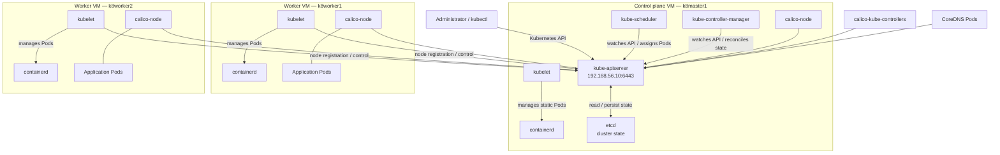
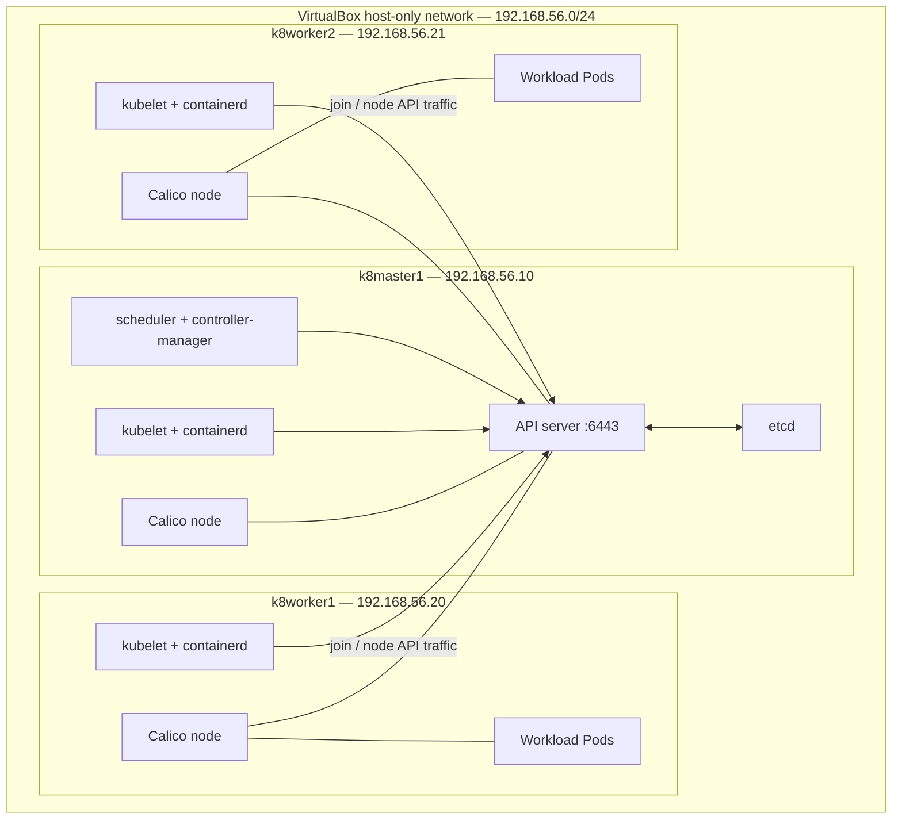
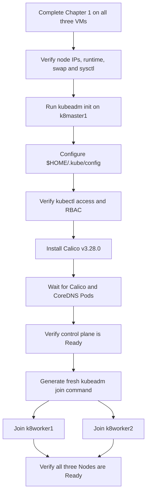

# Chapter 2 — Kubernetes Cluster Bootstrap with kubeadm

This chapter initializes the Kubernetes control plane on the three-node VirtualBox/Vagrant lab, installs the Calico CNI, joins both worker nodes, and verifies the completed cluster.

The procedure below follows the final successful bootstrap recorded in the lab notes:

- Kubernetes version: **v1.30.14**
- Control-plane endpoint: **192.168.56.10:6443**
- Control-plane Kubernetes node name: **k8master1**
- Pod network CIDR: **192.168.0.0/16**
- CNI: **Calico v3.28.0**
- Worker nodes: **k8worker1** and **k8worker2**

> **Scope:** This is a single-control-plane learning cluster. It is not a highly available production control plane. Commands and diagrams describe the recorded three-node lab; they do not add unverified control-plane replicas or network components.

---

## 2.1 Cluster topology and addressing

The three VMs created in Chapter 1 use the VirtualBox host-only network for stable node-to-node communication.

| Kubernetes node name in final cluster | Role | Host-only IP | Kubernetes version |
|---|---|---:|---:|
| `k8master1` | control-plane | `192.168.56.10` | `v1.30.14` |
| `k8worker1` | worker | `192.168.56.20` | `v1.30.14` |
| `k8worker2` | worker | `192.168.56.21` | `v1.30.14` |

The control-plane API endpoint used by the workers is:

```text
192.168.56.10:6443
```

### Node-name consistency note

The final Vagrantfile documented in Chapter 1 defines VM keys `master1`, `worker1`, and `worker2`, while the final Kubernetes cluster evidence records Node names `k8master1`, `k8worker1`, and `k8worker2`. The successful control-plane command explicitly sets `--node-name=k8master1`. The recovered notes later show the worker VMs being accessed as `k8worker1` and `k8worker2`, but do not include the exact hostname-change command.

Before joining the workers, verify their static hostnames:

```bash
hostnamectl --static
```

For a reproduction that must match the recorded Kubernetes Node names, ensure the worker identities are `k8worker1` and `k8worker2` before running `kubeadm join`. Do not assume that the Vagrant VM display name and Kubernetes Node name are necessarily identical.

---

## 2.2 Kubernetes bootstrap architecture

The control plane is hosted on `k8master1`. kubeadm creates the control-plane components as static Pods on that node. The local etcd instance stores cluster state. The kubelet on each machine manages its node's Pods through containerd.

Calico supplies the cluster pod networking. Its node component runs on the Kubernetes nodes, and the Calico controllers manage Calico resources. CoreDNS provides cluster DNS after the cluster networking layer is available.



**Diagram interpretation**

- `kube-apiserver` is the API endpoint used by `kubectl` and the node agents.
- `etcd` is the local control-plane datastore.
- `kube-scheduler` and `kube-controller-manager` communicate with the API server to perform their control-plane functions.
- kubeadm configures the control-plane components as static Pods, managed by the control-plane node's kubelet.
- containerd is the container runtime on each VM.
- Calico provides the CNI/networking layer. The diagram intentionally does not prescribe an unverified Calico encapsulation mode or draw an unsupported physical packet path.
- CoreDNS and Calico controllers are cluster workloads, not additional VMs.

---

## 2.3 Pre-bootstrap checks

Complete Chapter 1 on all three VMs before proceeding. Confirm that:

- All three VMs are running.
- The host-only IP addresses match the topology table.
- The NAT and host-only interfaces are present.
- Swap is disabled.
- `overlay` and `br_netfilter` are loaded.
- The Kubernetes sysctl values are configured.
- containerd is running and uses the systemd cgroup driver.
- kubelet, kubeadm, and kubectl are installed at the intended Kubernetes release.

### Verify Kubernetes versions

Run on each node:

```bash
kubeadm version
kubelet --version
kubectl version --client
```

The successful lab bootstrap used Kubernetes **v1.30.14**. The recorded package repository was the Kubernetes `v1.30` APT repository, and kubeadm selected `v1.30.14`.

### Verify containerd

Run on each node:

```bash
sudo systemctl is-active containerd
sudo grep -n 'SystemdCgroup' /etc/containerd/config.toml
```

The intended cgroup setting is:

```toml
SystemdCgroup = true
```

### Verify connectivity to the API endpoint

Before workers join, the control-plane API server will be created during initialization. After it is available, worker nodes must be able to reach TCP port `6443` on the control-plane host-only IP.

From each worker, the lab used this connectivity check:

```bash
nc -zv 192.168.56.10 6443
```

The API endpoint must be reachable over the host-only network, not through the VirtualBox NAT address.

---

## 2.4 Initialize the control plane

Run the following command on `k8master1`:

```bash
sudo kubeadm init \
  --apiserver-advertise-address=192.168.56.10 \
  --node-name=k8master1 \
  --pod-network-cidr=192.168.0.0/16
```

### Why these flags matter

| Flag | Value | Purpose |
|---|---|---|
| `--apiserver-advertise-address` | `192.168.56.10` | Advertises the API server on the stable host-only interface. |
| `--node-name` | `k8master1` | Sets the Kubernetes Node name for the control-plane machine. |
| `--pod-network-cidr` | `192.168.0.0/16` | Sets the pod address range expected by the selected Calico configuration. |

**Important network detail:** each Vagrant VM has two network interfaces. The NAT interface commonly receives a `10.0.2.x` address, while the host-only interface uses `192.168.56.x`. The explicit advertise address prevents kubeadm from selecting the NAT interface as the control-plane address.

Wait for kubeadm to finish and report successful control-plane initialization. The recorded successful initialization selected Kubernetes `v1.30.14`.

### Control-plane components created by kubeadm

The successful initialization recorded these control-plane components:

- kube-apiserver
- kube-controller-manager
- kube-scheduler
- etcd

kubeadm writes their static Pod manifests under:

```text
/etc/kubernetes/manifests
```

It also writes the administrator kubeconfig at:

```text
/etc/kubernetes/admin.conf
```

---

## 2.5 Configure kubectl on the control plane

Run these commands as the regular Vagrant user on `k8master1`:

```bash
mkdir -p "$HOME/.kube"

sudo cp /etc/kubernetes/admin.conf \
  "$HOME/.kube/config"

sudo chown "$(id -u):$(id -g)" \
  "$HOME/.kube/config"
```

This places the administrator kubeconfig in the current user's home directory so `kubectl` can authenticate to the cluster without requiring `sudo` for every command.

Verify API access:

```bash
kubectl get nodes
```

Before installing the CNI, the control-plane node is expected to show `NotReady`. This is the recorded initial state and is normal before a pod network is installed.

Verify the administrator's authorization:

```bash
kubectl auth can-i '*' '*' --all-namespaces
```

The successful checkpoint returned:

```text
yes
```

Proceed to Calico only after the API access and authorization checks succeed.

> Protect `/etc/kubernetes/admin.conf` and `$HOME/.kube/config`. These files grant powerful cluster access. Do not commit either file to Git.

---

## 2.6 Install Calico CNI

The lab used **Calico v3.28.0** with the upstream manifest.

Run on `k8master1`:

```bash
kubectl apply -f \
  https://raw.githubusercontent.com/projectcalico/calico/v3.28.0/manifests/calico.yaml
```

This applies the Calico resources to the cluster. The selected Calico release and the kubeadm pod CIDR are the versions and values recorded in the lab notes.

Watch the cluster Pods:

```bash
kubectl get pods -A -w
```

Wait for the Calico node Pods, Calico controllers, and CoreDNS Pods to become ready. The recorded successful checkpoint included:

- `calico-node` Pods running on the nodes
- `calico-kube-controllers` running
- CoreDNS Pods running

Check the nodes:

```bash
kubectl get nodes
```

The control-plane node should transition to `Ready` once the node networking prerequisites are satisfied.

### Calico role in this cluster

Calico is the Container Network Interface (CNI) selected for this cluster. It supplies the pod networking integration required for Kubernetes workloads to communicate across nodes. The pod CIDR configured at kubeadm initialization is `192.168.0.0/16`.

The exact Calico manifest URL is version-pinned to v3.28.0 in this lab documentation. Review the Calico and Kubernetes compatibility guidance before changing either version.

---

## 2.7 Generate a worker join command

Do not reuse a token copied from an old terminal transcript. Generate a fresh join command from the initialized control plane.

On `k8master1`:

```bash
kubeadm token create --print-join-command
```

The command prints a complete `kubeadm join` command containing:

- The API server address and port (`192.168.56.10:6443`)
- A bootstrap token
- The discovery-token CA certificate hash

The output is a credential-bearing command. Treat it as sensitive: do not commit it to Git, paste it into public tickets, or include the generated token/hash in documentation.

Before using it, confirm that the endpoint begins with:

```text
kubeadm join 192.168.56.10:6443
```

If it advertises the NAT address (`10.0.2.x`), do not use that command for this topology.

---

## 2.8 Join worker1 and worker2

Run the generated join command with `sudo` on each worker. Generate it once on the control plane and use the same valid output for both workers.

### On `k8worker1`

```bash
sudo kubeadm join 192.168.56.10:6443 \
  --token <TOKEN_FROM_GENERATED_JOIN_COMMAND> \
  --discovery-token-ca-cert-hash sha256:<CA_CERT_HASH_FROM_GENERATED_JOIN_COMMAND>
```

### On `k8worker2`

```bash
sudo kubeadm join 192.168.56.10:6443 \
  --token <TOKEN_FROM_GENERATED_JOIN_COMMAND> \
  --discovery-token-ca-cert-hash sha256:<CA_CERT_HASH_FROM_GENERATED_JOIN_COMMAND>
```

Replace the two angle-bracket values with the values from the fresh command printed by `kubeadm token create --print-join-command`. They are placeholders in this explanatory template, not literal command arguments.

A successful join registers the node with the API server and completes the kubelet TLS bootstrap process. The node then appears in the control-plane's Node list.

---

## 2.9 Pin kubelet node IPs to the host-only network

The lab notes record that node IPs initially appeared as VirtualBox NAT addresses and were later corrected to the host-only addresses. The recorded correction uses `/etc/default/kubelet` and the `--node-ip` kubelet argument.

Set the kubelet `--node-ip` argument on each VM through `/etc/default/kubelet`, using this node-specific mapping:

| Node | kubelet `--node-ip` value |
|---|---:|
| `k8master1` | `192.168.56.10` |
| `k8worker1` | `192.168.56.20` |
| `k8worker2` | `192.168.56.21` |

In `/etc/default/kubelet`, the setting uses the `KUBELET_EXTRA_ARGS` variable with the corresponding `--node-ip` value. Configure the matching value on each VM; do not copy the control-plane address into a worker's kubelet configuration.

After changing the setting on each node, reload systemd and restart kubelet:

```bash
sudo systemctl daemon-reload
sudo systemctl restart kubelet
```

Verify from the control plane:

```bash
kubectl get nodes -o wide
```

The `INTERNAL-IP` column should show `192.168.56.10`, `192.168.56.20`, and `192.168.56.21` for the corresponding nodes. This explicit node-IP setting prevents kubelet from advertising the NAT interface address in this dual-NIC lab.

> Apply the correct address on each machine. Do not copy the control-plane address into a worker's kubelet configuration.

---

## 2.10 Verify the completed cluster

Run all final checks from `k8master1`.

### Node status and addresses

```bash
kubectl get nodes -o wide
```

The final recorded cluster state was:

| Node | Status | Role | Host-only IP |
|---|---|---|---:|
| `k8master1` | `Ready` | `control-plane` | `192.168.56.10` |
| `k8worker1` | `Ready` | worker (`<none>` role label) | `192.168.56.20` |
| `k8worker2` | `Ready` | worker (`<none>` role label) | `192.168.56.21` |

Kubernetes commonly displays `<none>` in the `ROLES` column for worker nodes unless a role label has been added. This does not mean that the nodes failed to join.

### System Pods

```bash
kubectl get pods -A
```

Confirm that the system workloads, including CoreDNS and Calico components, are running and ready.

### Cluster information

```bash
kubectl cluster-info
```

This confirms the API server endpoint exposed by the current kubeconfig context.

### Final cluster architecture



This diagram represents the verified three-node topology and the component roles recorded during bootstrap. It is a logical component diagram, not a packet-capture or firewall-flow diagram.

---

## 2.11 Bootstrap sequence at a glance



---

## 2.12 Operational and security notes

- Keep the control-plane advertise address pinned to `192.168.56.10` for this dual-interface Vagrant topology.
- Keep the pod CIDR consistent with the Calico configuration used by the cluster.
- Generate join commands when needed; never hard-code a bootstrap token or CA hash into this repository.
- Protect kubeconfig files and Kubernetes PKI material. They are credentials, not ordinary configuration examples.
- Do not expose the Kubernetes API server beyond the intended lab network.
- This cluster has one control-plane node and a local etcd member; loss of that VM affects control-plane availability.
- The Kubernetes v1.30.14 and Calico v3.28.0 values document the recorded lab state. Check supported versions before upgrading or rebuilding.

## 2.13 Chapter completion checklist

- [ ] All three VMs are running with the expected host-only IP addresses.
- [ ] Kubernetes packages report the intended v1.30.14 release.
- [ ] containerd is active and uses `SystemdCgroup = true`.
- [ ] kubeadm initialized the control plane using `192.168.56.10`.
- [ ] The control-plane Node name is `k8master1`.
- [ ] kubectl uses `$HOME/.kube/config`.
- [ ] `kubectl auth can-i '*' '*' --all-namespaces` returns `yes`.
- [ ] Calico v3.28.0 resources have been applied.
- [ ] Calico and CoreDNS Pods are ready.
- [ ] A fresh worker join command points to `192.168.56.10:6443`.
- [ ] `k8worker1` has joined successfully.
- [ ] `k8worker2` has joined successfully.
- [ ] `kubectl get nodes -o wide` shows all three nodes as `Ready`.

**Outcome:** the three-node Kubernetes v1.30.14 learning cluster is bootstrapped with Calico v3.28.0 and all three nodes registered. Continue with Chapter 3 for focused Kubernetes networking and Calico exploration.