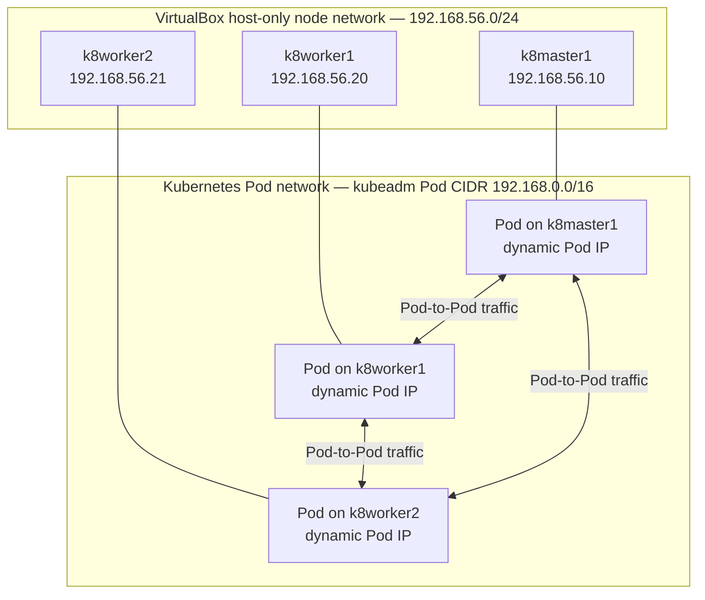
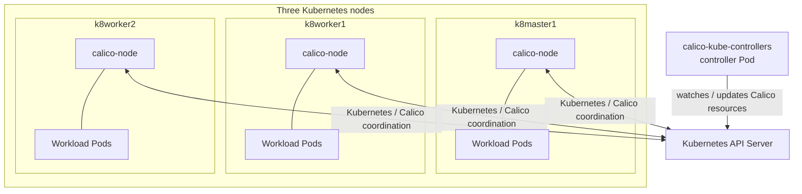
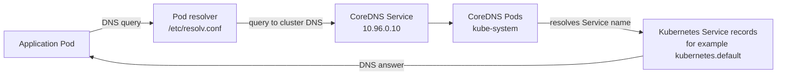

# Chapter 3 — Cluster Networking with Calico

This chapter documents the networking layer of the three-node Kubernetes lab: the separation between the VirtualBox node network and Kubernetes Pod network, Calico's role as the CNI, CoreDNS service discovery, and practical checks for node, Pod, and DNS connectivity.

It is written against the lab configuration and observations recorded in the `K8s Cluster in Vagrant` notes. Where a command is an additional repeatable validation exercise rather than a command explicitly recorded as completed, it is identified as a **recommended lab test**.

---

## 3.1 Lab environment and verified baseline

| Item | Recorded configuration / observation |
|---|---|
| Kubernetes | `v1.30.14` |
| Container runtime | `containerd` |
| CNI | Calico `v3.28.0` |
| Control plane | `k8master1` — `192.168.56.10` |
| Worker 1 | `k8worker1` — `192.168.56.20` |
| Worker 2 | `k8worker2` — `192.168.56.21` |
| Node network | VirtualBox host-only network, `192.168.56.0/24` |
| Pod network configured at kubeadm init | `192.168.0.0/16` |
| Kubernetes Service DNS address observed | `10.96.0.10` |
| Kubernetes default Service ClusterIP observed | `10.96.0.1` |

The node addresses and Pod addresses belong to different logical networks:

- **Node network:** `192.168.56.0/24` — addresses assigned to the three VMs.
- **Pod network:** configured as `192.168.0.0/16` — addresses assigned to Kubernetes Pods by the CNI.
- **Service network:** Kubernetes virtual Service IPs; the notes show the default `kubernetes` Service at `10.96.0.1` and CoreDNS at `10.96.0.10`.

Do not confuse the Pod CIDR with the Service CIDR. They serve different purposes.

### Important note about observed Pod IPs

The lab notes contain Pod IP observations from different points in the work:

- `192.168.145.x` in an earlier networking exercise.
- `192.168.81.4` for an NGINX Pod in a later exercise.

These are **observed Pod addresses, not fixed addresses to configure manually**. Pod addresses can change when Pods are recreated, rescheduled, or when the cluster's allocation state changes. Always obtain the current value from `kubectl get pods -o wide`.

The recorded kubeadm Pod CIDR is `192.168.0.0/16`. The exact Calico IPPool block size, encapsulation mode, and route programming details were not captured in the source notes; this chapter does not assume or invent those values.

---

## 3.2 Kubernetes networking model

Kubernetes expects a Pod network in which Pods can communicate with other Pods across the cluster without requiring application-level NAT between Pod IPs. Nodes also need connectivity to the Pods they host or manage, and Pod IPs must be unique within the cluster.

The lab notes summarize the essential expectations as:

1. Pod-to-Pod communication across the cluster.
2. Node-to-Pod communication.
3. Unique Pod IP addresses across the cluster.

### Logical network layout



This is a logical view of the two address spaces and the required communication relationships. It is not a claim that every Pod packet follows one particular physical route or encapsulation method.

### Why the two address spaces are different

A node is a VM. It receives its host-only address from the VirtualBox host-only network. A Pod is a workload network endpoint created by Kubernetes and configured through the CNI.

For example:

| Endpoint | Example address | Address space |
|---|---:|---|
| `k8master1` | `192.168.56.10` | Node network |
| `k8worker1` | `192.168.56.20` | Node network |
| Pod | `192.168.145.x` (observed in an earlier exercise) | Pod network |
| Kubernetes Service | `10.96.0.1` | Service network |
| CoreDNS Service | `10.96.0.10` | Service network |

Do not manually assign a Pod an address from the node network. Kubernetes and the CNI manage Pod addressing.

---

## 3.3 What the CNI does

CNI stands for **Container Network Interface**. It defines the interface between a container runtime and network plugins responsible for configuring container networking.

In this cluster, Calico is the selected CNI implementation. Its documented roles in the lab are:

- Pod networking.
- CNI implementation for Kubernetes workloads.
- Network Policy support.

At a high level, the CNI setup is responsible for providing Pod network connectivity as Pods are created. Calico components run in the cluster and coordinate the networking implementation on the nodes.

### Calico components observed in the cluster

| Component | Purpose in the lab | Where to inspect |
|---|---|---|
| `calico-node` | Node-level Calico networking component | `kube-system` namespace; one Pod per node in the observed three-node state |
| `calico-kube-controllers` | Calico controller workload | `kube-system` namespace |

The recorded healthy cluster showed three `calico-node` Pods, one on each Kubernetes node, and one `calico-kube-controllers` Pod.

### Runtime CNI configuration observed with crictl

A captured `sudo crictl info` from `k8master1` reported both `RuntimeReady: true` and `NetworkReady: true`. It also reported `lastCNILoadStatus: OK`.

The same output identified the active Pod network configuration as `k8s-pod-network`, with this plugin chain:

| Plugin | Recorded setting | What the captured configuration tells us |
|---|---|---|
| `calico` | `ipam.type: calico-ipam` | Calico IPAM allocates Pod addresses. |
| `calico` | `datastore_type: kubernetes` | Calico uses the Kubernetes datastore integration. |
| `calico` | `policy.type: k8s` | Kubernetes policy integration is configured. |
| `portmap` | `snat: true`, `portMappings: true` | Port-mapping plugin is enabled with SNAT in its plugin configuration. |
| `bandwidth` | `bandwidth: true` | Bandwidth plugin capability is enabled. |

The captured containerd CNI paths were:

```text
CNI binaries:       /opt/cni/bin
CNI configuration:  /etc/cni/net.d
Calico kubeconfig:   /etc/cni/net.d/calico-kubeconfig
Calico CNI log:      /var/log/calico/cni/cni.log
```

This is a **captured runtime configuration from `k8master1`**, not a promise that every node's current files are byte-for-byte identical. The output reports `mtu: 0` in the Calico CNI configuration; it does not reveal the effective interface MTU. Do not infer an MTU value from that field.

To inspect the live runtime state again on a node:

```bash
sudo crictl info
```

To inspect the CNI files on that node:

```bash
sudo ls -l /etc/cni/net.d/
sudo cat /etc/cni/net.d/10-calico.conflist
```

The exact filename may differ; list the directory before assuming a filename. Do not paste the contents of `calico-kubeconfig` into tickets or Git, because it is a credential-bearing file.

### Calico component relationship



This diagram shows the component placement and control relationship only. The source notes do not establish the exact Calico encapsulation mode, BGP peering configuration, IPPool block size, or whether a particular dataplane mode was enabled.

---

## 3.4 Verify Calico installation

Run from `k8master1`:

```bash
kubectl get pods -n kube-system -o wide
```

Filter for Calico components:

```bash
kubectl get pods -n kube-system -o wide | grep calico
```

Expected component names include:

```text
calico-node
calico-kube-controllers
```

Check the full cluster system workload list:

```bash
kubectl get pods -A -o wide
```

The recorded healthy state showed:

- `calico-kube-controllers` — `1/1 Running`.
- Three `calico-node` Pods — one on each node, each `1/1 Running`.
- CoreDNS Pods — `1/1 Running`.
- kube-proxy Pods — `1/1 Running`.
- Control-plane static Pods — running on `k8master1`.

Pod suffixes are generated dynamically. Do not expect the exact Pod names in the old terminal output to remain the same.

### Check Calico placement by node

```bash
kubectl get pods -n kube-system -o wide \
  -l k8s-app=calico-node
```

Inspect the controller:

```bash
kubectl get pods -n kube-system -o wide \
  -l k8s-app=calico-kube-controllers
```

If labels differ in a future manifest version, inspect the labels first:

```bash
kubectl get pods -n kube-system --show-labels
```

---

## 3.5 Inspect Pod IP allocation

List Pods across all namespaces with their IPs and node placement:

```bash
kubectl get pods -A -o wide
```

For a particular namespace:

```bash
kubectl get pods -n dev -o wide
```

The source notes show an NGINX Pod in the `dev` namespace with a Pod IP from the Pod network and scheduled on `k8worker2`. Another earlier check showed Pod addresses in the `192.168.145.x` range.

### Inspect a single Pod

```bash
kubectl get pod <POD_NAME> -n <NAMESPACE> -o wide
```

To inspect the full Pod object, including the assigned Pod IP and node:

```bash
kubectl describe pod <POD_NAME> -n <NAMESPACE>
```

### Inspect the node addresses Kubernetes registered

```bash
kubectl get nodes -o wide
```

The `INTERNAL-IP` values should correspond to the host-only node addresses:

```text
k8master1   192.168.56.10
k8worker1   192.168.56.20
k8worker2   192.168.56.21
```

This matters because the VMs also have NAT interfaces. The cluster's registered node addresses should not accidentally point to the NAT addresses.

---

## 3.6 CoreDNS and Kubernetes service discovery

CoreDNS provides DNS-based service discovery inside the cluster. Rather than requiring an application to hard-code a Service ClusterIP, a workload can use the Service's DNS name.

The standard Kubernetes Service DNS form is:

```text
<service-name>.<namespace>.svc.cluster.local
```

For example:

```text
kubernetes.default.svc.cluster.local
```

The source notes show:

- Kubernetes default Service ClusterIP: `10.96.0.1`.
- CoreDNS Service IP used by Pods: `10.96.0.10`.
- CoreDNS Pods running in `kube-system`.

### DNS request path



This diagram describes the logical DNS lookup path. The Service IP and CoreDNS Pod endpoints are distinct: `10.96.0.10` is the DNS Service address, not an individual CoreDNS Pod address.

### Inspect CoreDNS

```bash
kubectl get pods -n kube-system -o wide | grep coredns
kubectl get svc -n kube-system
```

Inspect the DNS Service:

```bash
kubectl get svc kube-dns -n kube-system -o wide
```

The Kubernetes Service is commonly named `kube-dns` even when CoreDNS is the DNS implementation.

---

## 3.7 Perform a DNS lookup from a test Pod

The lab used BusyBox to test DNS from inside a Pod. Use the pinned BusyBox tag from the later lab notes to make the test more reproducible.

Create a temporary interactive Pod:

```bash
kubectl run dns-test \
  --image=busybox:1.36 \
  -it \
  --rm \
  --restart=Never \
  -- sh
```

Inside the BusyBox shell, inspect the resolver configuration:

```sh
cat /etc/resolv.conf
```

The expected search-domain pattern is similar to:

```text
search default.svc.cluster.local svc.cluster.local cluster.local
```

Then query the full Kubernetes Service DNS name:

```sh
nslookup kubernetes.default.svc.cluster.local
```

The lab notes recorded the expected address:

```text
10.96.0.1
```

You can also query the shorter forms:

```sh
nslookup kubernetes.default.svc
nslookup kubernetes.default
```

Exit the shell. Because `--rm` was supplied, kubectl removes the temporary Pod when the session ends.

### Understanding the recorded NXDOMAIN result

One recorded test returned `NXDOMAIN` for `kubernetes.default`, while the DNS server shown in the output was `10.96.0.10`.

This distinction is important:

- A response from `10.96.0.10` demonstrates that the query reached the configured DNS Service.
- `NXDOMAIN` means the queried name was not found in DNS; it does not by itself prove that the DNS server is unreachable.
- The follow-up validation in the notes uses the fully qualified name `kubernetes.default.svc.cluster.local`.

When investigating DNS, check the Service record, resolver configuration, and exact queried name before concluding that CoreDNS is down.

---

## 3.8 Recommended lab test — Pod-to-Pod connectivity

The source notes establish the Kubernetes Pod networking requirements and show a workload Pod running on `k8worker2`. They do not contain a complete, repeatable cross-node Pod-to-Pod test transcript. The following is an additional lab exercise to validate that path.

Create a small NGINX Deployment:

```bash
kubectl create deployment netcheck-nginx \
  --image=nginx:stable \
  --replicas=3
```

Wait for the Pods:

```bash
kubectl rollout status deployment/netcheck-nginx
```

List Pod IPs and node placement:

```bash
kubectl get pods -o wide -l app=netcheck-nginx
```

Check whether the three replicas have been placed across more than one node. The scheduler may place multiple replicas on the same node; three replicas alone do not guarantee cross-node placement.

Create a temporary client Pod:

```bash
kubectl run netcheck-client \
  --image=busybox:1.36 \
  --restart=Never \
  --command -- sleep 3600
```

Wait for it:

```bash
kubectl wait \
  --for=condition=Ready \
  pod/netcheck-client \
  --timeout=120s
```

Get the NGINX Pod addresses:

```bash
kubectl get pods -o wide -l app=netcheck-nginx
```

From the client Pod, test HTTP connectivity to one of the NGINX Pod IPs:

```bash
kubectl exec netcheck-client -- \
  wget -qO- http://<NGINX_POD_IP>
```

A successful response contains the NGINX welcome page HTML. Repeat against another NGINX Pod IP, preferably one scheduled on a different node.

Clean up the test resources:

```bash
kubectl delete pod netcheck-client
kubectl delete deployment netcheck-nginx
```

**Interpretation:** this test exercises direct Pod-IP connectivity. It is different from testing a Service ClusterIP or DNS name; those paths involve additional Kubernetes service-discovery and service-routing components.

---

## 3.9 Recommended lab test — verify the Kubernetes Service and DNS path

Service routing and DNS are related but separate functions. The following optional exercise verifies a Service name resolves and can be used by a client Pod. It is an additional test, not a claim that the source notes recorded this exact run.

Create an NGINX Deployment and a ClusterIP Service:

```bash
kubectl create deployment service-check \
  --image=nginx:stable \
  --replicas=2

kubectl expose deployment service-check \
  --port=80 \
  --target-port=80
```

Inspect the Service and its backends:

```bash
kubectl get svc service-check
kubectl get endpoints service-check
```

Create a temporary client:

```bash
kubectl run service-client \
  --image=busybox:1.36 \
  --restart=Never \
  --command -- sleep 3600
```

Wait for readiness:

```bash
kubectl wait \
  --for=condition=Ready \
  pod/service-client \
  --timeout=120s
```

Test DNS and HTTP from the client:

```bash
kubectl exec service-client -- \
  nslookup service-check.default.svc.cluster.local

kubectl exec service-client -- \
  wget -qO- http://service-check
```

Clean up:

```bash
kubectl delete pod service-client
kubectl delete deployment service-check
kubectl delete svc service-check
```

A DNS answer verifies name resolution. The HTTP response verifies that the Service can route traffic to a ready backend. If DNS works but HTTP fails, investigate the Service selector, endpoints, Pod readiness, and application port separately.

---

## 3.10 Networking components and their responsibilities

| Component / object | Responsibility | Verification |
|---|---|---|
| Node host-only interface | Node-to-node connectivity in the Vagrant lab | `ip -br address` on each VM |
| kubelet | Registers and manages the node | `systemctl status kubelet` |
| containerd | Runs Pod containers | `systemctl status containerd` |
| CNI | Connects Pods to the cluster network | Calico Pods and Pod connectivity |
| `calico-node` | Node-level Calico networking | `kubectl get pods -n kube-system -o wide` |
| `calico-kube-controllers` | Calico controller workload | `kubectl get pods -n kube-system` |
| CoreDNS | Resolves Kubernetes Service DNS names | `nslookup` from a test Pod |
| Service ClusterIP | Stable virtual IP for a Service | `kubectl get svc` |
| kube-proxy | Implements Service networking on nodes in this lab | `kubectl get pods -n kube-system -o wide` |

The source notes show kube-proxy Pods running on all three nodes. This chapter records that observed component; it does not document an alternative kube-proxy replacement.

---

## 3.11 Useful networking commands

Run these from a machine with a working cluster kubeconfig unless noted otherwise.

### Cluster-level view

```bash
kubectl get nodes -o wide
kubectl get pods -A -o wide
kubectl get svc -A
kubectl get endpoints -A
```

### Calico and DNS workloads

```bash
kubectl get pods -n kube-system -o wide
kubectl get pods -n kube-system -o wide | grep calico
kubectl get pods -n kube-system -o wide | grep coredns
kubectl get svc kube-dns -n kube-system -o wide
```

### Inspect a Pod's network details

```bash
kubectl get pod <POD_NAME> -n <NAMESPACE> -o wide
kubectl describe pod <POD_NAME> -n <NAMESPACE>
```

### Inspect node interfaces

Run directly on each VM:

```bash
ip -br address
ip route
```

The source notes establish the node IP addresses and Pod IP observations, but do not preserve a complete, verified route-table output or a definitive interface-to-Calico tunnel mapping. Treat `ip route` as an inspection command; do not expect a hard-coded route entry from this document.

---

## 3.12 Troubleshooting approach

Use a layered approach. Do not jump directly to changing Calico configuration.

1. **Node layer:** verify all nodes are `Ready` and registered with the expected `192.168.56.x` addresses.
2. **System Pod layer:** verify Calico, CoreDNS, and kube-proxy Pods are running and ready.
3. **Pod address layer:** inspect the affected Pod with `kubectl get pod -o wide`.
4. **DNS layer:** inspect `kube-dns`, `/etc/resolv.conf`, and test the fully qualified Service name.
5. **Service layer:** inspect the Service selector and endpoints if DNS resolves but application access fails.
6. **Cross-node layer:** compare the node placement of the source and destination Pods, then test Pod-IP connectivity.
7. **Configuration layer:** inspect the actual Calico resources and manifest before changing IPPools, encapsulation, or routing.

Useful read-only inspection commands:

```bash
kubectl get nodes -o wide
kubectl get pods -A -o wide
kubectl get svc -A
kubectl get endpoints -A
kubectl get pods -n kube-system --show-labels
```

### Inspect the Calico IPPool instead of guessing

The exact IPPool values were not preserved in the source notes. If you need to document the live configuration, inspect it on the cluster:

```bash
kubectl get ippools.crd.projectcalico.org
kubectl get ippools.crd.projectcalico.org -o yaml
```

These commands are read-only. Record the actual CIDR, block size, NAT setting, and encapsulation settings from the live output before adding them to this manual. Do not infer those values from a Pod IP sample alone.

---

## 3.13 Key learning notes

- Node IPs, Pod IPs, and Service ClusterIPs are different address types.
- The lab's node network is `192.168.56.0/24`.
- kubeadm was initialized with Pod CIDR `192.168.0.0/16`.
- Pod IPs are dynamically assigned; the source notes show different observed Pod addresses at different stages.
- Calico is the CNI used by this cluster and provides Pod networking and Network Policy support.
- The recorded cluster had three `calico-node` Pods, one per node, plus the Calico controller workload.
- CoreDNS provides DNS-based discovery for Kubernetes Services.
- `10.96.0.10` was the CoreDNS Service IP observed in the lab.
- `10.96.0.1` was the default `kubernetes` Service IP observed in the lab.
- `NXDOMAIN` is a DNS response indicating that the queried name was not found; it is not the same as a DNS network timeout.
- A Pod-IP connectivity test, a Service connectivity test, and a DNS lookup test validate different parts of the networking stack.
- The source notes do not verify the Calico IPPool block size, encapsulation mode, BGP configuration, or exact route programming. Inspect the live cluster before documenting those details.

---

## 3.14 Chapter completion checklist

- [ ] All three nodes are `Ready`.
- [ ] Node `INTERNAL-IP` values are `192.168.56.10`, `192.168.56.20`, and `192.168.56.21`.
- [ ] Three `calico-node` Pods are running, one on each node.
- [ ] `calico-kube-controllers` is running.
- [ ] CoreDNS Pods are running.
- [ ] kube-proxy Pods are running on the three nodes.
- [ ] `kubectl get pods -A -o wide` shows Pod IPs from the Pod network, not the node network.
- [ ] A BusyBox test Pod can resolve `kubernetes.default.svc.cluster.local`.
- [ ] The DNS answer for the default Kubernetes Service is `10.96.0.1` in this lab.
- [ ] The CoreDNS Service is visible at `10.96.0.10`.
- [ ] (Recommended) Direct Pod-IP HTTP connectivity succeeds between Pods on different nodes.
- [ ] (Recommended) A ClusterIP Service name resolves and returns the NGINX response.
- [ ] (Optional documentation improvement) Live Calico IPPool settings have been inspected before recording exact block or encapsulation values.

**Outcome:** the cluster networking foundation is understood and validated at the node, Pod, CNI, DNS, and Service-discovery layers. Continue to Chapter 4 for Kubernetes core workloads and scheduling.