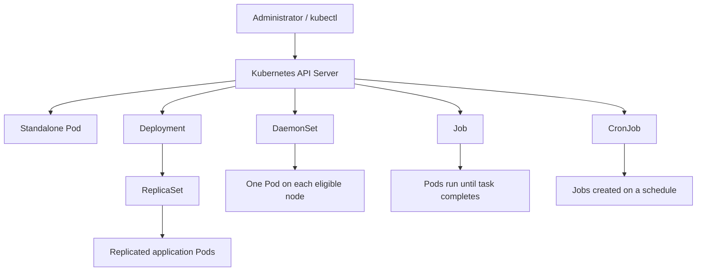
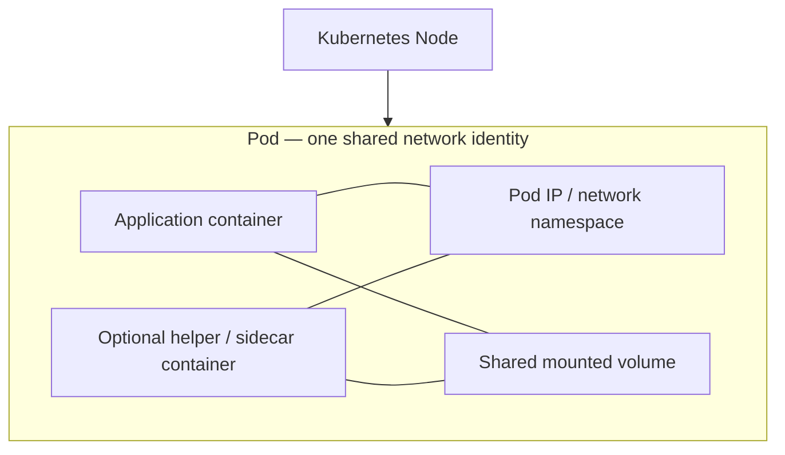
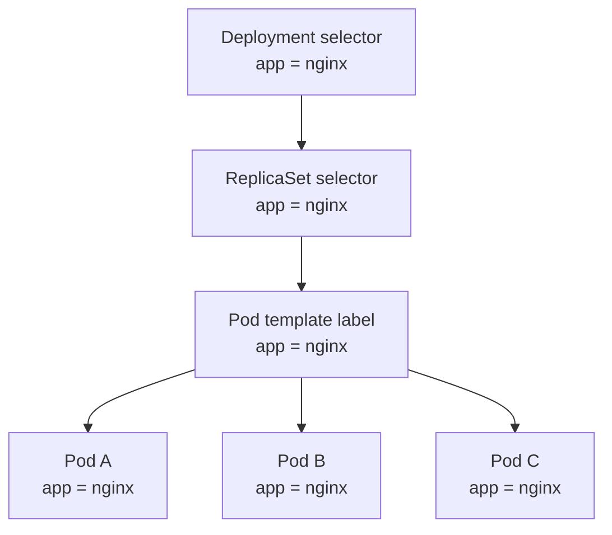
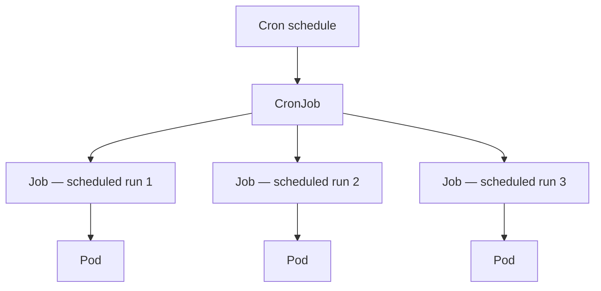

# Chapter 4 — Kubernetes Core Workloads

This chapter explains how Kubernetes creates, observes, and maintains application workloads. It follows the networking foundation in Chapter 3 and uses the final three-node Vagrant cluster documented in Chapters 1–3.

The chapter is grounded in the `K8s Cluster in Vagrant` conversation export. It preserves the commands and application-deployment work recorded there. Where the original conversation listed a topic as a future learning objective but did not show a completed lab, the section is labelled **Recommended lab** rather than presented as an observed result.

---

## 4.1 Learning objectives

By the end of this chapter, you should be able to:

- Explain the purpose and lifecycle of a Pod.
- Distinguish a standalone Pod from a controller-managed Pod.
- Explain the relationship between a Deployment, ReplicaSet, and Pods.
- Create, inspect, scale, update, and roll back a Deployment.
- Use labels and selectors to organize and identify workloads.
- Separate workloads with namespaces.
- Explain when to use a DaemonSet, Job, or CronJob.
- Troubleshoot common workload states using `kubectl`.

## 4.2 Lab baseline

The final lab topology used throughout this manual is:

| Item | Recorded value |
|---|---|
| Kubernetes version | `v1.30.14` |
| Control-plane node | `k8master1` — `192.168.56.10` |
| Worker node 1 | `k8worker1` — `192.168.56.20` |
| Worker node 2 | `k8worker2` — `192.168.56.21` |
| Container runtime | `containerd` |
| CNI | Calico `v3.28.0` |
| Pod CIDR configured with kubeadm | `192.168.0.0/16` |
| Host-only node network | `192.168.56.0/24` |

Check the cluster before starting:

```bash
kubectl get nodes -o wide
kubectl get pods -A
kubectl cluster-info
```

All three nodes should be `Ready`. If a node is not Ready, resolve the cluster or networking issue before using this chapter's workload exercises.

> **Namespace reminder:** Unless `-n` or `--namespace` is supplied, `kubectl` normally operates in the current namespace (usually `default`). The examples explicitly name namespaces where it matters.

---

## 4.3 Kubernetes workload objects: the big picture

A workload is an application or process running in the cluster. Kubernetes provides workload resources that describe the desired state and controllers that continuously try to make the real cluster state match that desired state.

The key distinction is whether you create a Pod directly or create a controller that manages Pods for you.



| Workload resource | Main purpose | Typical use |
|---|---|---|
| Pod | Run one or more tightly coupled containers | Short-lived test or a Pod managed by another controller |
| ReplicaSet | Maintain a requested number of matching Pods | Usually managed indirectly by a Deployment |
| Deployment | Manage stateless application replicas and revisions | Web applications, APIs, microservices |
| DaemonSet | Run a Pod on every eligible node | Node-level agents, log collectors, monitoring agents |
| Job | Run work to completion | Batch task, migration, one-time processing |
| CronJob | Create Jobs on a time schedule | Scheduled report, cleanup, recurring backup task |

StatefulSets are another workload controller, but persistent identity and storage are covered in the later storage chapter. Services and stable network access are covered in Chapter 5.

## 4.4 Pods — the smallest deployable unit

A **Pod** is the smallest deployable object in Kubernetes. A Pod contains one or more containers that are scheduled together and share the Pod's network identity. Containers in the same Pod can communicate over `localhost`; they can also share mounted volumes.

Most application Pods contain one main application container. Multi-container Pods are useful when containers are tightly coupled and must share a lifecycle, network namespace, or volumes.

### Pod architecture



The diagram illustrates the shared Pod-level network and optional shared storage. A Pod is not the same thing as a VM: it is a Kubernetes scheduling and execution unit hosted on a node.

### Create a first Pod (imperative)

The original learning exercise used NGINX:

```bash
kubectl run nginx --image=nginx
```

Inspect it:

```bash
kubectl get pods
kubectl get pod nginx -o wide
kubectl describe pod nginx
```

In `describe`, pay attention to:

- **Node** — which Kubernetes node was selected by the scheduler.
- **IP** — the Pod IP allocated through the CNI.
- **Image** — the container image requested.
- **Conditions** — the Pod's readiness and scheduling conditions.
- **Events** — scheduling, image-pull, container-start, and warning messages.

The Pod IP is dynamic. Do not hard-code a Pod IP in application configuration. Use a Service and DNS for stable access; those topics are covered in Chapter 5.

### Read logs and execute a command inside a container

```bash
kubectl logs nginx
kubectl exec -it nginx -- bash
```

Inside the container:

```bash
hostname
ip addr
exit
```

The original exercise noted that NGINX may not produce much startup output. An empty or short log is not automatically a failure; check the Pod state, events, and application behaviour as well.

If the image does not contain `bash`, use `sh`:

```bash
kubectl exec -it nginx -- sh
```

### Delete a standalone Pod

```bash
kubectl delete pod nginx
kubectl get pods
```

A directly created Pod has no higher-level controller to recreate it. When it is deleted, Kubernetes does not create a replacement merely because the Pod once existed.

This is the reason application workloads are normally managed by controllers such as Deployments rather than by manually created standalone Pods.

### Pod lifecycle: phase versus displayed status

The Pod API defines these lifecycle phases:

| Phase | Meaning |
|---|---|
| `Pending` | The Pod has been accepted, but one or more containers have not been started. Scheduling or image preparation may still be in progress. |
| `Running` | The Pod is bound to a node and at least one container is running or starting/restarting. This does **not** by itself guarantee application readiness. |
| `Succeeded` | All containers completed successfully and will not be restarted. |
| `Failed` | All containers have terminated and at least one terminated unsuccessfully. |
| `Unknown` | Kubernetes cannot determine the Pod state, commonly because node communication was lost. |

`kubectl get pods` also displays human-friendly status values such as `CrashLoopBackOff`, `ImagePullBackOff`, or `ContainerCreating`. These are not additional Pod lifecycle phases; they describe a condition or waiting reason for a container.

**Important:** `Running` and `Ready` are different. A container can be running while its readiness probe fails. A Pod should receive application traffic only when its readiness condition is satisfied.

### Recommended lab — observe a standalone Pod's lifecycle

This exercise is recommended for practice; the source notes document Pod creation, inspection, logs, exec, and deletion, but do not preserve a complete captured event timeline.

```bash
kubectl run lifecycle-test --image=nginx
kubectl get pod lifecycle-test -w
```

In another terminal:

```bash
kubectl describe pod lifecycle-test
```

Delete it and observe:

```bash
kubectl delete pod lifecycle-test
kubectl get pods -w
```

Expected learning: a standalone Pod disappears and is not replaced automatically.

---

## 4.5 Labels and selectors — how Kubernetes groups resources

A **label** is a key/value pair attached to an object. Labels provide a flexible way to identify and group Kubernetes resources.

Examples:

```yaml
app: nginx
environment: dev
team: platform
```

Labels are metadata, not unique identifiers. Many Pods can share the same label.

A **selector** identifies objects by matching their labels. Controllers use selectors to determine which Pods they manage. Services also use selectors to find backend Pods; that traffic relationship is examined in Chapter 5.

### Inspect labels

```bash
kubectl get pods --show-labels
```

The original exercise used an `app=nginx` label and added an environment label to a Pod:

```bash
kubectl label pod <POD_NAME> env=dev
```

If the label key already exists, Kubernetes refuses to overwrite it unless you explicitly use `--overwrite`:

```bash
kubectl label pod <POD_NAME> env=dev --overwrite
```

Filter Pods by label:

```bash
kubectl get pods -l env=dev
kubectl get pods -l app=nginx
kubectl get pods -l 'app=nginx,env=dev'
```

Show labels for Pods in every namespace:

```bash
kubectl get pods -A --show-labels
```

### Equality-based and set-based selectors

Equality-based examples:

```bash
kubectl get pods -l app=nginx
kubectl get pods -l 'environment!=production'
```

Set-based examples:

```bash
kubectl get pods -l 'environment in (dev,test)'
kubectl get pods -l 'environment notin (production)'
kubectl get pods -l 'tier'
kubectl get pods -l '!deprecated'
```

A comma between selector requirements means logical AND.

### Labels in a Deployment

A Deployment's selector must match the labels in its Pod template. The following relationship is essential:



If the selector and Pod-template labels do not match, the workload manifest will be rejected or will not manage the intended Pods. Treat a Deployment's selector as a fundamental part of its identity; changing it after creation is restricted and is not a routine way to rename an application.

**Good label design:** use consistent keys such as `app`, `environment`, `tier`, and `team`. Avoid putting frequently changing values such as build timestamps into labels; use annotations for non-identifying metadata.

---

## 4.6 ReplicaSets — maintaining the desired replica count

A **ReplicaSet** ensures that a specified number of Pods matching its selector are running.

For example:

- Desired replicas: `3`
- Current matching Pods: `2`
- ReplicaSet action: create another Pod
- Reconciled state: `3` matching Pods

A ReplicaSet continuously compares desired state with actual state. If one of its Pods is deleted, it creates a replacement. This is the self-healing behaviour that the original learning exercise observed through a Deployment-managed workload.

### Inspect ReplicaSets

```bash
kubectl get replicasets
kubectl get rs
kubectl get rs -o wide
```

For a namespace:

```bash
kubectl get rs -n dev
```

Describe one:

```bash
kubectl describe rs <REPLICASET_NAME> -n <NAMESPACE>
```

### Why Deployments are preferred over directly managed ReplicaSets

A ReplicaSet provides replica-count maintenance, but it does not provide the full application rollout and revision-management workflow that a Deployment provides. In normal application operations, create and update a Deployment. Kubernetes creates and manages the ReplicaSets behind it.

The controller hierarchy is:

```text
Deployment
    └── ReplicaSet
          └── Pods
```

Do not independently edit or delete the ReplicaSet created by a Deployment unless you are deliberately performing an advanced troubleshooting operation.

---

## 4.7 Deployments — the normal way to run stateless applications

A **Deployment** declares the desired state for a replicated application. The Deployment controller creates a ReplicaSet, and the ReplicaSet maintains the Pods.

Deployments provide:

- Desired replica-count management.
- Self-healing through replacement Pods.
- Scaling.
- Rolling updates when the Pod template changes.
- Rollback to a previous Deployment revision.
- Declarative management through YAML.

### Create a Deployment (imperative)

The original exercise used:

```bash
kubectl create deployment nginx --image=nginx
```

Inspect the resource hierarchy:

```bash
kubectl get deployments
kubectl get rs
kubectl get pods
```

The expected relationship is:

```text
Deployment
    |
    v
ReplicaSet
    |
    v
Pods
```

Use the wide output to see which nodes host the Pods:

```bash
kubectl get pods -o wide
```

### Scale a Deployment

The original exercise scaled NGINX to three replicas:

```bash
kubectl scale deployment nginx --replicas=3
```

Verify:

```bash
kubectl get deployment nginx
kubectl get rs
kubectl get pods -o wide
```

The Deployment's desired replica count should be three. Kubernetes schedules the Pods onto nodes that satisfy scheduling constraints and have sufficient resources; it does not promise an equal split across the two workers.

### Observe self-healing

List Pods:

```bash
kubectl get pods
```

Delete one Pod created by the Deployment:

```bash
kubectl delete pod <POD_NAME>
```

Watch the workload:

```bash
kubectl get pods -w
```

The old Pod terminates and a replacement Pod is created by the ReplicaSet. The replacement normally receives a different Pod name and Pod IP. The Deployment's desired replica count remains unchanged.

This is different from deleting a standalone Pod: a standalone Pod has no ReplicaSet to recreate it.

### Inspect a Deployment

```bash
kubectl describe deployment nginx
kubectl get deployment nginx -o yaml
kubectl get deployment nginx -o wide
```

Useful fields include:

- `spec.replicas` — requested number of replicas.
- `spec.selector` — labels used to identify the Deployment's Pods.
- `spec.template` — Pod template used to create new Pods.
- `status.replicas` — current replica count.
- `status.readyReplicas` — Pods currently reported ready.
- `status.availableReplicas` — Pods available to serve according to Deployment availability rules.

### Declarative Deployment manifest

The following is a **recommended reusable example**. The earlier conversation created the NGINX Deployment imperatively and later used a YAML Deployment for the Flask application. This standalone NGINX manifest is provided to practise declarative management.

Save as `nginx-deployment.yaml`:

```yaml
apiVersion: apps/v1
kind: Deployment
metadata:
  name: nginx
  namespace: default
  labels:
    app: nginx
    environment: lab
spec:
  replicas: 3
  selector:
    matchLabels:
      app: nginx
  template:
    metadata:
      labels:
        app: nginx
        environment: lab
    spec:
      containers:
        - name: nginx
          image: nginx:1.27
          ports:
            - name: http
              containerPort: 80
              protocol: TCP
```

Apply and inspect:

```bash
kubectl apply -f nginx-deployment.yaml
kubectl get deployment nginx
kubectl get rs
kubectl get pods -l app=nginx -o wide
```

The `selector.matchLabels` value must match the Pod template label. The additional `environment: lab` label helps with filtering but is not part of the selector in this example.

Delete the resources defined in the file:

```bash
kubectl delete -f nginx-deployment.yaml
```

### Imperative versus declarative management

| Imperative example | Declarative example |
|---|---|
| `kubectl create deployment nginx --image=nginx` | Define the desired Deployment in YAML and run `kubectl apply -f nginx-deployment.yaml` |
| `kubectl scale deployment nginx --replicas=3` | Change `spec.replicas` in the manifest and apply it |
| Useful for quick experiments | Better for repeatability, review, and version control |

The original notes explicitly identify YAML as the preferred approach for real, repeatable Kubernetes configuration. Keep manifests in source control, but never commit credentials or secret values.

---

## 4.8 Rolling updates and rollbacks

A Deployment creates a new ReplicaSet when its Pod template changes, for example when the container image changes. The Deployment controller gradually replaces old Pods with new Pods according to the rollout strategy.

A rolling update helps avoid taking every replica down at once. It is not an unconditional guarantee of zero downtime: application readiness, replica count, resource capacity, and rollout settings matter.

### Update the container image

For the example Deployment:

```bash
kubectl set image deployment/nginx nginx=nginx:1.28
```

Watch the rollout:

```bash
kubectl rollout status deployment/nginx
kubectl get pods -w
```

Inspect the current image:

```bash
kubectl get deployment nginx \
  -o jsonpath='{.spec.template.spec.containers[0].image}'
echo
```

For repeatable environments, update the image tag in the YAML manifest and apply the file rather than relying only on an imperative command.

### View rollout history

```bash
kubectl rollout history deployment/nginx
```

Inspect a particular revision:

```bash
kubectl rollout history deployment/nginx --revision=1
```

### Roll back

```bash
kubectl rollout undo deployment/nginx
kubectl rollout status deployment/nginx
```

To roll back to a specific revision:

```bash
kubectl rollout undo deployment/nginx --to-revision=1
```

Check the image after rollback:

```bash
kubectl get deployment nginx \
  -o jsonpath='{.spec.template.spec.containers[0].image}'
echo
```

### Pause and resume a rollout

```bash
kubectl rollout pause deployment/nginx
kubectl rollout resume deployment/nginx
```

Use these commands deliberately. A paused Deployment will not complete a rollout until it is resumed.

### Important lab observation — the Flask Deployment

The original lab later deployed a real Flask application in the existing `dev` namespace. The recorded Deployment details were:

| Field | Recorded value |
|---|---|
| Deployment | `flask-app` |
| Namespace | `dev` |
| Initial replica count | `2` |
| Container name | `flask-app` |
| Initial image | `mearvi/flask-lab:latest` |
| Container port | `5000` |
| Matching Pod label | `app: flask-app` |

The Deployment YAML used `apiVersion: apps/v1`, `kind: Deployment`, `spec.replicas: 2`, a selector matching `app: flask-app`, and the same label in the Pod template.

The source conversation later recorded two running Pods:

```text
flask-app-6c7464679b-bqq5r    Running
flask-app-6c7464679b-nkwrd    Running
```

The application was reachable through the separately configured Service and Ingress. Those network resources are documented in later chapters; this section focuses on the Deployment and its Pods.

The deployment workflow first used `kubectl rollout restart`, which restarted Pods but did not change the image reference. The lab then moved toward immutable, commit-SHA-based image tags and used:

```bash
kubectl set image deployment/flask-app \
  flask-app=<IMAGE_REPOSITORY>:<GIT_COMMIT_SHA> \
  -n dev

kubectl rollout status deployment/flask-app -n dev
```

The exact image repository and commit SHA are intentionally represented as placeholders here. Do not paste credentials or GitHub Actions secrets into a manifest or documentation.

The container name was explicitly checked in the lab:

```bash
kubectl get deployment flask-app -n dev \
  -o jsonpath='{.spec.template.spec.containers[0].name}'
echo
```

The recorded result was:

```text
flask-app
```

This matters because `kubectl set image` requires the **container name** from the Pod template, not merely the Deployment name.

The lab also inspected rollout history:

```bash
kubectl rollout history deployment/flask-app -n dev
```

The captured output showed revisions `1`, `2`, and `3`, each with `CHANGE-CAUSE` shown as `<none>`. This demonstrated that Deployment revisions had been created, while also showing that no change-cause annotation had been recorded.

For a future deployment pipeline, the conversation recommended annotating the Deployment after changing the image:

```bash
kubectl annotate deployment/flask-app \
  kubernetes.io/change-cause="Deploy commit <GIT_COMMIT_SHA>" \
  -n dev --overwrite
```

Then inspect:

```bash
kubectl rollout history deployment/flask-app -n dev
```

The original notes also recommended testing rollback:

```bash
kubectl rollout undo deployment/flask-app -n dev
kubectl rollout status deployment/flask-app -n dev

kubectl get deployment flask-app -n dev \
  -o jsonpath='{.spec.template.spec.containers[0].image}'
echo
```

The SHA-based image workflow and rollback are an important practical example of why Deployments and versioned container images matter in a DevOps pipeline.

---

## 4.9 Namespaces — logical separation of workloads

A **Namespace** provides a logical boundary for namespaced Kubernetes resources. It helps organize resources and is commonly used to separate environments or teams.

The original learning exercises created and used a namespace named `dev`.

### List namespaces

```bash
kubectl get namespaceskubectl get ns
```

### Create the `dev` namespace

```bash
kubectl create namespace dev
```

Verify:

```bash
kubectl get ns dev
```

### Create a Deployment inside `dev`

The recorded exercise used:

```bash
kubectl create deployment nginx \
  --image=nginx \
  -n dev
```

Inspect it:

```bash
kubectl get deployments -n dev
kubectl get pods -n dev
```

A Pod in `dev` will not appear in a plain `kubectl get pods` command if the current namespace is `default`. This is expected namespace scoping, not a missing Pod.

Compare:

```bash
kubectl get pods
kubectl get pods -n dev
kubectl get pods -A
```

### Namespace-qualified resource names

The same resource name can exist in different namespaces:

```text
dev/nginx
test/nginx
production/nginx
```

These are separate namespaced objects. A namespace is not a separate Kubernetes cluster and does not automatically provide complete network isolation. Network isolation requires additional controls such as NetworkPolicies, and access control is configured through RBAC.

### Set the current namespace in the active context

For convenience, you can change the namespace used by the current kubeconfig context:

```bash
kubectl config set-context --current --namespace=dev
```

Check the current context:

```bash
kubectl config view --minify | grep namespace
```

Return to `default` when required:

```bash
kubectl config set-context --current --namespace=default
```

For scripts and operational runbooks, explicit `-n <namespace>` flags are often safer because they make the target namespace visible in the command.

### Namespaced versus cluster-scoped resources

Most application workloads are namespaced: Pods, Deployments, ReplicaSets, Jobs, CronJobs, Services, ConfigMaps, and Secrets.

Nodes and Namespaces themselves are cluster-scoped. A namespace does not contain a separate set of Nodes.

---

## 4.10 DaemonSets — one Pod per eligible node

A **DaemonSet** ensures that a copy of a Pod runs on each node that matches its scheduling rules. When an eligible node is added, the DaemonSet controller creates a Pod there. When a node is removed, the corresponding DaemonSet Pod is cleaned up.

Common uses include:

- Log collection agents.
- Node monitoring agents.
- Storage or networking agents.
- Security and compliance agents that need node-level visibility.

A DaemonSet is not the same as a Deployment:

| Deployment | DaemonSet |
|---|---|
| Requests a number of replicas | Targets each eligible node |
| Pods can be scheduled across suitable nodes | Typically one managed Pod per eligible node |
| Common for application workloads | Common for node-level agents |

### Inspect DaemonSets

```bash
kubectl get daemonsets -A
kubectl get ds -A
kubectl describe daemonset <DAEMONSET_NAME> -n <NAMESPACE>
```

### Recommended lab — create a simple DaemonSet

The original fundamentals exercises listed DaemonSets as a learning objective. In a later monitoring installation, the lab output also showed a real DaemonSet named `prometheus-prometheus-node-exporter` with `DESIRED=3`, `CURRENT=3`, `READY=3`, and node selector `kubernetes.io/os=linux`. This is evidence of a healthy three-node node-exporter DaemonSet in that later captured state. The source does not preserve the exact standalone manifest used to create it; the following simple manifest is an additional practice exercise.

Save as `sample-daemonset.yaml`:

```yaml
apiVersion: apps/v1
kind: DaemonSet
metadata:
  name: node-sleeper
  namespace: default
  labels:
    app: node-sleeper
spec:
  selector:
    matchLabels:
      app: node-sleeper
  template:
    metadata:
      labels:
        app: node-sleeper
    spec:
      containers:
        - name: sleeper
          image: busybox:1.36
          command: ["sh", "-c", "while true; do sleep 3600; done"]
```

Apply and inspect:

```bash
kubectl apply -f sample-daemonset.yaml
kubectl get daemonset node-sleeper
kubectl get pods -l app=node-sleeper -o wide
kubectl describe daemonset node-sleeper
```

The number of Pods depends on the nodes eligible under the cluster's taints, tolerations, node selectors, affinity, and resource availability. Do not assume that a DaemonSet will run on the control-plane node: control-plane nodes are commonly tainted to repel ordinary workloads. If you intentionally want a node agent on a tainted node, configure the required toleration after reviewing that node's taints.

Delete the practice workload:

```bash
kubectl delete -f sample-daemonset.yaml
```

---

## 4.11 Jobs — run a task to completion

A **Job** creates one or more Pods and tracks successful completion. Unlike a Deployment, which is intended to keep an application running, a Job is intended to finish its work.

Common uses:

- Database migration.
- One-time data processing.
- Batch report generation.
- Administrative or maintenance scripts.

A Job can retry failed Pods according to its policy and configured retry limits. The exact behaviour depends on the Job specification and Pod failure mode.

### Inspect Jobs

```bash
kubectl get jobs
kubectl get pods
kubectl describe job <JOB_NAME>
```

### Recommended lab — create a one-time Job

The source conversation listed Jobs as a topic to learn but did not preserve a completed Job lab. This is an additional exercise.

```bash
kubectl create job date-check \
  --image=busybox:1.36 \
  -- sh -c 'date; echo Job completed'
```

Check its status:

```bash
kubectl get jobs
kubectl get pods -l job-name=date-check
kubectl describe job date-check
```

Read the output from the completed Pod:

```bash
kubectl logs job/date-check
```

Expected behaviour: the command prints the date and completion message, the Pod exits successfully, and the Job reports one successful completion.

Delete the Job:

```bash
kubectl delete job date-check
```

A completed Job remains as an API object until it is deleted or cleaned up by an applicable TTL-after-finished setting. Job Pods are not intended to run indefinitely.

---

## 4.12 CronJobs — schedule recurring Jobs

A **CronJob** creates Jobs on a recurring schedule. It is useful when the task should run periodically rather than continuously.

Examples:

- Daily report generation.
- Periodic cleanup.
- Scheduled data export.
- Recurring maintenance.

A CronJob creates Jobs; each Job creates Pods:



### Recommended lab — create a CronJob

The source conversation listed CronJobs as a future learning topic but did not preserve a completed CronJob creation or execution. This is an additional exercise.

Save as `sample-cronjob.yaml`:

```yaml
apiVersion: batch/v1
kind: CronJob
metadata:
  name: periodic-date
  namespace: default
spec:
  schedule: "*/5 * * * *"
  concurrencyPolicy: Forbid
  successfulJobsHistoryLimit: 2
  failedJobsHistoryLimit: 2
  jobTemplate:
    spec:
      backoffLimit: 1
      template:
        spec:
          restartPolicy: Never
          containers:
            - name: date
              image: busybox:1.36
              command: ["sh", "-c", "date; echo Scheduled task completed"]
```

Apply:

```bash
kubectl apply -f sample-cronjob.yaml
```

Inspect the CronJob and the Jobs it creates:

```bash
kubectl get cronjob periodic-date
kubectl describe cronjob periodic-date
kubectl get jobs --watch
```

Inspect a Job's Pod and logs:

```bash
kubectl get pods
kubectl logs <JOB_POD_NAME>
```

The schedule `*/5 * * * *` means every five minutes. CronJob scheduling is not a precision real-time scheduler; execution can be delayed. Avoid schedules that create overlapping runs unless the task is designed to handle concurrency.

Delete the practice CronJob and its Jobs:

```bash
kubectl delete cronjob periodic-date
kubectl delete jobs -l job-name
```

If the label selector does not match the Jobs you created, list them and delete the intended Job names explicitly. Do not run broad deletion commands against a shared namespace without checking the target resources first.

---

## 4.13 Workload troubleshooting

When a workload does not behave as expected, move from the high-level controller to the affected Pod and then to its container logs and events.

### First-level checks

```bash
kubectl get nodes
kubectl get pods -A -o wide
kubectl get deployments -A
kubectl get replicasets -A
kubectl get daemonsets -A
kubectl get jobs -A
kubectl get cronjobs -A
```

### Describe the controller

```bash
kubectl describe deployment <DEPLOYMENT_NAME> -n <NAMESPACE>
kubectl describe rs <REPLICASET_NAME> -n <NAMESPACE>
```

Look for desired versus available replicas, selector mismatches, scheduling failures, image errors, and events.

### Describe the Pod

```bash
kubectl describe pod <POD_NAME> -n <NAMESPACE>
```

Important areas:

- `Status` and `Conditions`.
- Node assignment.
- Container state and last termination state.
- Restart count.
- Image and image-pull information.
- Events at the bottom of the output.

### Inspect logs

```bash
kubectl logs <POD_NAME> -n <NAMESPACE>
```

For a Pod with multiple containers:

```bash
kubectl logs <POD_NAME> -c <CONTAINER_NAME> -n <NAMESPACE>
```

For a container that has restarted:

```bash
kubectl logs <POD_NAME> --previous -n <NAMESPACE>
```

### Inspect resource consumption

The lab later installed Metrics Server and verified that `kubectl top nodes` worked. With Metrics Server available, use:

```bash
kubectl top nodes
kubectl top pods -A
```

If the Metrics API is not installed or not ready, `kubectl top` may fail even when the workload itself is healthy.

### Common displayed statuses

| Displayed status / symptom | What to investigate first |
|---|---|
| `Pending` | Scheduler events, node capacity, taints/tolerations, affinity, PVC dependencies |
| `ImagePullBackOff` | Image name/tag, registry reachability, authentication, pull secrets |
| `ErrImagePull` | The underlying image-pull error in Pod events |
| `CrashLoopBackOff` | Current and previous container logs, command/arguments, configuration, probes, exit code |
| `CreateContainerConfigError` | Referenced ConfigMap, Secret, volume, or container configuration |
| `ContainerCreating` for a long time | Events, image pull, volume mount, CNI/runtime issues |
| `Running` but not `Ready` | Readiness probe, application listener, dependencies, startup state |
| Deployment has fewer available replicas than desired | ReplicaSet status, Pod events, scheduling, readiness, and resource limits |

Do not diagnose from the short status column alone. `kubectl describe` and container logs usually provide the evidence needed for the next step.

### Events

```bash
kubectl get events -n <NAMESPACE> --sort-by=.metadata.creationTimestamp
```

For all namespaces:

```bash
kubectl get events -A --sort-by=.metadata.creationTimestamp
```

---

## 4.14 Practical lab sequence

Complete the exercises in this order. Use the same three-node lab; do not create additional VMs.

### Lab A — standalone Pod

```bash
kubectl run nginx-test --image=nginx
kubectl get pod nginx-test -o wide
kubectl describe pod nginx-test
kubectl logs nginx-test
kubectl exec -it nginx-test -- sh
kubectl delete pod nginx-test
```

Confirm that a standalone Pod is not recreated after deletion.

### Lab B — Deployment and ReplicaSet

```bash
kubectl create deployment nginx-lab --image=nginx
kubectl get deployment nginx-lab
kubectl get rs
kubectl get pods -o wide
```

Scale to three replicas:

```bash
kubectl scale deployment nginx-lab --replicas=3
kubectl get pods -l app=nginx-lab -o wide
```

Delete one of the Pods and watch its replacement:

```bash
kubectl delete pod <ONE_NGINX_LAB_POD>
kubectl get pods -l app=nginx-lab -w
```

### Lab C — labels and selectors

```bash
kubectl get pods --show-labels
kubectl label deployment nginx-lab team=platform
kubectl get deployments -l team=platform
kubectl get pods -l app=nginx-lab
```

Note that labels on a Deployment object are not automatically the same as labels on its Pod template. Inspect both objects and use the selector that matches the object you are querying.

### Lab D — namespace isolation

```bash
kubectl create namespace dev
kubectl create deployment nginx-dev --image=nginx -n dev
kubectl get deployments
kubectl get deployments -n dev
kubectl get pods -A -o wide
```

Explain why `nginx-dev` does not appear in a default-namespace-only query.

### Lab E — rolling update and rollback

For the `nginx-lab` Deployment:

```bash
kubectl set image deployment/nginx-lab nginx=nginx:1.28
kubectl rollout status deployment/nginx-lab
kubectl rollout history deployment/nginx-lab
kubectl rollout undo deployment/nginx-lab
kubectl rollout status deployment/nginx-lab
```

Check the resulting image and explain which revision was restored.

### Lab F — DaemonSet, Job, and CronJob

Complete the recommended exercises in sections 4.10–4.12. Record the number of DaemonSet Pods and the Job/CronJob completion states. These are additional exercises, not previously recorded successful observations.

### Cleanup

Remove only the resources created by these exercises:

```bash
kubectl delete deployment nginx-lab
kubectl delete namespace dev
```

If you used the standalone `nginx-deployment.yaml`, `sample-daemonset.yaml`, or `sample-cronjob.yaml` manifests, remove those resources using the matching manifest or explicit resource names.

Do not delete the `dev` namespace if it contains the Flask application or other work you still need. The recorded lab used `dev` for the Flask Deployment, so inspect it before cleanup:

```bash
kubectl get all -n dev
```

---

## 4.15 Command reference

| Task | Command |
|---|---|
| List Pods | `kubectl get pods` |
| List Pods on all namespaces | `kubectl get pods -A` |
| Show Pod IP and node | `kubectl get pods -o wide` |
| Show labels | `kubectl get pods --show-labels` |
| Filter by label | `kubectl get pods -l app=nginx` |
| Describe Pod | `kubectl describe pod <POD>` |
| View logs | `kubectl logs <POD>` |
| Previous container logs | `kubectl logs <POD> --previous` |
| Execute in container | `kubectl exec -it <POD> -- sh` |
| List Deployments | `kubectl get deployments` |
| List ReplicaSets | `kubectl get rs` |
| Scale Deployment | `kubectl scale deployment <NAME> --replicas=3` |
| Watch Pods | `kubectl get pods -w` |
| Rollout status | `kubectl rollout status deployment/<NAME>` |
| Rollout history | `kubectl rollout history deployment/<NAME>` |
| Roll back | `kubectl rollout undo deployment/<NAME>` |
| List DaemonSets | `kubectl get ds -A` |
| List Jobs | `kubectl get jobs -A` |
| List CronJobs | `kubectl get cronjobs -A` |
| List namespaces | `kubectl get ns` |
| Create namespace | `kubectl create namespace <NAME>` |
| List all resources in namespace | `kubectl get all -n <NAMESPACE>` |
| Apply manifest | `kubectl apply -f <FILE.yaml>` |
| Delete manifest resources | `kubectl delete -f <FILE.yaml>` |
| Recent events | `kubectl get events -n <NAMESPACE> --sort-by=.metadata.creationTimestamp` |
| Resource usage | `kubectl top pods -A` |

---

## 4.16 Key concepts and interview review

**What is a Pod?**  
The smallest deployable Kubernetes unit. It contains one or more co-scheduled containers that share a network identity and can share storage.

**Why should application workloads normally use Deployments instead of standalone Pods?**  
A standalone Pod is not automatically recreated when deleted. A Deployment manages ReplicaSets, which maintain the requested number of Pods and support rollout and rollback operations.

**What is a ReplicaSet?**  
A controller that maintains the desired number of Pods matching its selector.

**What is the relationship between a Deployment, ReplicaSet, and Pod?**  
The Deployment manages ReplicaSets; a ReplicaSet creates and maintains Pods.

**What happens when one Deployment-managed Pod is deleted?**  
The ReplicaSet notices that the actual number of matching Pods is below the desired count and creates a replacement.

**What is the difference between scaling and rolling updates?**  
Scaling changes the desired number of replicas. A rolling update changes the Pod template, such as the container image, and gradually replaces old Pods with new ones.

**What is a label?**  
A key/value metadata pair attached to an object.

**What is a selector?**  
A query that identifies objects whose labels match specified requirements.

**Why must a Deployment selector match the Pod template labels?**  
The controller uses the selector to identify the Pods belonging to the Deployment's ReplicaSet.

**What is a Namespace?**  
A logical grouping and scope for namespaced Kubernetes resources. It is not a separate cluster and does not automatically provide network isolation.

**When should you use a DaemonSet?**  
When a Pod must run on each eligible node, for example a node-level logging or monitoring agent.

**What is the difference between a Job and a Deployment?**  
A Job runs work to completion. A Deployment keeps an application running at a desired replica count.

**What is a CronJob?**  
A controller that creates Jobs according to a recurring schedule.

**How do you inspect a failed Pod?**  
Start with `kubectl describe pod`, inspect events, then check current or previous container logs with `kubectl logs`.

**How do you roll back a Deployment?**  
Use `kubectl rollout undo deployment/<NAME>` and verify with `kubectl rollout status`.

---

## 4.17 Chapter completion checklist

- [ ] I can explain the Pod abstraction and shared Pod networking.
- [ ] I can create, inspect, read logs from, exec into, and delete a standalone Pod.
- [ ] I understand why a standalone Pod is not self-healing.
- [ ] I can explain Pod lifecycle phases and distinguish them from displayed container statuses.
- [ ] I can explain how a ReplicaSet maintains the desired Pod count.
- [ ] I can explain the Deployment → ReplicaSet → Pod hierarchy.
- [ ] I can create and scale a Deployment.
- [ ] I can delete a Deployment-managed Pod and observe its replacement.
- [ ] I can perform and verify a rolling update and rollback.
- [ ] I can use labels and selectors to find resources.
- [ ] I can create and query resources in the `dev` namespace.
- [ ] I understand the intended use of DaemonSets, Jobs, and CronJobs.
- [ ] I can use `get`, `describe`, `logs`, `exec`, `top`, and `events` to troubleshoot workloads.

---

## 4.18 Source fidelity and scope notes

The following points are directly supported by the recorded lab conversation:

- The three-node Kubernetes lab and its node addresses.
- The standalone NGINX Pod exercise: create, inspect, logs, exec, and delete.
- The explanation that a directly created Pod is not recreated after deletion.
- The Deployment → ReplicaSet → Pod hierarchy.
- Scaling an NGINX Deployment to three replicas.
- Deleting a Deployment-managed Pod and observing replacement behaviour.
- The `app=nginx` label example, adding `env=dev`, and filtering with `kubectl get pods -l env=dev`.
- Creating the `dev` namespace and creating an NGINX Deployment in that namespace.
- A Flask Deployment named `flask-app` in namespace `dev`, with two replicas, container name `flask-app`, and label `app=flask-app`.
- Two Flask Pods observed running in `dev`.
- Deployment image updates, rollout status, rollout history revisions `1`–`3`, missing change-cause entries, and the recommended rollback and annotation commands.
- DaemonSets, StatefulSets, Jobs, and CronJobs appeared in the learning objectives. A later Prometheus Helm installation output explicitly showed `prometheus-prometheus-node-exporter` as a DaemonSet with three desired, current, and ready Pods across the three-node cluster. The source does not establish that a standalone DaemonSet manifest exercise was completed. It does not establish a completed Job or CronJob exercise.

The DaemonSet, Job, and CronJob manifests in this chapter are **recommended additional practice**, not claims about resources already installed in the lab. The declarative NGINX manifest and the lifecycle practice sequence are also included as structured learning exercises. They should be applied only when you are ready to run the exercises.

Configuration topics such as ConfigMaps and Secrets are intentionally left for Chapter 7. Service networking, DNS, and traffic exposure are intentionally left for Chapter 5. Persistent workload identity and storage are addressed in the storage chapters.

---

## 4.19 References

- Kubernetes documentation — [Pods](https://kubernetes.io/docs/concepts/workloads/pods/)
- Kubernetes documentation — [Deployments](https://kubernetes.io/docs/concepts/workloads/controllers/deployment/)
- Kubernetes documentation — [ReplicaSets](https://kubernetes.io/docs/concepts/workloads/controllers/replicaset/)
- Kubernetes documentation — [DaemonSets](https://kubernetes.io/docs/concepts/workloads/controllers/daemonset/)
- Kubernetes documentation — [Jobs](https://kubernetes.io/docs/concepts/workloads/controllers/job/)
- Kubernetes documentation — [CronJobs](https://kubernetes.io/docs/concepts/workloads/controllers/cron-jobs/)
- Kubernetes documentation — [Labels and Selectors](https://kubernetes.io/docs/concepts/overview/working-with-objects/labels/)
- Kubernetes documentation — [Namespaces](https://kubernetes.io/docs/concepts/overview/working-with-objects/namespaces/)
- Kubernetes documentation — [kubectl reference](https://kubernetes.io/docs/reference/kubectl/)