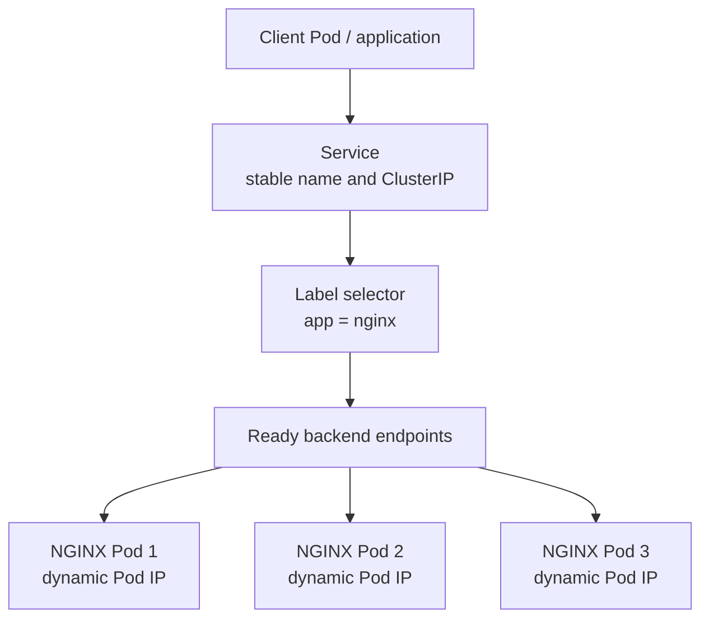
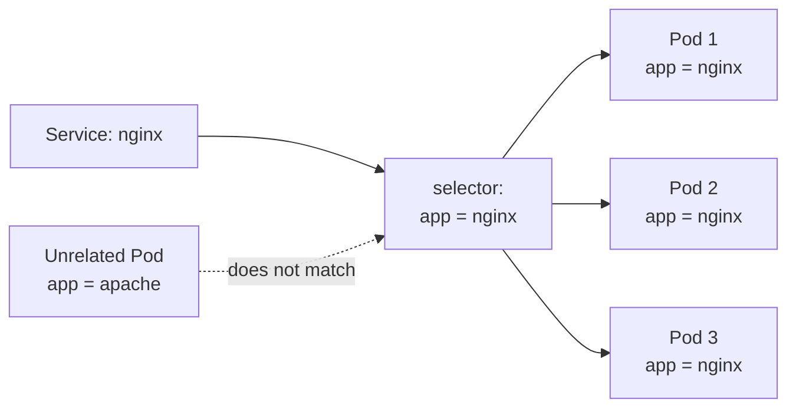
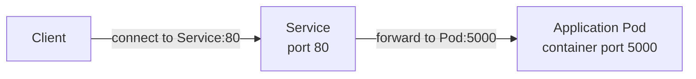
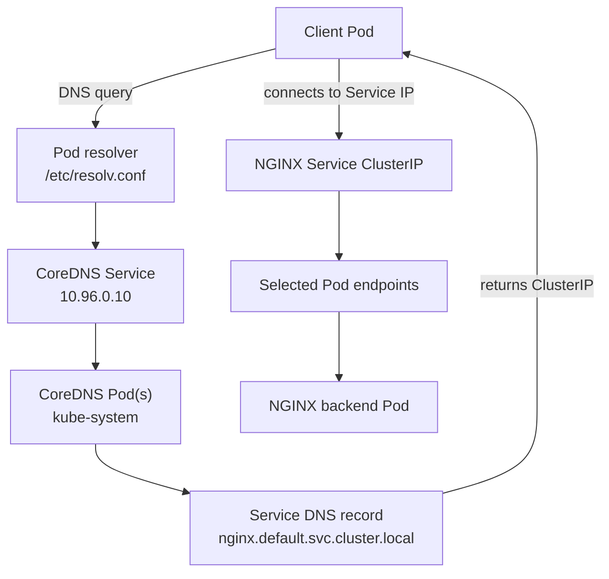
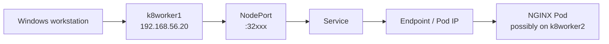

# Chapter 5 — Kubernetes Services, DNS, and Cluster Networking

This chapter builds on the Pod networking foundation in Chapter 3 and the workload controllers in Chapter 4. It explains how a Kubernetes Service gives clients a stable way to reach a changing set of Pods, how labels and selectors connect a Service to its backends, how CoreDNS provides Service discovery, and how the lab exposed applications with ClusterIP, NodePort, and LoadBalancer Services.

The examples are grounded in the `K8s Cluster in Vagrant` conversation export. The chapter preserves the NGINX Service exercises, BusyBox connectivity and DNS tests, the NodePort access pattern, the MetalLB address pool, and the Flask application's actual Service configuration. Additional examples are labelled as recommended practice.

> **Scope boundary:** Ingress is introduced only as a consumer of a Service in this chapter. Ingress controllers, Ingress rules, host/path routing, rewrite annotations, and TLS are documented in Chapter 6.

---

## 5.1 Learning objectives

By the end of this chapter, you should be able to:

- Explain why Pods need a stable access mechanism.
- Explain the difference between Node IP, Pod IP, and Service ClusterIP.
- Describe how a Service selector discovers matching Pods.
- Inspect Service ports, selectors, Endpoints, and EndpointSlices.
- Create and test a ClusterIP Service.
- Resolve a Service name using CoreDNS.
- Explain the Pod DNS search domains and diagnose common NXDOMAIN confusion.
- Create and test a NodePort Service from the Windows host.
- Explain LoadBalancer Services and how MetalLB supplied an external IP in this lab.
- Explain how a Service is used as the backend for an Ingress resource.
- Troubleshoot a Service that has no endpoints or cannot be reached.

## 5.2 Lab baseline

| Item | Recorded configuration |
|---|---|
| Kubernetes | `v1.30.14` |
| Runtime | `containerd` |
| CNI | Calico `v3.28.0` |
| Control plane | `k8master1` — `192.168.56.10` |
| Worker 1 | `k8worker1` — `192.168.56.20` |
| Worker 2 | `k8worker2` — `192.168.56.21` |
| Node network | `192.168.56.0/24` |
| Pod CIDR configured at bootstrap | `192.168.0.0/16` |
| Kubernetes API Service | `10.96.0.1` |
| CoreDNS Service | `10.96.0.10` |

Verify the cluster before starting:

```bash
kubectl get nodes -o wide
kubectl get pods -A
kubectl get svc -A
```

The `INTERNAL-IP` values of the three nodes should correspond to the host-only addresses. Pod addresses are allocated dynamically and should be read from `kubectl get pods -o wide`; do not copy an old Pod IP into a new exercise.

### Three different addresses

| Address type | Example from this lab | Meaning |
|---|---|---|
| Node IP | `192.168.56.20` | Address of a Kubernetes VM on the host-only network |
| Pod IP | `192.168.81.4` (one recorded observation) | Address assigned to an individual Pod |
| Service ClusterIP | `10.96.0.1` (Kubernetes API Service) or `10.96.177.250` (recorded Flask Service) | Stable virtual IP allocated to a Service |

These address spaces serve different purposes. A Pod IP can change when a Pod is recreated. A Service ClusterIP normally remains stable for the lifetime of that Service object.

---

## 5.3 Why Kubernetes Services are necessary

Pods are replaceable. A Deployment can delete and recreate Pods during scaling, recovery, rescheduling, or an image rollout. Replacement Pods can have different names and IP addresses.

If clients were configured with a Pod IP directly, every replacement could require an application configuration change.

A **Service** provides a stable virtual network endpoint and selects the Pods that should receive traffic. Clients use the Service's stable name or ClusterIP rather than tracking individual Pod addresses.



The Service is not a container and does not run the application. It is an API object that describes a stable access point and the backend selection rules. The data plane implements traffic forwarding to eligible backends.

---

## 5.4 How a Service selects Pods

The Service selector matches labels on Pod objects. Kubernetes uses the selector to determine which Pods are backends for the Service.

The original lab created an NGINX Deployment with three replicas:

```bash
kubectl create deployment nginx \
  --image=nginx \
  --replicas=3
```

Inspect the Pods and their labels:

```bash
kubectl get pods -o wide
kubectl get pods --show-labels
```

The Deployment created Pods with a label similar to:

```yaml
app: nginx
```

The Service created by `kubectl expose deployment nginx` uses the Deployment's Pod selector. The conceptual relationship is:



A Pod that does not match the Service selector is not included as a backend for that selector-based Service.

### Inspect the selector

```bash
kubectl get service nginx -o yaml
kubectl describe service nginx
```

Look for:

- `spec.selector`
- `spec.ports`
- `spec.type`
- `spec.clusterIP`
- The Endpoints shown in `kubectl describe`

The lab notes highlighted the relationship:

```text
Service → Label Selector → Pods
```

### Important label consistency check

A common reason for a Service having no backends is a selector mismatch. Compare the Service selector with the actual Pod labels:

```bash
kubectl get svc nginx -o jsonpath='{.spec.selector}'
echo

kubectl get pods --show-labels
```

If the Service selects `app=nginx`, at least one eligible Pod must carry that exact label in the same namespace.

A Service and its selector-based Pods must be in the same namespace. A Service in `dev` does not select Pods in `default` merely because the labels match.

---

## 5.5 Service ports: port, targetPort, and nodePort

These fields are easy to confuse:

| Field | Meaning |
|---|---|
| `port` | Port exposed by the Service itself |
| `targetPort` | Port on the selected backend Pod to which traffic is forwarded |
| `nodePort` | Port opened on each eligible node for a NodePort Service |

For example, the Flask application listens on port `5000` in its container, while its Service exposes port `80`:

```yaml
ports:
  - port: 80
    targetPort: 5000
```

The request is addressed to the Service on port `80`; the selected backend receives it on port `5000`.

For an NGINX example where the container listens on port `80`, both `port` and `targetPort` can be `80`.

### Port mapping illustration



`containerPort` in a Pod specification is descriptive metadata for the container port; it does not itself publish the application outside the Pod. The Service's `targetPort` must point to the port where the application is actually listening.

---

## 5.6 ClusterIP — internal cluster access

**ClusterIP** is the default Service type. It provides a stable virtual IP reachable from within the cluster network. It is commonly used for communication between applications and internal APIs.

The original lab created a three-replica NGINX Deployment and exposed it using ClusterIP:

```bash
kubectl create deployment nginx \
  --image=nginx \
  --replicas=3

kubectl expose deployment nginx \
  --port=80 \
  --type=ClusterIP
```

Because ClusterIP is the default type, this also works:

```bash
kubectl expose deployment nginx --port=80
```

Inspect the Service:

```bash
kubectl get svc
kubectl get service nginx -o wide
kubectl describe svc nginx
```

A representative result looks like:

```text
NAME    TYPE       CLUSTER-IP     PORT(S)
nginx   ClusterIP  10.96.x.x      80/TCP
```

The `10.96.x.x` address is illustrative. The actual ClusterIP is allocated by the cluster and should be obtained from `kubectl get svc`.

### Inspect backend Endpoints

The original lab emphasized this command:

```bash
kubectl get endpoints nginx
```

The expected result for three healthy NGINX replicas is a list of backend Pod IPs and ports, conceptually:

```text
192.168.x.x:80
192.168.x.x:80
192.168.x.x:80
```

Those are Pod backend addresses, not the Service ClusterIP.

A Service selects Pods; Kubernetes publishes the selected backend addresses as endpoint data. The legacy `Endpoints` object is still useful to inspect, although EndpointSlices are the scalable API representation used by modern Kubernetes.

Inspect both:

```bash
kubectl get endpoints nginx
kubectl get endpointslices \
  -l kubernetes.io/service-name=nginx
```

If the Service has no endpoints, check the selector, namespace, Pod readiness, and Pod labels before troubleshooting the network data plane.

### Test ClusterIP from a client Pod

The original exercise created a temporary BusyBox client:

```bash
kubectl run test-client \
  --image=busybox:1.36 \
  -it \
  --rm \
  --restart=Never -- sh
```

Inside the BusyBox shell:

```sh
wget -qO- nginx
```

The recorded expected response was:

```text
Welcome to nginx!
```

This single test exercises several layers:

1. BusyBox asks DNS to resolve the Service name `nginx`.
2. CoreDNS resolves the Service name to its ClusterIP.
3. The client sends traffic to the Service IP and port.
4. The Service data plane forwards the traffic to one of its eligible endpoints.
5. An NGINX Pod returns the response.

Exit the client shell to remove the temporary Pod (`--rm`):

```sh
exit
```

The lab notes recorded that Labs 2.1–2.4 (Deployment, ClusterIP, endpoint inspection, and BusyBox Service test) were completed.

---

## 5.7 Service load distribution

When a Service has multiple eligible backend endpoints, traffic to the Service can be distributed among those endpoints by the Kubernetes Service data plane.

For the three-replica NGINX workload:

```bash
kubectl get pods -o wide
kubectl get endpoints nginx
```

You should see multiple Pod IPs behind the Service. A request to the Service does not require the client to know which Pod receives it.

### Recommended observation exercise

The source conversation described an experiment to prove load balancing by identifying the different NGINX Pods. The captured excerpt does not preserve a final completed per-request distribution result. Use the following as a recommended repeatable test.

Create a temporary client:

```bash
kubectl run test-client \
  --image=busybox:1.36 \
  -it \
  --rm \
  --restart=Never -- sh
```

Inside:

```sh
for i in 1 2 3 4 5 6 7 8 9 10; do
  wget -qO- http://nginx
done
```

For a clearer demonstration, use an application image that returns its hostname in the HTTP response, or inspect the backend Pod logs. A stock NGINX welcome page does not identify the Pod that served the request.

Do not expect an exact round-robin sequence. Service traffic distribution should not be treated as a strict per-request round-robin guarantee; connection reuse and the implementation details affect what you observe.

---

## 5.8 CoreDNS — Service discovery inside the cluster

CoreDNS provides DNS-based service discovery for Kubernetes workloads. It allows applications to use a stable Service DNS name instead of hard-coding a ClusterIP.

The standard fully qualified Service name is:

```text
<service-name>.<namespace>.svc.cluster.local
```

Examples:

```text
nginx.default.svc.cluster.local
flask-service.dev.svc.cluster.local
kubernetes.default.svc.cluster.local
```

For a Service in the same namespace as the client, the short Service name is usually sufficient:

```text
nginx
```

For a Service in another namespace, include the namespace:

```text
flask-service.dev
```

### CoreDNS Service and Pod resolver

The lab observed:

- Kubernetes default API Service: `10.96.0.1`.
- CoreDNS Service: `10.96.0.10`.
- The BusyBox Pod's resolver pointed to `10.96.0.10`.

Inspect CoreDNS:

```bash
kubectl get pods -n kube-system -o wide | grep coredns
kubectl get svc -n kube-system
kubectl get svc kube-dns -n kube-system -o wide
```

The DNS Service is commonly named `kube-dns`, even when CoreDNS is the DNS server implementation.

### Inspect the resolver configuration inside a Pod

Create the DNS test Pod:

```bash
kubectl run dns-test \
  --image=busybox:1.36 \
  -it \
  --rm \
  --restart=Never \
  -- sh
```

Inside:

```sh
cat /etc/resolv.conf
```

The recorded output had this form:

```text
search default.svc.cluster.local svc.cluster.local cluster.local
nameserver 10.96.0.10
options ndots:5
```

The `search` line supplies suffixes that the resolver can try for short or partially qualified names. The `nameserver` line points the Pod to the cluster DNS Service. The `ndots` option influences when the resolver tries a name as absolute versus trying search suffixes.

### Test the Kubernetes API Service DNS name

Inside the BusyBox Pod:

```sh
nslookup kubernetes.default.svc.cluster.local
```

The recorded successful result was:

```text
Name: kubernetes.default.svc.cluster.local
Address: 10.96.0.1
```

This is the canonical DNS test used in the lab.

You can also query:

```sh
nslookup kubernetes.default.svc
nslookup kubernetes.default
nslookup kube-dns.kube-system.svc.cluster.local
```

Short-name lookup depends on the Pod's namespace and search domains. Prefer the fully qualified name when troubleshooting because it removes ambiguity.

### Test the NGINX Service DNS name

From a client Pod in the `default` namespace:

```sh
nslookup nginx.default.svc.cluster.local
wget -qO- http://nginx
```

For the Flask Service in `dev`, use:

```sh
nslookup flask-service.dev.svc.cluster.local
```

The Flask application is in a different namespace from a default-namespace test Pod, so using the namespace-qualified Service name is important.

### Logical DNS and Service traffic flow



DNS resolution and application traffic forwarding are separate steps. CoreDNS resolves the name to the Service IP; the Service data plane then forwards the connection to a backend endpoint.

---

## 5.9 The DNS troubleshooting incident from the lab

The source conversation includes a useful real troubleshooting case. A BusyBox Pod initially had the correct resolver search configuration:

```text
search default.svc.cluster.local svc.cluster.local cluster.local
nameserver 10.96.0.10
options ndots:5
```

The user manually edited `/etc/resolv.conf` inside the temporary Pod, changing the search line to:

```text
search kubernetes.default.svc.cluster.local svc.cluster.local cluster.local
```

After that edit, short-name lookups produced confusing NXDOMAIN responses. This was a test-Pod resolver configuration change, not evidence that the cluster's CoreDNS Service was broken.

The successful test later returned:

```text
Name: kubernetes.default.svc.cluster.local
Address: 10.96.0.1
```

### What the incident teaches

- `Server: 10.96.0.10` showed that the DNS query reached the cluster DNS Service.
- `NXDOMAIN` means the queried name did not resolve to a DNS record; it is not the same as a DNS server timeout.
- A manually modified search list can cause the resolver to try unexpected names.
- A fresh Pod receives the DNS configuration generated by Kubernetes.
- Do not edit `/etc/resolv.conf` in a test Pod as a first-line fix. Inspect it and test the fully qualified name first.

### Correct recovery procedure

Exit the altered BusyBox Pod:

```sh
exit
```

Create a fresh DNS test Pod:

```bash
kubectl run dns-test \
  --image=busybox:1.36 \
  -it \
  --rm \
  --restart=Never \
  -- sh
```

Inside, do not edit `/etc/resolv.conf`:

```sh
cat /etc/resolv.conf
nslookup kubernetes.default.svc.cluster.local
```

Outside the Pod, verify the Services and CoreDNS components:

```bash
kubectl get svc -A
kubectl get pods -n kube-system -o wide | grep coredns
kubectl get svc kube-dns -n kube-system -o wide
```

### Distinguish DNS failure types

| Symptom | Meaning / next check |
|---|---|
| `NXDOMAIN` | DNS server responded that the queried name does not exist. Check the exact name, namespace, search list, and whether the Service exists. |
| `connection timed out; no servers could be reached` | The resolver did not receive a response. Check Pod-to-DNS connectivity, CoreDNS Pods, and the DNS Service. |
| Correct DNS answer but HTTP request fails | DNS may be fine; inspect Service port, endpoints, backend application, and network path. |
| Short name fails but FQDN succeeds | Investigate namespace and resolver search domains. |
| Service name resolves but Service has no backends | Inspect selector, Pod labels, readiness, Endpoints, and EndpointSlices. |

The source notes also show an intermediate `nslookup kubernetes` response that displayed failed search attempts followed by a successful answer for `kubernetes.default.svc.cluster.local`. This is consistent with the resolver trying multiple search suffixes. Do not treat an intermediate NXDOMAIN line as proof that the final lookup failed if the command later returns the expected record.

---

## 5.10 NodePort — access a Service through a node address

A **NodePort** Service exposes a Service on a port from the configured NodePort range on each node. The default Kubernetes range is `30000–32767`.

The request path is:

```text
Windows host
    |
    |  Node IP : NodePort
    v
Kubernetes Service
    |
    v
Backend endpoint
    |
    v
Application Pod
```

The Pod does not need to be hosted on the same node whose IP the client uses. The Service data plane can route traffic to an eligible backend on another node.

### Create a NodePort Service

The original lab first deleted the existing ClusterIP Service:

```bash
kubectl delete svc nginx
```

Then exposed the Deployment as NodePort:

```bash
kubectl expose deployment nginx \
  --port=80 \
  --type=NodePort
```

Inspect the Service:

```bash
kubectl get svc nginx
kubectl describe svc nginx
```

A recorded example format was:

```text
NAME    TYPE       CLUSTER-IP   PORT(S)
nginx   NodePort   10.96.x.x    80:32456/TCP
```

`32456` is an example port from the notes, not a value to assume for a new Service. Read the actual port from your own `kubectl get svc` output.

Extract the assigned NodePort:

```bash
kubectl get svc nginx \
  -o jsonpath='{.spec.ports[0].nodePort}'
echo
```

### Verify the endpoints

```bash
kubectl get endpoints nginx
```

The backend endpoints remain the Pod IPs and target ports. Changing the Service type to NodePort does not replace the Pods or change their Pod IPs.

### Test from the Windows host

Use the assigned NodePort with any reachable node address:

```text
http://192.168.56.10:<NODE_PORT>
http://192.168.56.20:<NODE_PORT>
http://192.168.56.21:<NODE_PORT>
```

For example, if the actual Service output assigns `32456`, test:

```text
http://192.168.56.20:32456
```

The lab notes expected the NGINX welcome page:

```text
Welcome to nginx!
```

The notes document the NodePort creation and expected access pattern. The exact assigned port can vary when Kubernetes allocates a new NodePort; always use the live Service output.

### Why NodePort works when the Pod is on another node

For example, a request can arrive at `k8worker1` even if the selected NGINX Pod is running on `k8worker2`. The Service data plane forwards the traffic to the backend endpoint.



### Troubleshoot NodePort access

If the NodePort is not reachable from Windows:

1. Confirm the Service type and assigned port:
   ```bash
   kubectl get svc nginx -o wide
   ```
2. Confirm that the Service has backend endpoints:
   ```bash
   kubectl get endpoints nginx
   ```
3. Confirm the Pods are Ready:
   ```bash
   kubectl get pods -l app=nginx -o wide
   ```
4. Test the Service from inside the cluster using a BusyBox client.
5. Test each node IP with the assigned NodePort.
6. Check host firewall rules and VirtualBox host-only network reachability.
7. Inspect node and Service networking components if internal tests also fail.

Do not assume a NodePort failure is automatically a Calico problem. First determine whether the Service has valid backends and whether in-cluster traffic works.

---

## 5.11 LoadBalancer Services and MetalLB in this lab

A Service of type `LoadBalancer` requests an external load-balancer address from an implementation that supports that integration. In cloud environments, a cloud controller can provision the load balancer. In this local VirtualBox lab, MetalLB was installed to provide LoadBalancer functionality.

The source conversation records the MetalLB v0.14.5 manifest:

```bash
kubectl apply -f \
  https://raw.githubusercontent.com/metallb/metallb/v0.14.5/config/manifests/metallb-native.yaml
```

The recorded address pool was:

```text
192.168.56.240-192.168.56.250
```

The notes recorded a LoadBalancer Service named `nginx-lb` with external IP:

```text
192.168.56.240
```

Inspect it:

```bash
kubectl get svc nginx-lb
```

The captured result showed:

```text
EXTERNAL-IP
192.168.56.240
```

### What MetalLB contributes

MetalLB provides the load-balancer implementation for environments that do not have a cloud provider assigning external addresses. It allocates an address from the configured pool to a LoadBalancer Service and makes that address reachable according to its configured advertisement mode.

The source notes establish the installed version, address pool, and observed external IP. They do not preserve enough detail here to assert which MetalLB advertisement mode or exact Layer 2/BGP configuration was used. Do not infer that configuration from the assigned IP alone.

### Inspect LoadBalancer Services

```bash
kubectl get svc -A
kubectl describe svc nginx-lb
```

Check the MetalLB components and configuration resources:

```bash
kubectl get pods -n metallb-system -o wide
kubectl get ipaddresspools -A
kubectl get l2advertisements -A
kubectl get bgppeers -A
```

Some of these resource kinds may not exist in the cluster if they were not configured. Use the commands to inspect the live configuration; do not create new pools or advertisements without checking the existing resources first.

### Distinguish the LoadBalancer application address from the Ingress address

The lab notes separately recorded:

| Purpose | Recorded address |
|---|---|
| `nginx-lb` LoadBalancer Service | `192.168.56.240` |
| NGINX Ingress Controller Service | `192.168.56.241` |

These are different Services and different external access points. The `.241` address is associated with the Ingress Controller's Service; it is not the same as the application Service's ClusterIP or the `nginx-lb` LoadBalancer address.

Ingress controller installation, host/path routing, and TLS are covered in Chapter 6.

---

## 5.12 The Flask application's ClusterIP Service

The later application-delivery phase deployed a Flask application in the existing `dev` namespace.

The recorded Deployment had:

| Setting | Recorded value |
|---|---|
| Deployment | `flask-app` |
| Namespace | `dev` |
| Replicas | `2` |
| Pod label | `app: flask-app` |
| Container name | `flask-app` |
| Container port | `5000` |

The Service manifest was:

```yaml
apiVersion: v1
kind: Service
metadata:
  name: flask-service
  namespace: dev
spec:
  selector:
    app: flask-app
  ports:
    - port: 80
      targetPort: 5000
  type: ClusterIP
```

This is a particularly important example because the Service port differs from the application container port.

### Recorded live Service details

The source output from the Helm preparation exercise showed:

```text
name: flask-service
namespace: dev
clusterIP: 10.96.177.250
ports:
- port: 80
  protocol: TCP
  targetPort: 5000
selector:
  app: flask-app
type: ClusterIP
```

`10.96.177.250` is the ClusterIP recorded at that point in the lab. A recreated Service may receive a different ClusterIP.

Inspect the live resource:

```bash
kubectl get svc flask-service -n dev -o wide
kubectl describe svc flask-service -n dev
kubectl get endpoints flask-service -n dev
kubectl get endpointslices -n dev \
  -l kubernetes.io/service-name=flask-service
```

### Test Flask Service DNS from a client Pod

Recommended test:

```bash
kubectl run flask-client \
  --image=busybox:1.36 \
  -it \
  --rm \
  --restart=Never \
  -n dev \
  -- sh
```

Inside the client:

```sh
nslookup flask-service
wget -qO- http://flask-service
```

The request uses Service port `80`, and Kubernetes forwards it to the selected Flask Pod on port `5000`.

If you run the client in `default` instead of `dev`, use the fully qualified name:

```sh
wget -qO- http://flask-service.dev.svc.cluster.local
```

This test is an additional validation exercise. The source conversation records the Flask Service configuration and its use as the backend of the Ingress rule; it does not preserve a separate BusyBox-to-Flask test output.

### Service as the backend of Ingress

The recorded Ingress rule referenced the Service by name and Service port:

```yaml
backend:
  service:
    name: flask-service
    port:
      number: 80
```

This is the key boundary between the chapters:

- Chapter 5: the Service provides stable internal access to the Flask Pods.
- Chapter 6: the Ingress Controller accepts external HTTP traffic and forwards it to the `flask-service` Service.

The client does not need to know the Flask Pod IPs or port `5000`.

---

## 5.13 Service types at a glance

| Type | Access pattern | Typical use |
|---|---|---|
| `ClusterIP` | Internal Service IP and DNS name | Internal application-to-application communication |
| `NodePort` | `NodeIP:NodePort` | Simple external access through a node address |
| `LoadBalancer` | External IP or hostname allocated by a load-balancer implementation | External access through a load balancer |
| `ExternalName` | DNS CNAME to an external hostname | Map a Kubernetes Service name to an external DNS name |

The lab directly practised ClusterIP and NodePort, and recorded MetalLB providing a LoadBalancer IP. `ExternalName` is included as conceptual reference; the source notes do not show an ExternalName Service being created.

### Recommended ExternalName example

This is a conceptual example only; it does not create a proxy or a ClusterIP:

```yaml
apiVersion: v1
kind: Service
metadata:
  name: external-api
  namespace: default
spec:
  type: ExternalName
  externalName: api.example.com
```

Clients resolving `external-api.default.svc.cluster.local` receive a DNS alias to `api.example.com`. Network connectivity to the external hostname must still exist.

---

## 5.14 Troubleshooting Services systematically

When a Service is not working, troubleshoot from the Kubernetes object outward.

### Step 1 — confirm the Service exists

```bash
kubectl get svc -A
kubectl get svc <SERVICE_NAME> -n <NAMESPACE> -o wide
kubectl describe svc <SERVICE_NAME> -n <NAMESPACE>
```

Confirm the Service type, ClusterIP, port, targetPort, and selector.

### Step 2 — inspect selector and Pod labels

```bash
kubectl get svc <SERVICE_NAME> -n <NAMESPACE> \
  -o jsonpath='{.spec.selector}'
echo

kubectl get pods -n <NAMESPACE> --show-labels
```

The selector must match the intended Pods in the same namespace.

### Step 3 — inspect endpoints

```bash
kubectl get endpoints <SERVICE_NAME> -n <NAMESPACE>
kubectl get endpointslices -n <NAMESPACE> \
  -l kubernetes.io/service-name=<SERVICE_NAME>
```

If no endpoints are present, investigate the selector, Pod labels, readiness, and namespace before investigating packet routing.

### Step 4 — verify Pod readiness and application port

```bash
kubectl get pods -n <NAMESPACE> -o wide
kubectl describe pod <POD_NAME> -n <NAMESPACE>
kubectl logs <POD_NAME> -n <NAMESPACE>
```

Confirm the application actually listens on the port specified by `targetPort`. A Service cannot make an application listen on a port where no process is accepting connections.

### Step 5 — test DNS

From a temporary client Pod:

```bash
kubectl run service-debug \
  --image=busybox:1.36 \
  -it \
  --rm \
  --restart=Never \
  -n <NAMESPACE> \
  -- sh
```

Inside:

```sh
cat /etc/resolv.conf
nslookup <SERVICE_NAME>
nslookup <SERVICE_NAME>.<NAMESPACE>.svc.cluster.local
```

### Step 6 — test application connectivity

Inside the client Pod:

```sh
wget -qO- http://<SERVICE_NAME>:<SERVICE_PORT>
```

For a service that uses a non-default port, include it explicitly.

### Step 7 — inspect the cluster networking components

```bash
kubectl get pods -n kube-system -o wide
kubectl get pods -n kube-system -o wide | grep kube-proxy
kubectl get pods -n kube-system -o wide | grep coredns
```

- CoreDNS is relevant to name resolution.
- The Service data plane is relevant to ClusterIP and NodePort forwarding.
- Calico is relevant to Pod networking.
- A working DNS lookup does not by itself prove that the application backend is healthy.

### Troubleshooting matrix

| Symptom | Likely area to investigate |
|---|---|
| Service does not exist | Wrong name or namespace; manifest not applied |
| Service exists but has no endpoints | Selector mismatch, wrong namespace, no matching Pods, or Pods not eligible/ready |
| Service DNS name returns NXDOMAIN | Incorrect Service name or namespace, missing Service, resolver search path, CoreDNS |
| DNS resolves but HTTP fails | Service port/targetPort, endpoints, application listener, network path |
| ClusterIP works inside cluster but NodePort fails from Windows | Node IP reachability, assigned NodePort, host firewall, VirtualBox host-only network |
| LoadBalancer has `<pending>` external IP | Load-balancer implementation, MetalLB pool and advertisement configuration |
| Flask Service resolves but connection is refused | Confirm Flask process listens on `5000`, Pod readiness, and Service `targetPort` |

Do not change Calico, kube-proxy, or CoreDNS configuration until the Service object, selector, endpoints, and application port have been checked.

---

## 5.15 Practical lab sequence

Perform the labs in order. Use the existing cluster and clean up only the resources created for these exercises.

### Lab A — create a three-replica NGINX Deployment

```bash
kubectl create deployment nginx \
  --image=nginx \
  --replicas=3

kubectl get deployment nginx
kubectl get rs
kubectl get pods -o wide
kubectl get pods --show-labels
```

Record the three Pod IPs and their node placement.

### Lab B — create a ClusterIP Service

```bash
kubectl expose deployment nginx \
  --port=80 \
  --type=ClusterIP

kubectl get svc nginx
kubectl describe svc nginx
kubectl get endpoints nginx
kubectl get endpointslices \
  -l kubernetes.io/service-name=nginx
```

Explain the Service selector and identify the backend Pod IPs.

### Lab C — test from BusyBox

```bash
kubectl run test-client \
  --image=busybox:1.36 \
  -it \
  --rm \
  --restart=Never -- sh
```

Inside:

```sh
cat /etc/resolv.conf
nslookup nginx.default.svc.cluster.local
wget -qO- http://nginx
```

Confirm that NGINX returns its welcome page.

### Lab D — test Pod replacement behind the Service

In another terminal, delete one NGINX Pod:

```bash
kubectl get pods -l app=nginx
kubectl delete pod <ONE_NGINX_POD>
kubectl get pods -l app=nginx -w
```

Then inspect the Service endpoints again:

```bash
kubectl get endpoints nginx
```

Observe that the Service name and ClusterIP remain stable while the backend Pod list changes.

### Lab E — change the Service to NodePort

Exit the BusyBox client if it is still running, then:

```bash
kubectl delete svc nginx

kubectl expose deployment nginx \
  --port=80 \
  --type=NodePort

kubectl get svc nginx
kubectl get endpoints nginx
```

Extract the NodePort:

```bash
NODEPORT=$(kubectl get svc nginx \
  -o jsonpath='{.spec.ports[0].nodePort}')

echo "$NODEPORT"
```

From Windows, test:

```text
http://192.168.56.10:<NODEPORT>
http://192.168.56.20:<NODEPORT>
http://192.168.56.21:<NODEPORT>
```

Use the actual number printed by the command.

### Lab F — verify CoreDNS

```bash
kubectl run dns-test \
  --image=busybox:1.36 \
  -it \
  --rm \
  --restart=Never \
  -- sh
```

Inside:

```sh
cat /etc/resolv.conf
nslookup kubernetes.default.svc.cluster.local
nslookup nginx.default.svc.cluster.local
```

Do not manually edit the test Pod's resolver configuration.

### Lab G — inspect MetalLB

If MetalLB is still installed:

```bash
kubectl get pods -n metallb-system
kubectl get ipaddresspools -A
kubectl get l2advertisements -A
kubectl get svc -A
```

Inspect the recorded `nginx-lb` Service if it still exists:

```bash
kubectl get svc nginx-lb -o wide
kubectl describe svc nginx-lb
```

The source notes recorded `192.168.56.240` for this Service. The address may differ if the Service or MetalLB configuration has since changed.

### Cleanup

Delete only the resources created in the exercise:

```bash
kubectl delete svc nginx
kubectl delete deployment nginx
```

If `test-client` or `dns-test` was not removed automatically, inspect and delete it:

```bash
kubectl get pods
kubectl delete pod test-client dns-test --ignore-not-found
```

Do not delete `flask-service`, `flask-app`, `nginx-lb`, MetalLB, or the Ingress Controller as part of this basic cleanup. They belong to other recorded lab work and later chapters.

---

## 5.16 Command reference

| Task | Command |
|---|---|
| List Services | `kubectl get svc` |
| List Services in all namespaces | `kubectl get svc -A` |
| Describe a Service | `kubectl describe svc <NAME>` |
| Show Service YAML | `kubectl get svc <NAME> -o yaml` |
| Create ClusterIP Service | `kubectl expose deployment <DEPLOYMENT> --port=80 --type=ClusterIP` |
| Create NodePort Service | `kubectl expose deployment <DEPLOYMENT> --port=80 --type=NodePort` |
| List Endpoints | `kubectl get endpoints` |
| Inspect one Endpoints object | `kubectl get endpoints <NAME>` |
| List EndpointSlices | `kubectl get endpointslices -A` |
| Find EndpointSlices for a Service | `kubectl get endpointslices -l kubernetes.io/service-name=<NAME>` |
| Extract ClusterIP | `kubectl get svc <NAME> -o jsonpath='{.spec.clusterIP}'` |
| Extract NodePort | `kubectl get svc <NAME> -o jsonpath='{.spec.ports[0].nodePort}'` |
| Inspect CoreDNS Pods | `kubectl get pods -n kube-system -l k8s-app=kube-dns` |
| Inspect DNS Service | `kubectl get svc kube-dns -n kube-system` |
| Run DNS test Pod | `kubectl run dns-test --image=busybox:1.36 -it --rm --restart=Never -- sh` |
| Inspect resolver | `cat /etc/resolv.conf` |
| Resolve a Service | `nslookup <SERVICE>.<NAMESPACE>.svc.cluster.local` |
| Test HTTP from BusyBox | `wget -qO- http://<SERVICE>:<PORT>` |
| Inspect MetalLB Pods | `kubectl get pods -n metallb-system` |
| Inspect LoadBalancer Service | `kubectl get svc <NAME> -o wide` |

---

## 5.17 Interview and knowledge review

**Why do we need a Service when a Deployment already creates Pods?**  
Pods are replaceable and their IP addresses can change. A Service provides a stable virtual IP and DNS name and selects the current backend Pods.

**What is a ClusterIP?**  
The virtual IP allocated to a ClusterIP Service for internal cluster access.

**What is the difference between a Pod IP, Node IP, and Service IP?**  
A Pod IP belongs to an individual workload Pod; a Node IP belongs to a Kubernetes machine; a Service IP belongs to the stable virtual endpoint represented by a Service object.

**How does a Service know which Pods to send traffic to?**  
It uses a label selector to identify matching Pods. Kubernetes publishes the backend addresses through Endpoints/EndpointSlices.

**What is an Endpoint?**  
A backend network address and port associated with a Service. In the lab, `kubectl get endpoints nginx` displayed the Pod IPs behind the NGINX Service.

**What is EndpointSlice?**  
A scalable Kubernetes API representation of Service backend endpoints. It is useful to inspect alongside the legacy Endpoints object.

**What is the difference between `port` and `targetPort`?**  
`port` is the Service port clients connect to. `targetPort` is the port on the backend Pod that receives the traffic.

**What is NodePort?**  
A Service type that exposes a Service on a port from the NodePort range on cluster nodes.

**Can a NodePort request arriving at worker1 reach a Pod running on worker2?**  
Yes. The Service data plane can forward the request to an eligible backend endpoint on another node.

**What is the default NodePort range?**  
`30000–32767`, unless the API server is configured with a different range.

**What is CoreDNS responsible for?**  
Cluster DNS and Service discovery. It resolves Kubernetes Service names to their corresponding Service records.

**What is the fully qualified DNS name of a Service?**  
`<service>.<namespace>.svc.cluster.local`.

**What does NXDOMAIN mean?**  
The DNS server responded that the queried name does not exist. It is different from a timeout or an unreachable DNS server.

**What is MetalLB used for in this lab?**  
It provides LoadBalancer Service address allocation in the local VirtualBox environment. The recorded pool was `192.168.56.240–192.168.56.250`.

**How is Ingress different from a Service?**  
A Service provides a stable endpoint to a set of Pods. Ingress defines HTTP/HTTPS routing rules implemented by an Ingress Controller, which typically forwards traffic to Services.

---

## 5.18 Chapter completion checklist

- [ ] I can explain why Pod IPs should not be used as long-lived application endpoints.
- [ ] I can distinguish Node IP, Pod IP, and Service ClusterIP.
- [ ] I can explain how a Service selector matches Pod labels.
- [ ] I can inspect Service ports, selectors, Endpoints, and EndpointSlices.
- [ ] I can create a ClusterIP Service and test it from a BusyBox Pod.
- [ ] I can explain `port`, `targetPort`, and `nodePort`.
- [ ] I can resolve a Service using its fully qualified DNS name.
- [ ] I understand the Pod resolver search domains and the lab's NXDOMAIN incident.
- [ ] I can create a NodePort Service and access it through the three node IPs.
- [ ] I can explain how a NodePort request can reach a Pod on another node.
- [ ] I understand the role of MetalLB in the recorded LoadBalancer setup.
- [ ] I can troubleshoot a Service with no endpoints or a failed DNS/HTTP request.
- [ ] I can explain how the Flask Service on port `80` forwards to the Flask container on port `5000`.
- [ ] I can explain how an Ingress rule uses a Service as its backend.

---

## 5.19 Source fidelity and scope notes

The following work is directly supported by the recorded conversation:

- Creating a three-replica NGINX Deployment.
- Exposing the Deployment as a ClusterIP Service.
- Inspecting the Service's selector, Endpoints, and ClusterIP.
- Seeing three backend Pod IPs in the Endpoints output.
- Creating a BusyBox client and running `wget -qO- nginx`, with the expected NGINX welcome response.
- Completing the recorded ClusterIP and Service test exercises.
- Creating a NodePort Service and documenting the default NodePort range and node-IP access pattern.
- The expected NodePort output format `80:32xxx/TCP` and example `32456`; the assigned port is not a constant.
- The DNS test using BusyBox, `/etc/resolv.conf`, and `nslookup kubernetes.default.svc.cluster.local`.
- The successful resolution of the Kubernetes API Service name to `10.96.0.1`.
- The temporary manual edit to the BusyBox Pod's resolver search list and the resulting confusing NXDOMAIN responses.
- The later successful DNS lookup and explanation of resolver search-domain behaviour.
- The MetalLB v0.14.5 manifest, address pool `192.168.56.240–192.168.56.250`, and observed `nginx-lb` external IP `192.168.56.240`.
- The Ingress Controller Service external IP `192.168.56.241`.
- The Flask Service in `dev`, its ClusterIP `10.96.177.250` at the captured point in time, selector `app: flask-app`, Service port `80`, and target port `5000`.

The following material is included as general Kubernetes explanation or recommended practice rather than a claim that it was completed in the source lab:

- The detailed EndpointSlice inspection commands.
- The hostname-returning load-balancing demonstration and repeated-request exercise.
- The separate Flask BusyBox client connectivity test.
- The ExternalName Service example.
- The broader troubleshooting matrix and structured cleanup sequence.

The source does not preserve the exact MetalLB advertisement mode or full Layer 2/BGP configuration. This chapter records the address pool and observed external IP without guessing those missing settings.

The source records the NodePort workflow and expected response, but the assigned example port must not be treated as a permanent value. Read the live port from the Service each time.

Ingress routing and TLS are intentionally reserved for Chapter 6.

---

## 5.20 References

- Kubernetes documentation — [Service](https://kubernetes.io/docs/concepts/services-networking/service/)
- Kubernetes documentation — [Service types](https://kubernetes.io/docs/concepts/services-networking/service/#publishing-services-service-types)
- Kubernetes documentation — [EndpointSlices](https://kubernetes.io/docs/concepts/services-networking/endpoint-slices/)
- Kubernetes documentation — [DNS for Services and Pods](https://kubernetes.io/docs/concepts/services-networking/dns-pod-service/)
- Kubernetes documentation — [Debugging Services](https://kubernetes.io/docs/tasks/debug/debug-application/debug-service/)
- Kubernetes documentation — [Virtual IPs and Service Proxies](https://kubernetes.io/docs/reference/networking/virtual-ips/)
- MetalLB documentation — [Installation](https://metallb.universe.tf/installation/)
- MetalLB documentation — [Configuration](https://metallb.universe.tf/configuration/)