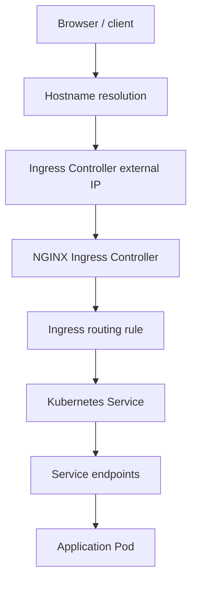
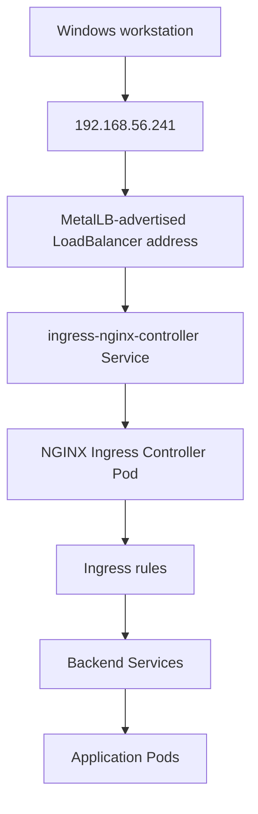
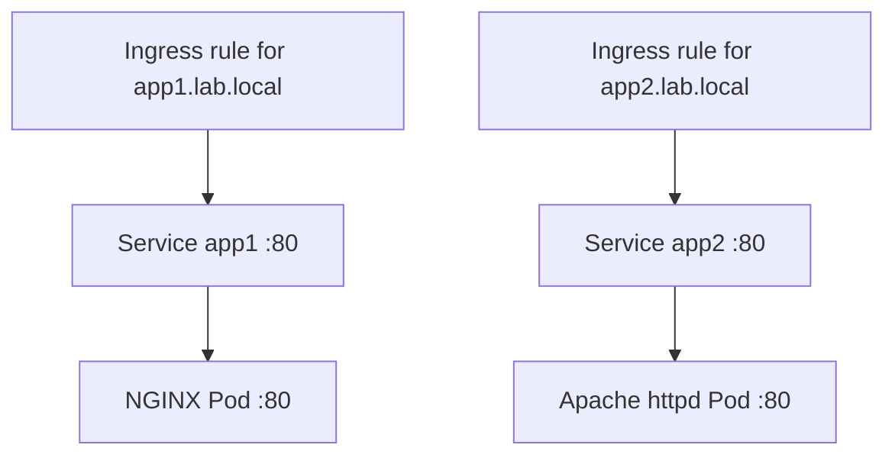
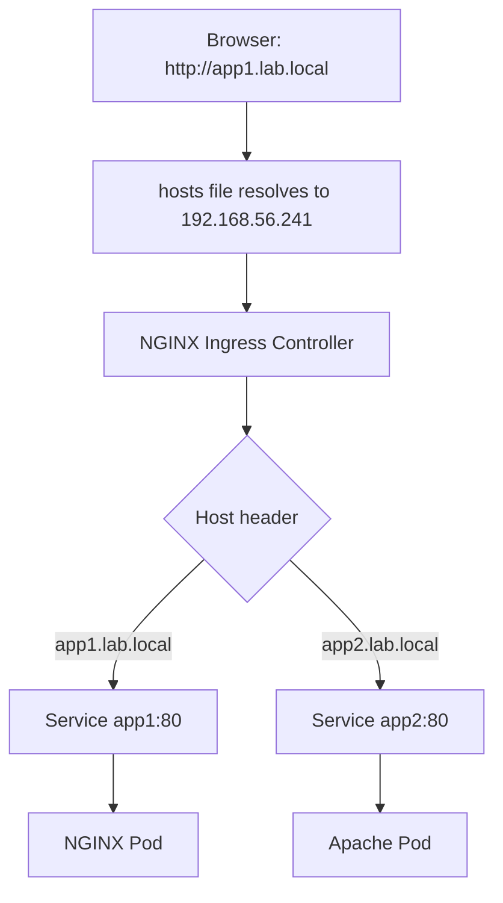
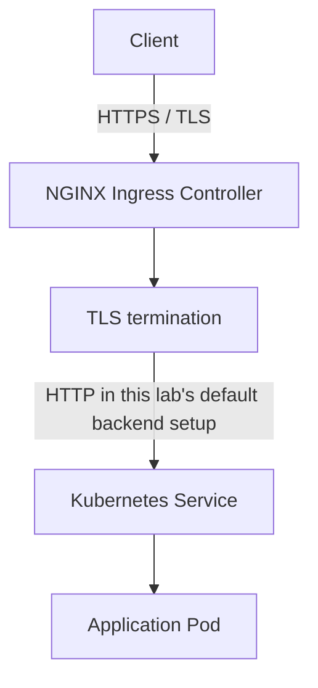

# Chapter 6 — Ingress, Host/Path Routing, and TLS

## Chapter objectives

In this chapter, we expose multiple Kubernetes applications through a shared external entry point. The lab uses the NGINX Ingress Controller and the MetalLB address pool already configured in the cluster.

By the end of the chapter, you should be able to:

- Explain the difference between a Service, an Ingress resource, and an Ingress Controller.
- Install and inspect the NGINX Ingress Controller.
- Explain how MetalLB assigns an external IP to the controller's LoadBalancer Service.
- Route requests to different Services by hostname.
- Route requests to different Services by URL path.
- Diagnose a path-based routing 404 caused by an application receiving a path it does not serve.
- Configure an Ingress TLS Secret and understand where TLS terminates.
- Troubleshoot the client-to-Ingress-to-Service-to-Pod request path.

> **Source fidelity:** This chapter is based on the recorded Vagrant/Kubernetes lab. It distinguishes observed results from recommended improvements. The captured host-routing test succeeded. The source records the path-routing 404 and the rewrite configuration used to address it, but does not include a complete captured post-fix response for both paths. The TLS configuration and browser test are documented; the browser warning was expected because the certificate was self-signed.

---

## 1. Lab environment and baseline

The cluster documented in the earlier chapters is:

| Component | Value |
|---|---|
| Kubernetes version | v1.30.14 |
| Provisioning | Vagrant |
| Hypervisor | VirtualBox 7.1 |
| Host operating system | Windows 11 |
| Guest operating system | Ubuntu 22.04 LTS |
| Container runtime | containerd |
| CNI | Calico v3.28.0 |
| Control-plane node | `k8master1` — `192.168.56.10` |
| Worker node 1 | `k8worker1` — `192.168.56.20` |
| Worker node 2 | `k8worker2` — `192.168.56.21` |
| Host-only network | `192.168.56.0/24` |

The MetalLB address pool configured earlier in the lab is:

```text
192.168.56.240-192.168.56.250
```

The recorded NGINX Ingress Controller external address is:

```text
192.168.56.241
```

These are lab observations, not universal Kubernetes defaults. IP assignments can change if the address pool or Services are recreated. Always inspect the live Service before relying on an address.

### 1.1 Confirm the existing MetalLB and cluster state

Run the following from the control-plane node:

```bash
kubectl get nodes -o wide
kubectl get pods -n metallb-system
kubectl get ipaddresspools -n metallb-system
kubectl get svc -A
```

The lab notes record the MetalLB pool as `192.168.56.240-192.168.56.250`. They also record a separate LoadBalancer Service, `nginx-lb`, receiving `192.168.56.240`, and the Ingress Controller receiving `192.168.56.241`.

**Important:** Do not assume that a particular IP always belongs to a particular Service. Verify the current allocation:

```bash
kubectl get svc -n ingress-nginx
kubectl get svc nginx-lb
```

---

## 2. Why Ingress is needed

A ClusterIP Service provides an internal stable endpoint. A NodePort Service exposes a port on cluster nodes. A LoadBalancer Service requests an external address from an implementation that can provide one.

If every application is exposed using a separate LoadBalancer Service, a platform with many applications can require many external addresses. Ingress provides a shared HTTP/HTTPS entry point and routes requests to internal Services using rules such as:

- Hostname: `app1.lab.local`
- Hostname: `app2.lab.local`
- Path: `lab.local/nginx`
- Path: `lab.local/apache`

The lab uses one external address for the Ingress Controller and multiple backend Services.

### 2.1 Service vs Ingress vs Ingress Controller

| Component | Responsibility |
|---|---|
| Service | Provides a stable virtual endpoint and selects backend Pods. |
| Ingress resource | Stores HTTP/HTTPS routing rules, such as hostnames, paths, and backend Services. |
| Ingress Controller | Watches Ingress resources and implements the routing behavior using a data plane such as NGINX. |
| MetalLB | Provides external IP allocation and advertisement for LoadBalancer Services in this bare-metal-style lab. |

An Ingress resource is configuration. It does not, by itself, run a proxy or accept network traffic. An Ingress Controller must be installed and configured to process the resource.

### 2.2 Request flow



The Ingress Controller is itself a workload running inside Kubernetes. In this lab, its Service is of type `LoadBalancer`; MetalLB allocates an external address to that Service.

---

## 3. Install the NGINX Ingress Controller

The recorded installation command was:

```bash
kubectl apply -f \
  https://raw.githubusercontent.com/kubernetes/ingress-nginx/main/deploy/static/provider/cloud/deploy.yaml
```

This applies the ingress-nginx cloud-provider deployment manifest. In the lab, it created the `ingress-nginx` namespace and the controller resources.

> **Versioning note:** The source lab used the upstream `main` branch URL. That URL is mutable. For a repeatable environment, select a release supported by your Kubernetes version and use that release's documented manifest or pinned artifact. Do not assume the current `main` manifest is identical to the one used during the original lab.

### 3.1 Verify the namespace

```bash
kubectl get namespaces
kubectl get namespace ingress-nginx
```

### 3.2 Verify controller Pods

```bash
kubectl get pods -n ingress-nginx -o wide
```

The recorded output showed a controller Pod in the `Running` state with `1/1` containers ready and zero restarts at the time of observation.

Example shape (the generated Pod name is dynamic):

```text
NAME                                       READY   STATUS    RESTARTS
ingress-nginx-controller-...              1/1     Running   0
```

### 3.3 Verify the controller Service

```bash
kubectl get svc -n ingress-nginx
```

The recorded Service output included:

- Service: `ingress-nginx-controller`
- Type: `LoadBalancer`
- ClusterIP observed: `10.97.46.143`
- External IP observed: `192.168.56.241`
- HTTP: Service port 80, NodePort observed as 30523
- HTTPS: Service port 443, NodePort observed as 30439

The NodePort values and ClusterIP are observations from that particular run. They are allocated values and must not be hard-coded into automation.

Example verification commands:

```bash
kubectl get svc ingress-nginx-controller -n ingress-nginx -o wide
kubectl describe svc ingress-nginx-controller -n ingress-nginx
kubectl get endpoints -n ingress-nginx
```

### 3.4 How MetalLB participates

The request path in this lab is:



MetalLB does not interpret HTTP hostnames or URL paths. It makes the external Service address reachable on the lab network. The Ingress Controller interprets the HTTP request and applies the routing rules.

The source documents the MetalLB pool and the assigned address. It does not establish the exact MetalLB advertisement mode or the full L2/BGP configuration, so this chapter does not infer one.

---

## 4. Create two backend applications

The host-routing exercise used two visibly different web servers:

- `app1`: NGINX
- `app2`: Apache HTTP Server (`httpd`)

Create the first Deployment and Service:

```bash
kubectl create deployment app1 --image=nginx
kubectl expose deployment app1 --port=80
```

Create the second Deployment and Service:

```bash
kubectl create deployment app2 --image=httpd
kubectl expose deployment app2 --port=80
```

The commands create Deployments and expose each Deployment through a Service. Because no Service type is specified, `kubectl expose` creates ClusterIP Services by default.

### 4.1 Verify the application workloads and Services

```bash
kubectl get deployments
kubectl get pods -o wide
kubectl get svc app1 app2
kubectl get endpoints app1 app2
```

Expected resource names:

| Resource | Name | Role |
|---|---|---|
| Deployment | `app1` | Runs the NGINX application |
| Service | `app1` | Stable backend endpoint for NGINX |
| Deployment | `app2` | Runs the Apache application |
| Service | `app2` | Stable backend endpoint for Apache |

The Pod IPs are dynamic. Use `kubectl get pods -o wide` rather than copying Pod addresses from old terminal output.

### 4.2 Understand the backend relationship



The Ingress backend references the Service name and Service port. It does not point directly to a Pod IP.

---

## 5. Host-based routing

Host-based routing sends requests to different backend Services according to the HTTP Host header.

The lab uses these names:

| Hostname | Backend Service | Application |
|---|---|---|
| `app1.lab.local` | `app1:80` | NGINX |
| `app2.lab.local` | `app2:80` | Apache |

Both hostnames resolve to the same Ingress Controller external IP. The controller selects the backend according to the hostname in the request.

### 5.1 Create the host-based Ingress manifest

Create a file named `apps-ingress.yaml`:

```yaml
apiVersion: networking.k8s.io/v1
kind: Ingress
metadata:
  name: apps-ingress
spec:
  ingressClassName: nginx
  rules:
    - host: app1.lab.local
      http:
        paths:
          - path: /
            pathType: Prefix
            backend:
              service:
                name: app1
                port:
                  number: 80
    - host: app2.lab.local
      http:
        paths:
          - path: /
            pathType: Prefix
            backend:
              service:
                name: app2
                port:
                  number: 80
```

Apply the manifest:

```bash
kubectl apply -f apps-ingress.yaml
```

### 5.2 Inspect the Ingress

```bash
kubectl get ingress
kubectl describe ingress apps-ingress
kubectl get ingress apps-ingress -o yaml
```

The captured output showed:

- Ingress name: `apps-ingress`
- Ingress class: `nginx`
- Hosts: `app1.lab.local` and `app2.lab.local`
- Address: `192.168.56.241`
- `app1.lab.local` routed to `app1:80`
- `app2.lab.local` routed to `app2:80`

The captured backend Pod IPs were `192.168.81.13` and `192.168.226.79`. Those addresses are historical Pod IPs from that run, not static configuration values.

### 5.3 Configure the Windows hosts file

The lab used the Windows hosts file to resolve the local test names without configuring a DNS server.

Open Notepad or another editor **as Administrator**, then edit:

```text
C:\Windows\System32\drivers\etc\hosts
```

Add:

```text
192.168.56.241 app1.lab.local
192.168.56.241 app2.lab.local
```

Save the file. Do not add URL schemes such as `http://` to the hosts file; it contains hostname-to-address mappings only.

You can verify name resolution from Windows:

```powershell
ping app1.lab.local
ping app2.lab.local
```

A ping response is not required for HTTP routing to work because ICMP handling and HTTP connectivity are separate. The important check is that the names resolve to the expected address.

### 5.4 Test the host routes

Open these URLs from the Windows workstation:

- `http://app1.lab.local` — expected NGINX Welcome page.
- `http://app2.lab.local` — expected Apache It Works page.

The source conversation explicitly records that both host-based URLs worked successfully.

### 5.5 Host-based routing request flow



The key point is that both hostnames use one external address. The HTTP Host header distinguishes the intended application.

---

## 6. Path-based routing

Host-based routing uses different hostnames. Path-based routing uses one hostname and sends different URL paths to different Services.

The lab's intended URLs are:

| URL | Backend Service |
|---|---|
| `http://lab.local/nginx` | `app1:80` |
| `http://lab.local/apache` | `app2:80` |

### 6.1 Add the hostname to the Windows hosts file

Add this line to the same Windows hosts file:

```text
192.168.56.241 lab.local
```

### 6.2 Create the path-based Ingress

Create `path-ingress.yaml`:

```yaml
apiVersion: networking.k8s.io/v1
kind: Ingress
metadata:
  name: path-ingress
spec:
  ingressClassName: nginx
  rules:
    - host: lab.local
      http:
        paths:
          - path: /nginx
            pathType: Prefix
            backend:
              service:
                name: app1
                port:
                  number: 80
          - path: /apache
            pathType: Prefix
            backend:
              service:
                name: app2
                port:
                  number: 80
```

Apply and inspect it:

```bash
kubectl apply -f path-ingress.yaml
kubectl get ingress
kubectl describe ingress path-ingress
```

### 6.3 Understand the initial 404

The lab encountered a `404 Not Found` response when opening:

```text
http://lab.local/nginx
```

The response page identified the NGINX Ingress Controller (the screenshot showed `nginx/1.31.1`), rather than the application NGINX Pod. This was useful evidence:

- The browser reached the Ingress Controller.
- The hosts-file mapping was working.
- The request reached the controller.
- The path was not being served successfully by the backend.

The underlying issue was the URI passed to the backend:

1. The browser requested `/nginx`.
2. The Ingress rule selected Service `app1`.
3. Without a rewrite, the backend received the path `/nginx`.
4. The default NGINX container serves its welcome page at `/` and does not provide a `/nginx` resource.
5. The backend therefore returned a 404.

The same consideration applies to the Apache backend and `/apache`.

### 6.4 Apply the rewrite annotation

The source conversation introduced this NGINX Ingress annotation:

```yaml
nginx.ingress.kubernetes.io/rewrite-target: /
```

The complete revised manifest is:

```yaml
apiVersion: networking.k8s.io/v1
kind: Ingress
metadata:
  name: path-ingress
  annotations:
    nginx.ingress.kubernetes.io/rewrite-target: /
spec:
  ingressClassName: nginx
  rules:
    - host: lab.local
      http:
        paths:
          - path: /nginx
            pathType: Prefix
            backend:
              service:
                name: app1
                port:
                  number: 80
          - path: /apache
            pathType: Prefix
            backend:
              service:
                name: app2
                port:
                  number: 80
```

Apply the updated resource:

```bash
kubectl apply -f path-ingress.yaml
kubectl describe ingress path-ingress
```

With this configuration, the controller rewrites the matched request URI to `/` before forwarding it to the selected backend. The default NGINX and Apache welcome pages can then serve the root path.

> **Important behavior:** This simple rewrite is appropriate for the lab's default welcome pages. It rewrites the backend request path to `/`; it is not a general-purpose solution for applications that need to preserve subpaths or serve nested assets. Production applications often need a carefully designed rewrite rule or native application base-path configuration. The exact regex/capture-group rewrite patterns are controller-specific and should be tested against the installed controller version.

### 6.5 Validate the path routes

Test:

- `http://lab.local/nginx`
- `http://lab.local/apache`

Inspect the Ingress and controller logs if a route still fails:

```bash
kubectl get ingress path-ingress -o yaml
kubectl describe ingress path-ingress
kubectl logs -n ingress-nginx deployment/ingress-nginx-controller --tail=100
```

The original lab notes document the initial 404 and the rewrite-target correction. They do not include a full post-correction command output for both URLs; treat the two URLs above as the validation steps to perform in a current run, not as a separately captured success result.

### 6.6 Isolate the backend from Ingress

The source conversation also suggested a direct Service test using port-forwarding:

```bash
kubectl port-forward svc/app1 8080:80
```

Then, from the workstation, open:

```text
http://localhost:8080/
http://localhost:8080/nginx
```

The expected behavior for the default NGINX container is that `/` serves the welcome page while `/nginx` returns 404. This isolates the application behavior from the Ingress routing layer.

Stop the port-forward process with `Ctrl+C` when the test is complete.

### 6.7 Host-based vs path-based routing

| Feature | Host-based | Path-based |
|---|---|---|
| Routing key | HTTP Host header | URL path |
| Example | `app1.lab.local` | `lab.local/nginx` |
| DNS/hosts entries | One hostname per app | Shared hostname |
| Typical use | Separate application subdomains | Multiple apps under one domain |
| Main concern | Correct host rule and name resolution | Correct path matching and backend URI behavior |

---

## 7. TLS / HTTPS with a Kubernetes Secret

HTTP traffic is not encrypted. TLS allows the client to establish an encrypted HTTPS connection to the Ingress Controller.

In the lab, the TLS certificate was self-signed and created for `app1.lab.local`. The certificate and private key were stored in a Kubernetes Secret of type `kubernetes.io/tls`.

### 7.1 Generate the self-signed certificate used in the source lab

On `k8master1`, the recorded command was:

```bash
openssl req -x509 \
  -nodes \
  -days 365 \
  -newkey rsa:2048 \
  -keyout tls.key \
  -out tls.crt \
  -subj "/CN=app1.lab.local"
```

This command creates:

- `tls.key` — private key.
- `tls.crt` — self-signed certificate.
- A 2048-bit RSA key.
- A certificate valid for 365 days.
- A subject common name of `app1.lab.local`.

The `-nodes` option creates an unencrypted private key file. Protect that file carefully.

### 7.2 Modern certificate note: Subject Alternative Name

The source command records a Common Name (CN), but modern browsers and TLS clients validate the Subject Alternative Name (SAN) extension for hostname matching. A certificate containing only the CN can therefore trigger a hostname validation error even when the CN looks correct.

For a new lab run, a self-signed certificate with a SAN can be generated with OpenSSL as follows (recommended supplementary command; this is not the exact command captured in the original conversation):

```bash
openssl req -x509 \
  -nodes \
  -days 365 \
  -newkey rsa:2048 \
  -keyout tls.key \
  -out tls.crt \
  -subj "/CN=app1.lab.local" \
  -addext "subjectAltName=DNS:app1.lab.local"
```

Inspect the resulting certificate:

```bash
openssl x509 -in tls.crt -noout -subject -issuer -dates -ext subjectAltName
```

A self-signed certificate is suitable for a controlled lab, not a public production website. A browser warning is expected unless the certificate is explicitly trusted by the client. Trusting a self-signed certificate and validating its hostname are separate concerns.

### 7.3 Create the Kubernetes TLS Secret

Run this command from the directory containing `tls.crt` and `tls.key`:

```bash
kubectl create secret tls app1-tls \
  --cert=tls.crt \
  --key=tls.key
```

Verify the Secret:

```bash
kubectl get secrets
kubectl describe secret app1-tls
```

The Secret should have type:

```text
kubernetes.io/tls
```

Kubernetes stores the certificate and private key in the Secret's `tls.crt` and `tls.key` data keys. Do not print or commit the private key. A Secret is an API object, not a substitute for access control or encryption-at-rest configuration.

**Namespace requirement:** An Ingress can reference a TLS Secret only in the same namespace as the Ingress. In this lab, both were created in the `default` namespace because no namespace was specified. If you move the Ingress to another namespace, create or provision the corresponding TLS Secret in that namespace too.

### 7.4 Add TLS configuration to the Ingress

Update `apps-ingress.yaml` to include the `tls` section under `spec`:

```yaml
apiVersion: networking.k8s.io/v1
kind: Ingress
metadata:
  name: apps-ingress
spec:
  ingressClassName: nginx
  tls:
    - hosts:
        - app1.lab.local
      secretName: app1-tls
  rules:
    - host: app1.lab.local
      http:
        paths:
          - path: /
            pathType: Prefix
            backend:
              service:
                name: app1
                port:
                  number: 80
    - host: app2.lab.local
      http:
        paths:
          - path: /
            pathType: Prefix
            backend:
              service:
                name: app2
                port:
                  number: 80
```

Apply and inspect:

```bash
kubectl apply -f apps-ingress.yaml
kubectl describe ingress apps-ingress
kubectl get ingress apps-ingress -o yaml
kubectl get secret app1-tls
```

The source configuration enabled TLS for `app1.lab.local`. It did not configure a TLS Secret for `app2.lab.local`; do not assume that the second host is covered by this certificate.

### 7.5 Test HTTPS

Open:

```text
https://app1.lab.local
```

The source lab expected a browser certificate warning because the certificate was self-signed. For a modern browser, also check whether the certificate includes the SAN matching `app1.lab.local`.

You can inspect the certificate presented by the endpoint from a Linux shell:

```bash
openssl s_client \
  -connect 192.168.56.241:443 \
  -servername app1.lab.local \
  -showcerts
```

This command helps inspect the certificate and TLS handshake. It does not, by itself, make a self-signed certificate trusted.

### 7.6 TLS termination flow

The lab's intended traffic flow is:



The TLS certificate is presented at the Ingress Controller. The controller terminates the client TLS connection and proxies the request to the backend Service. The lab's basic configuration does not enable end-to-end TLS from the Ingress Controller to the application Pod.

For sensitive production workloads, decide explicitly whether backend traffic may use HTTP inside the cluster or whether re-encryption/mTLS is required. That is a separate design decision from enabling client-side HTTPS.

---

## 8. Troubleshooting guide

Use a layered approach. Confirm each hop before changing configuration.

### 8.1 Ingress Controller Pod is not Running

```bash
kubectl get pods -n ingress-nginx -o wide
kubectl describe pod -n ingress-nginx <controller-pod-name>
kubectl logs -n ingress-nginx deployment/ingress-nginx-controller --tail=200
kubectl get events -n ingress-nginx --sort-by=.lastTimestamp
```

Check image-pull failures, scheduling events, readiness probes, and controller logs.

### 8.2 External IP is pending

```bash
kubectl get svc -n ingress-nginx
kubectl get pods -n metallb-system
kubectl get ipaddresspools -n metallb-system -o yaml
kubectl get l2advertisements -n metallb-system -o yaml
kubectl get events -A --sort-by=.lastTimestamp
```

Check that MetalLB is healthy, an address pool exists, and the pool has an available address. The exact advertisement object and mode must be verified from the live cluster; the original lab record does not provide enough detail to assert its configuration.

### 8.3 Hostname does not resolve

On Windows:

```powershell
ping app1.lab.local
ping app2.lab.local
ping lab.local
ipconfig /displaydns
```

Verify that the hosts file contains the expected mappings and that it was saved with administrative permissions. Check for duplicate or conflicting entries. Flush the Windows DNS cache if necessary:

```powershell
ipconfig /flushdns
```

Remember: ICMP ping may fail even when HTTP is reachable. Use a browser or an HTTP client for the actual application test.

### 8.4 Ingress address is correct but the browser returns 404

```bash
kubectl get ingress
kubectl describe ingress <ingress-name>
kubectl get ingress <ingress-name> -o yaml
kubectl get svc
kubectl get endpoints
kubectl logs -n ingress-nginx deployment/ingress-nginx-controller --tail=100
```

Check:

1. Does the request hostname match the Ingress `host` field?
2. Does the path match the configured path rule?
3. Is the Ingress class correct?
4. Does the backend Service name exist in the same namespace?
5. Does the backend Service expose the port referenced by the Ingress?
6. Does the Service have ready endpoints?
7. Does the application actually serve the URI forwarded by the controller?

A 404 generated by the Ingress Controller is different from a 404 returned by the backend application. Inspect the response body, headers, and controller logs to identify which layer generated it.

### 8.5 Ingress returns 503 or 502

Check the Service and endpoints first:

```bash
kubectl get svc <service-name> -o yaml
kubectl get endpoints <service-name>
kubectl get endpointslices
kubectl get pods -o wide
kubectl describe pods
```

A Service with no ready endpoints cannot forward traffic to an application Pod. Also verify the Service port and targetPort against the container's listening port.

### 8.6 HTTPS certificate warning

Inspect the Secret and Ingress:

```bash
kubectl describe secret app1-tls
kubectl describe ingress apps-ingress
kubectl get ingress apps-ingress -o yaml
```

Inspect the certificate file:

```bash
openssl x509 -in tls.crt -noout -subject -issuer -dates -ext subjectAltName
```

Check:

- The Secret is type `kubernetes.io/tls`.
- The Secret name matches `secretName`.
- The Secret is in the same namespace as the Ingress.
- The hostname is listed in the Ingress TLS hosts and the certificate SAN.
- The certificate has not expired.
- The client trusts the issuing certificate authority.

A self-signed certificate is not trusted by default. A trust warning is expected unless you explicitly install the certificate or its CA into the client trust store.

### 8.7 Useful controller and cluster inspection commands

```bash
kubectl get ingress -A
kubectl get ingressclass
kubectl get pods -n ingress-nginx -o wide
kubectl get svc -n ingress-nginx -o wide
kubectl get events -A --sort-by=.lastTimestamp
kubectl logs -n ingress-nginx deployment/ingress-nginx-controller --since=15m
```

---

## 9. Lab checklist

Use this checklist when repeating the exercises on the current cluster.

### Lab 6.1 — Inspect the Ingress Controller

- [ ] Confirm the `ingress-nginx` namespace exists.
- [ ] Confirm the controller Pod is Ready.
- [ ] Confirm the controller Service is type `LoadBalancer`.
- [ ] Record the currently assigned external IP.
- [ ] Confirm the MetalLB pool has an available address.

### Lab 6.2 — Host-based routing

- [ ] Create the `app1` NGINX Deployment and Service.
- [ ] Create the `app2` Apache Deployment and Service.
- [ ] Apply `apps-ingress.yaml`.
- [ ] Add the two hostnames to the Windows hosts file.
- [ ] Verify `http://app1.lab.local`.
- [ ] Verify `http://app2.lab.local`.
- [ ] Inspect the Ingress backend Services and endpoints.

**Source status:** The original conversation records both host-based URLs working successfully.

### Lab 6.3 — Path-based routing

- [ ] Add `lab.local` to the Windows hosts file.
- [ ] Apply `path-ingress.yaml` with `/nginx` and `/apache` paths.
- [ ] Observe the initial URI behavior.
- [ ] Add the `nginx.ingress.kubernetes.io/rewrite-target: /` annotation.
- [ ] Reapply the manifest.
- [ ] Verify both path URLs.
- [ ] Use port-forwarding to compare direct backend behavior.

**Source status:** The original conversation records the initial 404 and the rewrite-target explanation/configuration. It does not provide a captured post-fix result for both URLs.

### Lab 6.4 — TLS

- [ ] Generate the self-signed certificate and private key.
- [ ] Inspect the certificate subject, validity, and SAN.
- [ ] Create the `app1-tls` Secret.
- [ ] Add the TLS host and Secret reference to the Ingress.
- [ ] Apply the updated manifest.
- [ ] Verify `https://app1.lab.local`.
- [ ] Inspect the certificate warning and determine whether it is due to trust, hostname, or validity.

**Source status:** The source records creation of the self-signed certificate and Secret, the Ingress TLS reference, and the expected browser warning. The SAN-enhanced command in this chapter is a recommended modern improvement.

---

## 10. Review questions

1. What is the difference between a Kubernetes Service and an Ingress?
2. Why does an Ingress resource require an Ingress Controller?
3. What role does MetalLB play in this lab?
4. Why did the Ingress Controller Service receive an external IP?
5. How can two hostnames share the same external IP?
6. What is the difference between host-based and path-based routing?
7. Why did `lab.local/nginx` initially return 404?
8. What does `nginx.ingress.kubernetes.io/rewrite-target: /` change?
9. Why should an Ingress backend reference a Service instead of a Pod IP?
10. Which Kubernetes object stores the TLS certificate and private key?
11. Why must the TLS Secret be in the same namespace as the Ingress?
12. Where does TLS terminate in the lab's basic Ingress configuration?
13. Why can a self-signed certificate trigger a browser warning?
14. Why should a modern certificate include a Subject Alternative Name?
15. How would you troubleshoot an Ingress that has an external IP but returns 503?

---

## 11. Key takeaways

- A Service provides stable access to application Pods; an Ingress resource defines HTTP/HTTPS routing rules.
- An Ingress Controller implements those rules. The lab uses the NGINX Ingress Controller.
- MetalLB provides the external IP for the controller's LoadBalancer Service in this local virtualized environment.
- The recorded controller external IP was `192.168.56.241`, allocated from the configured pool `192.168.56.240-192.168.56.250`.
- Host-based routing sent `app1.lab.local` to NGINX and `app2.lab.local` to Apache through the same external address.
- Path-based routing introduced a real URI mismatch. The rewrite annotation was used to map the incoming path to the root path expected by the default applications.
- A Kubernetes TLS Secret stores the certificate and private key used by the Ingress Controller.
- A self-signed certificate is appropriate for a lab, but production environments should use a trusted certificate lifecycle and secure key management.
- Troubleshooting should follow the complete request path: client resolution → external IP → controller → Ingress rule → Service → endpoints → Pod.

## 12. References

### Upstream documentation

- Kubernetes Ingress: https://kubernetes.io/docs/concepts/services-networking/ingress/
- Kubernetes Ingress controllers: https://kubernetes.io/docs/concepts/services-networking/ingress-controllers/
- Kubernetes TLS Secrets: https://kubernetes.io/docs/concepts/configuration/secret/#tls-secrets
- ingress-nginx documentation: https://kubernetes.github.io/ingress-nginx/
- ingress-nginx rewrite examples: https://kubernetes.github.io/ingress-nginx/examples/rewrite/
- MetalLB documentation: https://metallb.universe.tf/

> Upstream documentation is supplementary context. The recorded IP addresses, object names, commands, and observed lab behavior above come from the source lab unless explicitly labelled as a recommended improvement.
