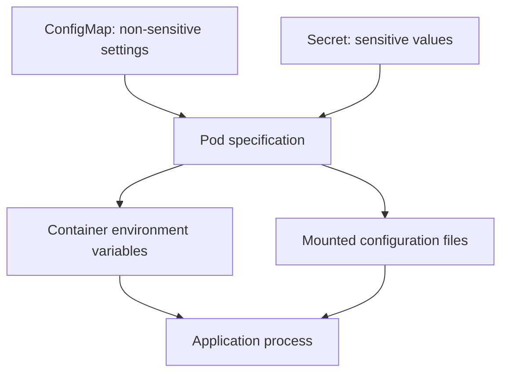

# Chapter 7 — Kubernetes Configuration and Secrets

## Chapter objectives

Applications need configuration that can change independently of their container image. Kubernetes provides ConfigMaps for non-sensitive configuration and Secrets for sensitive values such as passwords, tokens, and certificates.

This chapter documents the configuration work from the original Kubernetes fundamentals exercises and connects it to the later Flask and multi-tier Helm labs.

By the end of this chapter, you should be able to:

- Explain why configuration should be separated from a container image.
- Create, inspect, update, and delete ConfigMaps.
- Create and inspect generic Secrets and TLS Secrets.
- Understand the difference between a ConfigMap and a Secret.
- Inject individual keys or complete sets of values into containers as environment variables.
- Mount ConfigMaps and Secrets as files.
- Troubleshoot missing keys, wrong namespaces, and configuration changes that are not visible to an existing process.
- Understand how ConfigMaps and Secrets appeared in the later Flask Helm chart and PostgreSQL multi-tier chart.

> **Evidence labels used in this chapter**
>
> - **Recorded lab step:** a command, manifest, or observation found in the practice-session record.
> - **Recorded validation:** an output or result explicitly captured in the source conversation.
> - **Supplementary exercise:** a useful Kubernetes operation included to make the chapter complete, but not claimed as something you already executed.
> - **Recommended practice:** security or operational guidance added for a safer and more repeatable lab.

---

## 1. Why application configuration matters

Consider a container image that runs a Flask application. The same image might be deployed in development, testing, and production. The application code should not need to be rebuilt just because the environment name, log level, or database endpoint changes.

A common pattern is to keep:

- Application code and dependencies in the container image.
- Non-sensitive runtime configuration in a ConfigMap.
- Sensitive runtime values in a Secret.
- The mapping from Kubernetes objects to container environment variables or files in the Pod specification.

For example:

| Setting | Typical source | Example |
|---|---|---|
| Application environment | ConfigMap | `APP_ENV=production` |
| Log level | ConfigMap | `LOG_LEVEL=INFO` |
| Feature flag | ConfigMap | `FEATURE_X_ENABLED=true` |
| Database hostname | ConfigMap | `DB_HOST=postgres` |
| Database username | Depends on policy; often Secret | `POSTGRES_USER` |
| Database password | Secret | `POSTGRES_PASSWORD` |
| TLS private key | Secret | `tls.key` |

The rule is simple: a ConfigMap is for configuration that is not confidential; a Secret is for sensitive data. Putting a password in a ConfigMap does not make it safe.

### 1.1 Configuration flow



ConfigMaps and Secrets are Kubernetes API objects. A Deployment or Pod references them; the kubelet makes the selected values available to the container.

---

## 2. ConfigMaps

A ConfigMap stores non-confidential key/value data. It can be consumed by a Pod as environment variables, command-line arguments, or mounted files.

ConfigMaps are namespaced resources. A Pod can only reference a ConfigMap in its own namespace.

### 2.1 Create the ConfigMap from a literal value

The original fundamentals exercise created a ConfigMap named `app-config` with one key:

```bash
kubectl create configmap app-config \
  --from-literal=ENV=DEV
```

Because the command did not specify `-n`, Kubernetes created the object in the current namespace. In the original exercise, that meant the `default` namespace.

Inspect it:

```bash
kubectl get configmaps
kubectl describe configmap app-config
kubectl get configmap app-config -o yaml
```

The important data entry is:

```yaml
data:
  ENV: DEV
```

The source conversation records the create and inspect commands, but does not include a captured terminal output for the ConfigMap. The YAML above shows the expected object data, not a copied terminal transcript.

### 2.2 Create a ConfigMap with multiple keys

**Supplementary exercise:** create a ConfigMap containing multiple application settings:

```bash
kubectl create configmap web-config \
  --from-literal=APP_ENV=development \
  --from-literal=LOG_LEVEL=debug \
  --from-literal=APP_PORT=5000
```

Inspect the keys:

```bash
kubectl get configmap web-config -o yaml
kubectl describe configmap web-config
```

### 2.3 Create a ConfigMap declaratively using YAML

Create `app-config.yaml`:

```yaml
apiVersion: v1
kind: ConfigMap
metadata:
  name: app-config
  namespace: default
data:
  ENV: "DEV"
  LOG_LEVEL: "INFO"
  APP_PORT: "5000"
  application.properties: |
    app.environment=development
    app.logging.level=INFO
    app.feature.reporting=true
```

Apply and inspect:

```bash
kubectl apply -f app-config.yaml
kubectl get configmap app-config -o yaml
kubectl describe configmap app-config
```

Notes:

- ConfigMap values are strings. Quote values where that makes the intended type clear.
- The `|` YAML block scalar preserves a multi-line file-like value.
- A ConfigMap is not a general-purpose file system. It is intended for configuration data and has a size limit (1 MiB per ConfigMap object).

### 2.4 Create a ConfigMap from a file

**Supplementary exercise:** create a local configuration file:

```bash
cat > application.properties <<'EOF'
app.environment=development
app.logging.level=INFO
app.feature.reporting=true
EOF
```

Create a ConfigMap from that file:

```bash
kubectl create configmap file-config \
  --from-file=application.properties
```

Inspect:

```bash
kubectl get configmap file-config -o yaml
```

The file name becomes the key by default. The file contents become the value.

You can also choose a key explicitly:

```bash
kubectl create configmap file-config \
  --from-file=app.properties=application.properties
```

### 2.5 Update a ConfigMap

A declarative ConfigMap can be changed in its YAML file and reapplied:

```bash
kubectl apply -f app-config.yaml
```

For a quick imperative update, use:

```bash
kubectl create configmap app-config \
  --from-literal=ENV=TEST \
  --dry-run=client -o yaml | kubectl apply -f -
```

Then inspect the new value:

```bash
kubectl get configmap app-config -o yaml
```

This command replaces the object data with the data generated by that command. If the ConfigMap contains other keys, include them too or use a declarative manifest that preserves the complete intended configuration.

### 2.6 Delete a ConfigMap

```bash
kubectl delete configmap app-config
```

Or delete a declaratively managed object:

```bash
kubectl delete -f app-config.yaml
```

Do not delete a ConfigMap while a workload still requires it unless you are deliberately testing the failure behavior.

---

## 3. Secrets

A Secret stores sensitive values such as passwords, tokens, and private keys. Kubernetes provides different Secret types for different purposes. This chapter focuses on generic Opaque Secrets and the TLS Secret already introduced in Chapter 6.

A Secret is also namespaced. The Pod and the referenced Secret must be in the same namespace.

### 3.1 Create a generic Secret from a literal

The original fundamentals exercise created a Secret named `db-secret`:

```bash
kubectl create secret generic db-secret \
  --from-literal=password='<replace-with-a-lab-password>'
```

The exported practice notes show two different example strings in separate snapshots (`MyPassword123` and `SuperSecret123`). They are example values, not evidence that either value was used as a real database credential. Use a unique disposable lab value when repeating the exercise, and never reuse a real password.

Inspect the Secret metadata:

```bash
kubectl get secrets
kubectl describe secret db-secret
kubectl get secret db-secret -o yaml
```

The Secret should have type `Opaque`. Kubernetes does not normally show the decoded value in `kubectl describe`; the data field in YAML output is Base64-encoded.

> **Security warning:** Base64 is an encoding, not encryption. Anyone who can read the Secret data can decode it. Do not commit real credentials, private keys, or decoded Secret values to Git.

### 3.2 Understand the Secret data representation

A Secret manifest can use `data` or `stringData`.

With `data`, values must be Base64-encoded:

```yaml
apiVersion: v1
kind: Secret
metadata:
  name: db-secret
  namespace: default
type: Opaque
data:
  password: <base64-encoded-value>
```

With `stringData`, you can provide plain text in the manifest and the API server converts it into the Secret's stored data representation:

```yaml
apiVersion: v1
kind: Secret
metadata:
  name: db-secret
  namespace: default
type: Opaque
stringData:
  password: "<replace-with-a-lab-password>"
```

Apply:

```bash
kubectl apply -f db-secret.yaml
kubectl describe secret db-secret
```

**Recommended practice:** avoid keeping real plaintext credentials in a Git-tracked YAML file, even when using `stringData`. The field is convenient for demonstrations, not a secure source-control workflow.

### 3.3 Decode a Secret value for a controlled lab check

The original study notes included this command:

```bash
kubectl get secret db-secret \
  -o jsonpath='{.data.password}' \
  | base64 -d
```

It retrieves the Base64-encoded value and decodes it. This demonstrates that Base64 does not protect the underlying password.

Use this only with a disposable test value in a controlled terminal. Avoid printing production credentials into terminal logs, shell history, screenshots, chat messages, or CI logs.

You can inspect only whether a key exists without displaying its value:

```bash
kubectl get secret db-secret \
  -o jsonpath='{.data.password}' | wc -c
```

### 3.4 Create a Secret from a file

**Supplementary exercise:** create a local file containing a disposable test token:

```bash
printf '%s' 'replace-with-a-disposable-lab-token' > token.txt
kubectl create secret generic api-token \
  --from-file=token=token.txt
```

Verify the Secret without printing its value:

```bash
kubectl describe secret api-token
```

Remove the local test file after the exercise:

```bash
rm -f token.txt
```

### 3.5 Delete a Secret

```bash
kubectl delete secret db-secret
```

Or:

```bash
kubectl delete -f db-secret.yaml
```

Deleting a Secret can break workloads that depend on it. Confirm references before deleting it.

---

## 4. ConfigMap vs Secret

| Property | ConfigMap | Secret |
|---|---|---|
| Intended content | Non-sensitive configuration | Sensitive values |
| Typical examples | Environment, log level, feature flags | Passwords, tokens, private keys |
| API object | `ConfigMap` | `Secret` |
| Default Secret type | Not applicable | Often `Opaque` for generic data |
| Environment injection | Supported | Supported |
| Volume mounts | Supported | Supported |
| Namespace scoped | Yes | Yes |
| Base64 representation | Not required for normal ConfigMap data | `data` values are Base64-encoded |
| Encryption by default | Not applicable as a confidentiality mechanism | Do not assume encryption at rest is enabled |

The presence of a Secret object does not automatically make a cluster secure. Access must be controlled using RBAC, and encryption at rest should be configured for the Kubernetes datastore where required.

---

## 5. Inject ConfigMap values into a container

Creating a ConfigMap is only the first step. A workload must reference it to make the configuration available to an application.

Kubernetes supports several consumption patterns:

1. A single ConfigMap key as one environment variable.
2. All keys from a ConfigMap as environment variables.
3. ConfigMap keys mounted as files in a container.

### 5.1 Inject one ConfigMap key using `configMapKeyRef`

This is the exact pattern later used in the Flask Helm chart.

ConfigMap:

```yaml
apiVersion: v1
kind: ConfigMap
metadata:
  name: flask-config
data:
  APP_ENV: production
```

Deployment fragment:

```yaml
apiVersion: apps/v1
kind: Deployment
metadata:
  name: flask
spec:
  replicas: 2
  selector:
    matchLabels:
      app: flask
  template:
    metadata:
      labels:
        app: flask
    spec:
      containers:
        - name: flask-app
          image: mearvi/flask-lab:<image-tag>
          ports:
            - containerPort: 5000
          env:
            - name: APP_ENV
              valueFrom:
                configMapKeyRef:
                  name: flask-config
                  key: APP_ENV
```

The important mapping is:

- Container environment variable: `APP_ENV`
- ConfigMap: `flask-config`
- ConfigMap key: `APP_ENV`

The name of the environment variable does not have to be identical to the ConfigMap key, although using the same name makes the mapping easier to read.

### 5.2 Inject all keys with `envFrom`

**Supplementary exercise:** if the ConfigMap contains several environment-style keys, use `envFrom`:

```yaml
spec:
  containers:
    - name: app
      image: nginx
      envFrom:
        - configMapRef:
            name: web-config
```

All valid ConfigMap keys are exposed as environment variables in the container. Use this only when the key names are suitable environment variable names and the application is intended to receive all of them.

### 5.3 Verify environment variables inside a Pod

The later Flask chart notes specify this verification:

```bash
kubectl get pods -n helm-flask
kubectl exec -it <pod-name> -n helm-flask -- env | grep APP_ENV
```

Expected value for the chart example:

```text
APP_ENV=production
```

The source records this as the expected verification step. It includes the successful Helm render and lint output, but does not provide the terminal output of this particular `kubectl exec` command.

If the container image does not contain `grep` or a shell, use a suitable debug image or inspect the process environment using an application-supported diagnostic method. Do not add debugging tools to a production image solely for convenience.

---

## 6. Inject Secret values into a container

Use `secretKeyRef` to expose one Secret key as an environment variable.

Secret:

```yaml
apiVersion: v1
kind: Secret
metadata:
  name: postgres-secret
type: Opaque
stringData:
  POSTGRES_USER: appuser
  POSTGRES_PASSWORD: "<replace-with-a-lab-password>"
  POSTGRES_DB: appdb
```

Deployment fragment:

```yaml
spec:
  containers:
    - name: postgres
      image: postgres:16
      env:
        - name: POSTGRES_USER
          valueFrom:
            secretKeyRef:
              name: postgres-secret
              key: POSTGRES_USER
        - name: POSTGRES_PASSWORD
          valueFrom:
            secretKeyRef:
              name: postgres-secret
              key: POSTGRES_PASSWORD
        - name: POSTGRES_DB
          valueFrom:
            secretKeyRef:
              name: postgres-secret
              key: POSTGRES_DB
```

The source multi-tier Helm rendering showed this exact structure for the PostgreSQL StatefulSet, using the Secret name `postgres-secret` and keys `POSTGRES_USER`, `POSTGRES_PASSWORD`, and `POSTGRES_DB`.

The original rendered example contained the demonstration values `appuser`, `apppassword`, and `appdb`. They are sample chart values, not production credentials. This chapter replaces the password with a placeholder.

### 6.1 Verify a Secret reference without printing the password

Inspect the Pod specification and Secret metadata:

```bash
kubectl describe pod <pod-name> -n <namespace>
kubectl describe secret postgres-secret -n <namespace>
```

The Pod description can show environment variable references and whether they were resolved, but avoid commands that print the actual password.

---

## 7. Mount ConfigMaps and Secrets as files

Some applications read configuration from files rather than environment variables. Kubernetes can mount ConfigMap or Secret data as files inside the container.

### 7.1 Mount a ConfigMap as a directory

**Supplementary exercise:**

```yaml
apiVersion: v1
kind: Pod
metadata:
  name: config-file-demo
spec:
  containers:
    - name: nginx
      image: nginx
      volumeMounts:
        - name: app-config-volume
          mountPath: /etc/app-config
          readOnly: true
  volumes:
    - name: app-config-volume
      configMap:
        name: file-config
```

If the ConfigMap contains a key named `application.properties`, the container sees a file at:

```text
/etc/app-config/application.properties
```

Create and inspect:

```bash
kubectl apply -f config-file-demo.yaml
kubectl exec config-file-demo -- ls -l /etc/app-config
kubectl exec config-file-demo -- cat /etc/app-config/application.properties
```

### 7.2 Mount a Secret as a directory

**Supplementary exercise:** the same pattern works for a Secret:

```yaml
apiVersion: v1
kind: Pod
metadata:
  name: secret-file-demo
spec:
  containers:
    - name: nginx
      image: nginx
      volumeMounts:
        - name: secret-volume
          mountPath: /etc/app-secrets
          readOnly: true
  volumes:
    - name: secret-volume
      secret:
        secretName: api-token
```

The Secret keys appear as files in the mounted directory. Keep the mount read-only and restrict access to the Pod and container.

### 7.3 Environment variables vs mounted files

| Consumption method | How the application receives data | Update behavior |
|---|---|---|
| Individual environment variable | `configMapKeyRef` or `secretKeyRef` | Existing process environment does not change when the object is updated |
| `envFrom` | All keys become environment variables | Existing process environment does not change when the object is updated |
| ConfigMap volume | Keys appear as files | Kubelet updates projected files eventually, subject to the volume update mechanism |
| Secret volume | Keys appear as files | Kubelet updates projected files eventually, subject to the volume update mechanism |

A containerized application may need to reload a changed file before the new value takes effect. A `subPath` volume mount does not receive automatic projected-volume updates. These are Kubernetes behavior notes, not actions recorded as completed in the original lab.

### 7.4 Restart a Deployment after an environment-based configuration change

**Recommended operational approach:** when a ConfigMap or Secret is consumed as environment variables, recreate the Pods so that the new values are injected:

```bash
kubectl rollout restart deployment/<deployment-name> -n <namespace>
kubectl rollout status deployment/<deployment-name> -n <namespace>
```

This is a generic command pattern. Replace the placeholders with the actual Deployment and namespace.

For file-mounted configuration, a restart may not be necessary for Kubernetes to update the projected files, but the application may still need a reload or restart to consume the new contents.

---

## 8. Namespace scope and reference troubleshooting

The early fundamentals exercise created the ConfigMap and Secret without specifying a namespace, so both were created in `default`.

The later Helm Flask example used a separate namespace, `helm-flask`, and a ConfigMap named `flask-config`.

These objects are not interchangeable across namespaces. A Pod in `helm-flask` cannot directly reference a ConfigMap or Secret in `default`.

Useful inspection commands:

```bash
kubectl get configmaps -A
kubectl get secrets -A
kubectl get pods -A
kubectl get deployment -A
```

For the Flask Helm example:

```bash
kubectl get configmap flask-config -n helm-flask
kubectl get deployment flask -n helm-flask
kubectl get pods -n helm-flask
```

Common symptoms and checks:

| Symptom | Likely cause | Checks |
|---|---|---|
| Pod reports ConfigMap not found | Wrong name or namespace | `kubectl get cm -n <namespace>` |
| Pod reports Secret not found | Wrong name or namespace | `kubectl get secret -n <namespace>` |
| Key not found | Manifest key and reference key differ | Inspect ConfigMap/Secret YAML |
| Environment variable is empty or absent | Wrong reference, optional reference, or wrong container | Inspect Deployment and Pod |
| New ConfigMap value is not visible in an environment variable | Existing Pod was not recreated | Check Pod creation time and roll out restart |
| Application rejects the value | Wrong format or application expects a different variable name | Inspect application configuration and logs |
| Secret value appears in Git | Credential was committed in plaintext or encoded form | Rotate the credential and remove it from the repository history as appropriate |

Useful diagnostic commands:

```bash
kubectl describe pod <pod-name> -n <namespace>
kubectl get pod <pod-name> -n <namespace> -o yaml
kubectl get configmap <configmap-name> -n <namespace> -o yaml
kubectl describe secret <secret-name> -n <namespace>
kubectl logs <pod-name> -n <namespace>
kubectl get events -n <namespace> --sort-by=.lastTimestamp
```

---

## 9. How configuration appeared in the later Flask Helm lab

This section connects the fundamentals exercise to a later practical chart from the same learning journey. It is included here because it demonstrates how a ConfigMap is wired into a real application Deployment.

### 9.1 Flask chart configuration

The later Flask chart used:

- Helm release: `flask`
- Namespace: `helm-flask`
- ConfigMap: `flask-config`
- ConfigMap key: `APP_ENV`
- ConfigMap value: `production`
- Deployment: `flask`
- Container: `flask-app`
- Container port: `5000`
- Replicas rendered: `2`

The ConfigMap template shown in the conversation was:

```yaml
apiVersion: v1
kind: ConfigMap
metadata:
  name: {{ .Release.Name }}-config
data:
  APP_ENV: production
```

With the release name `flask`, Helm rendered the object name as `flask-config`.

### 9.2 Flask Deployment template fragment

The Deployment referenced the ConfigMap key from inside the container specification:

```yaml
env:
  - name: APP_ENV
    valueFrom:
      configMapKeyRef:
        name: {{ .Release.Name }}-config
        key: APP_ENV
```

The source conversation captured an indentation problem during chart development: the `env` block had initially been placed outside the container definition. That would produce an invalid Deployment structure. The correction placed `env` beneath the container entry, alongside `image`, `ports`, and `resources`.

The conversation also corrected Helm indentation for resource values by using `nindent` so that rendered YAML nested under the container was valid.

### 9.3 Validate Helm output before applying it

The recorded validation commands were:

```bash
helm lint .
helm template flask .
```

The captured lint result was:

```text
1 chart(s) linted, 0 chart(s) failed
```

The captured rendered output included a ConfigMap named `flask-config` with:

```yaml
data:
  APP_ENV: production
```

It also included the Deployment's environment reference:

```yaml
env:
  - name: APP_ENV
    valueFrom:
      configMapKeyRef:
        name: flask-config
        key: APP_ENV
```

This is a **recorded render and lint validation**. The conversation then proposed the next deployment checks:

```bash
helm upgrade flask . -n helm-flask
kubectl get configmap -n helm-flask
kubectl describe configmap flask-config -n helm-flask
kubectl get pods -n helm-flask
kubectl exec -it <pod-name> -n helm-flask -- env | grep APP_ENV
```

The source includes these as next-step verification instructions and an expected `APP_ENV=production` value. It does not include the resulting output of those commands in the captured section. Do not treat the expected output as an independently captured observation.

---

## 10. How Secrets appeared in the later PostgreSQL Helm lab

The later multi-tier Helm chart used a Secret named `postgres-secret` for PostgreSQL initialization values.

The recorded rendered Secret structure was:

```yaml
apiVersion: v1
kind: Secret
metadata:
  name: postgres-secret
type: Opaque
stringData:
  POSTGRES_USER: appuser
  POSTGRES_PASSWORD: apppassword
  POSTGRES_DB: appdb
```

The PostgreSQL StatefulSet referenced the Secret values individually:

```yaml
env:
  - name: POSTGRES_USER
    valueFrom:
      secretKeyRef:
        name: postgres-secret
        key: POSTGRES_USER
  - name: POSTGRES_PASSWORD
    valueFrom:
      secretKeyRef:
        name: postgres-secret
        key: POSTGRES_PASSWORD
  - name: POSTGRES_DB
    valueFrom:
      secretKeyRef:
        name: postgres-secret
        key: POSTGRES_DB
```

The chart's recorded validation included:

```bash
helm lint .
helm template multi .
```

The captured `helm lint .` result was:

```text
1 chart(s) linted, 0 chart(s) failed
```

The rendered manifest showed the Secret, PostgreSQL Service, and PostgreSQL StatefulSet. This establishes that the chart rendered the Secret and referenced its keys correctly at template-render time. It does not, by itself, prove that the Secret was installed or that PostgreSQL successfully authenticated with those values.

> **Security lesson from the chart:** a Helm template that contains plaintext values under `stringData` can expose those values in source control, rendered output, release metadata, or command output. For real credentials, do not commit plaintext passwords to `values.yaml` or templates. Use a controlled secret-management workflow and keep generated credentials out of Git.

---

## 11. Kubernetes Secret security: what Base64 does not do

The fundamentals lab explicitly highlighted that Secret values are encoded, not encrypted by default. This distinction is critical.

### 11.1 Base64 is not encryption

Base64 is a reversible encoding. Anyone with the encoded value can decode it. A Secret's `data` field should never be treated as safe to publish merely because it is not human-readable.

### 11.2 RBAC still matters

Use Kubernetes RBAC to restrict who can:

- List or get Secrets.
- Create or update Secrets.
- Create Pods that mount or reference Secrets.
- Execute into containers that have Secret values in their environment or mounted file system.

Permission to create a Pod in a namespace can indirectly allow access to Secrets in that namespace if the Pod is configured to mount them. Review workload-creation permissions carefully.

### 11.3 Encryption at rest

Kubernetes Secret data is stored in etcd. Do not assume it is encrypted at rest in a self-managed cluster. Configure API server encryption at rest according to the cluster's security requirements and protect encryption keys.

The original local lab did not record an encryption-at-rest configuration. This chapter therefore does not claim that the lab's etcd data was encrypted.

### 11.4 Avoid leaking credentials

Recommended practices:

- Do not place real passwords in shell command arguments; they may be recorded in shell history or process listings.
- Do not commit Secret manifests containing real credentials.
- Do not paste decoded Secret output into tickets, chat, or screenshots.
- Restrict Secret access with RBAC.
- Rotate any credential that has been exposed.
- Prefer an external secret-management system for production use cases where appropriate.
- Do not assume Base64 encoding protects a Secret.
- Keep private keys and kubeconfig credentials out of the Git repository.

For disposable labs, use throwaway values and remove them when the exercise is complete.

---

## 12. Hands-on lab sequence

The following sequence combines the original fundamentals tasks with additional consumption and verification exercises. Complete the steps in order.

### Lab 7.1 — Create and inspect the original ConfigMap

Recorded exercise:

```bash
kubectl create configmap app-config \
  --from-literal=ENV=DEV

kubectl get configmap
kubectl describe configmap app-config
```

Expected key/value:

```text
ENV: DEV
```

### Lab 7.2 — Create and inspect a generic Secret

Recorded exercise, using a disposable value:

```bash
kubectl create secret generic db-secret \
  --from-literal=password='<replace-with-a-lab-password>'

kubectl get secrets
kubectl describe secret db-secret
```

To understand the encoding, decode only the disposable lab value:

```bash
kubectl get secret db-secret \
  -o jsonpath='{.data.password}' | base64 -d
echo
```

### Lab 7.3 — Inject the ConfigMap key into a Pod

Create `config-env-demo.yaml`:

```yaml
apiVersion: v1
kind: Pod
metadata:
  name: config-env-demo
spec:
  containers:
    - name: app
      image: busybox:1.36
      command: ["sh", "-c", "env; sleep 3600"]
      env:
        - name: APP_ENV
          valueFrom:
            configMapKeyRef:
              name: app-config
              key: ENV
```

Apply and inspect:

```bash
kubectl apply -f config-env-demo.yaml
kubectl get pod config-env-demo
kubectl logs config-env-demo
kubectl exec config-env-demo -- printenv APP_ENV
```

Expected value:

```text
DEV
```

### Lab 7.4 — Inject the Secret key into a Pod

Create `secret-env-demo.yaml`:

```yaml
apiVersion: v1
kind: Pod
metadata:
  name: secret-env-demo
spec:
  containers:
    - name: app
      image: busybox:1.36
      command: ["sh", "-c", "sleep 3600"]
      env:
        - name: DB_PASSWORD
          valueFrom:
            secretKeyRef:
              name: db-secret
              key: password
```

Apply:

```bash
kubectl apply -f secret-env-demo.yaml
kubectl get pod secret-env-demo
```

For this disposable lab only, verify that the environment variable is present without printing its value:

```bash
kubectl exec secret-env-demo -- sh -c 'test -n "$DB_PASSWORD" && echo "DB_PASSWORD is set"'
```

Do not use `printenv DB_PASSWORD` in a shared or recorded environment.

### Lab 7.5 — Update the ConfigMap and observe environment behavior

Update the ConfigMap:

```bash
kubectl create configmap app-config \
  --from-literal=ENV=TEST \
  --dry-run=client -o yaml | kubectl apply -f -
```

The existing Pod's environment variable remains the value that was injected when the container started. Recreate the Pod to receive the new value:

```bash
kubectl delete pod config-env-demo
kubectl apply -f config-env-demo.yaml
kubectl wait --for=condition=Ready pod/config-env-demo --timeout=90s
kubectl exec config-env-demo -- printenv APP_ENV
```

Expected new value:

```text
TEST
```

This demonstrates the environment-variable update behavior. It is a supplementary lab, not a historical result from the original fundamentals exercise.

### Lab 7.6 — Clean up the practice resources

```bash
kubectl delete pod config-env-demo secret-env-demo
kubectl delete configmap app-config
kubectl delete secret db-secret
```

If you created the file-based or multi-key examples, remove those too:

```bash
kubectl delete configmap web-config file-config --ignore-not-found
kubectl delete secret api-token --ignore-not-found
```

Check that the objects are gone:

```bash
kubectl get configmaps
kubectl get secrets
kubectl get pods
```

Only delete resources that belong to this exercise. Do not remove application configuration used by other namespaces or Helm releases.

---

## 13. Review questions

1. What problem does a ConfigMap solve?
2. Why should passwords not be stored in a ConfigMap?
3. What is the difference between `data` and `stringData` in a Secret?
4. Why is Base64 not encryption?
5. What is the difference between `configMapKeyRef` and `envFrom`?
6. How can a ConfigMap be consumed as a file?
7. Can a Pod in the `default` namespace reference a Secret in `helm-flask`?
8. What happens to an environment variable in an already-running container when the source ConfigMap is updated?
9. How can you verify that a Secret reference exists without printing the password?
10. Why does a Secret object alone not guarantee secure credential storage?
11. What did the Flask Helm chart use the `flask-config` ConfigMap for?
12. Which Secret keys did the PostgreSQL StatefulSet consume in the multi-tier chart?
13. Why should you run `helm lint` and `helm template` before installing or upgrading a chart?
14. Why is it dangerous to put a plaintext password in a Helm template or `values.yaml`?

---

## 14. Key takeaways

- ConfigMaps hold non-sensitive configuration; Secrets hold sensitive values.
- Both are namespaced Kubernetes API objects.
- A workload must explicitly reference a ConfigMap or Secret to consume its data.
- Values can be exposed as individual environment variables, all environment variables, or mounted files.
- Environment variables are fixed for the lifetime of the container process; changing the source object does not rewrite an existing process environment.
- Secret Base64 encoding is reversible and must not be confused with encryption.
- RBAC and encryption at rest are important parts of Secret security.
- The original fundamentals exercise created `app-config` with `ENV=DEV` and `db-secret` with a password key.
- The later Flask Helm chart rendered `flask-config` with `APP_ENV=production` and referenced it from the Flask container.
- The later multi-tier Helm chart rendered `postgres-secret` and referenced its PostgreSQL keys from the StatefulSet.
- The Helm render/lint outputs are recorded evidence; suggested deployment checks are not presented as completed unless their output was captured.

---

## 15. References

### Original lab conversation export

- `K8s Cluster in Vagrant.pdf`: Kubernetes fundamentals ConfigMap and Secret exercises (pages 105–106 and 125–126).
- `K8s Cluster in Vagrant.pdf`: Flask Helm ConfigMap template and rendered Deployment environment reference (pages 624–634).
- `K8s Cluster in Vagrant.pdf`: PostgreSQL Helm Secret and StatefulSet Secret references (pages 656–660).
- The conversation export is a reference artifact. Where the original conversation contains more specific practice-session output, that evidence takes precedence over generic expected output.

### Upstream documentation

- Kubernetes ConfigMaps: https://kubernetes.io/docs/concepts/configuration/configmap/
- Kubernetes Secrets: https://kubernetes.io/docs/concepts/configuration/secret/
- Distribute credentials securely using Secrets: https://kubernetes.io/docs/tasks/inject-data-application/distribute-credentials-secure/
- Configure a Pod to use a ConfigMap: https://kubernetes.io/docs/tasks/configure-pod-container/configure-pod-configmap/
- Configure a Pod to use a Secret: https://kubernetes.io/docs/tasks/inject-data-application/distribute-credentials-secure/
- Kubernetes API concepts: https://kubernetes.io/docs/reference/using-api/api-concepts/

> Upstream references provide additional explanation. Lab-specific object names, example commands, and captured Helm output are identified as source-derived; supplementary exercises and security recommendations are labelled accordingly.
