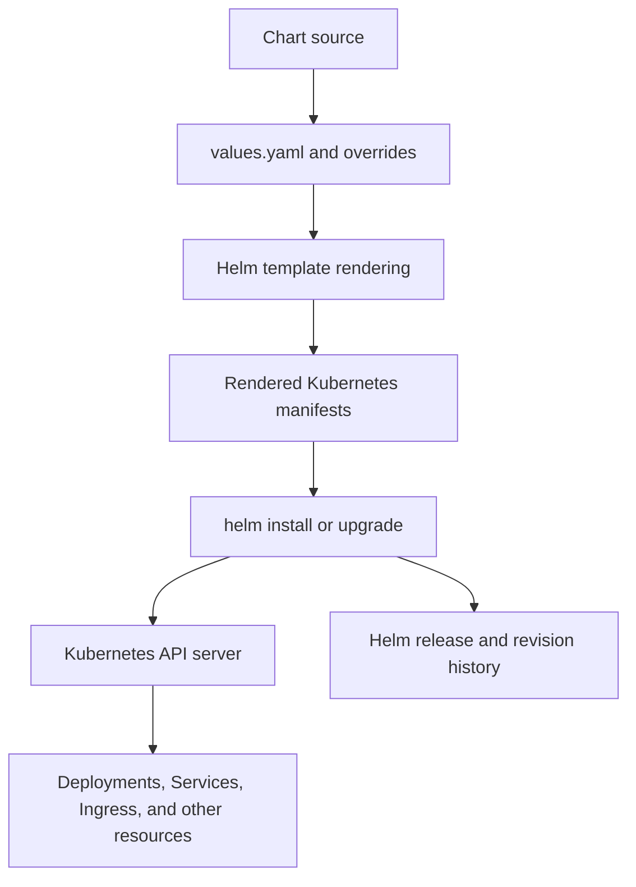
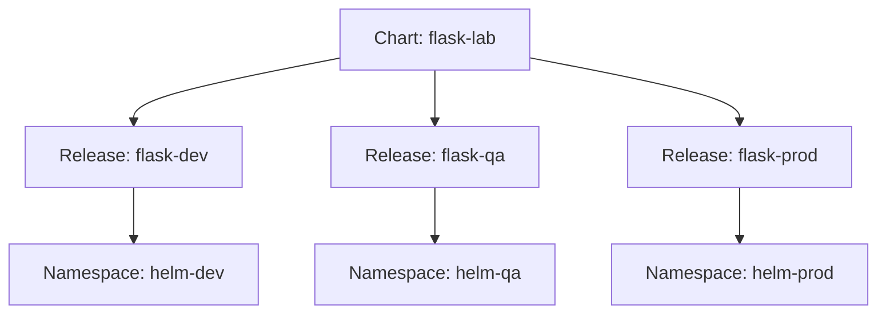
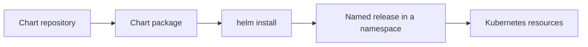
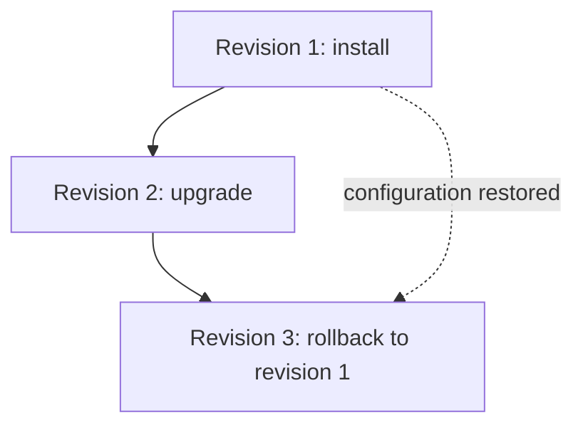

# Chapter 8 — Helm Fundamentals

## Chapter objectives

Helm is the package manager used to define, configure, install, upgrade, inspect, and roll back applications on Kubernetes. This chapter explains the Helm concepts and commands used during the lab and records the practical work performed on the three-node Vagrant cluster.

By the end of this chapter, you should be able to:

- Explain the problem Helm solves and how it relates to Kubernetes manifests.
- Distinguish a chart, a repository, and a release.
- Understand the purpose of `Chart.yaml`, `values.yaml`, `templates/`, `charts/`, and helper templates.
- Create and inspect a chart using `helm create`.
- Parameterize a Kubernetes manifest using Helm values and Go-template expressions.
- Add and search chart repositories.
- Render and lint a chart before installing it.
- Install, inspect, upgrade, roll back, and uninstall a Helm release.
- Inspect the values and manifests stored for a release.
- Explain chart version versus application version and release revision history.
- Troubleshoot common chart rendering and release-management problems.

> **Evidence labels used in this chapter**
>
> - **Recorded lab step:** a command or configuration shown in the practice-session record.
> - **Recorded validation:** a terminal output or resulting state captured in the source conversation.
> - **Supplementary explanation:** additional detail needed to understand the topic; it is not presented as an action you necessarily performed.
> - **Recommended practice:** an operational or security recommendation for future work.

---

## 1. Why Helm?

A Kubernetes application is usually made up of multiple API objects. A simple web application may need:

- Deployment
- Service
- Ingress
- ConfigMap
- Secret
- HorizontalPodAutoscaler

Without a packaging and configuration approach, an operator maintains separate YAML files and repeats similar changes for every environment. For example, development, QA, UAT, and production may use the same application but require different replica counts, image tags, hostnames, resource settings, or storage options.

Helm addresses this by packaging related Kubernetes manifests into a **chart** and allowing configurable values to be supplied when a release is installed or upgraded.

### 1.1 Without Helm

A basic deployment may require several commands:

```bash
kubectl apply -f deployment.yaml
kubectl apply -f service.yaml
kubectl apply -f ingress.yaml
kubectl apply -f configmap.yaml
kubectl apply -f secret.yaml
```

The operator must keep the files consistent and track which versions were applied.

### 1.2 With Helm

The resources are packaged in a chart and installed as a release:

```bash
helm install flask ./flask-lab -n helm-flask
```

Helm renders the chart templates using the selected values and submits the resulting Kubernetes resources to the cluster. Helm also records release information so that the release can be inspected, upgraded, and rolled back.

**Important distinction:** Helm does not replace Kubernetes. Kubernetes still schedules Pods, manages Deployments, provides Services, and reconciles resources. Helm is the packaging and release-management tool used to generate and manage the Kubernetes objects.

### 1.3 The basic Helm workflow



---

## 2. Helm terminology

Three terms are particularly important.

| Term | Meaning | Example from the lab |
|---|---|---|
| Chart | A package containing templates, default values, metadata, and optionally dependencies | `flask-lab` |
| Repository | A location from which packaged charts and their metadata can be retrieved | `grafana`, `ingress-nginx` |
| Release | A named installation of a chart in a Kubernetes cluster and namespace | `flask` in `helm-flask` |

A chart is not itself an installed application. Installing a chart creates a release.

The same chart can be installed more than once with different release names and configuration, subject to resource naming and cluster constraints. For example, the same Grafana chart can be installed as separate releases for different purposes.

### 2.1 Chart versus release



This is a conceptual illustration. The release names and namespaces above are examples, not additional releases recorded in the lab.

### 2.2 Release revision

A release revision is a numbered point in the release history. The first installation normally creates revision 1. An upgrade creates another revision. A rollback also creates a new revision; it does not erase the history or make the old revision number current again.

This behavior is demonstrated later using the recorded Flask release.

---

## 3. Helm installation and version used in the lab

### 3.1 Recorded environment

Helm was installed on the Kubernetes control-plane VM, `k8master1`.

The recorded version output was:

```text
version.BuildInfo{
  Version:"v3.21.0",
  GitCommit:"e0878d41b711792be60777fd65ad23a101e6b85f",
  GitTreeState:"clean",
  GoVersion:"go1.25.10"
}
```

This is the version captured in the practice session. It should not be interpreted as a claim about the latest Helm release today.

Verify the version on your own VM:

```bash
helm version
```

Check the available top-level commands:

```bash
helm help
helm list --help
helm install --help
```

### 3.2 Installation command recorded in the lab

The source conversation records the official Helm installation script being used:

```bash
curl https://raw.githubusercontent.com/helm/helm/main/scripts/get-helm-3 | bash
```

Then verify:

```bash
helm version
```

**Recommended practice:** review an installation script before executing it, especially on shared or production systems. Pin and verify a specific Helm release when reproducibility is required. The command above is preserved as a historical lab command; it tracks the script from the upstream repository and is not a version-pinned installation method.

---

## 4. Helm chart repositories

A chart repository is a location that makes charts available to Helm clients. The repository metadata allows Helm to search for chart names and versions.

The lab added repositories for ingress-nginx, Prometheus Community, Grafana, and Argo:

```bash
helm repo add ingress-nginx https://kubernetes.github.io/ingress-nginx

helm repo add prometheus-community https://prometheus-community.github.io/helm-charts

helm repo add grafana https://grafana.github.io/helm-charts

helm repo add argo https://argoproj.github.io/argo-helm
```

Update the local repository indexes:

```bash
helm repo update
```

List configured repositories:

```bash
helm repo list
```

Search the repositories:

```bash
helm search repo grafana
helm search repo prometheus
```

The practice record shows `grafana/grafana` as a search result.

### 4.1 Repository versus chart versus release



Adding a repository does not install any application. Searching for a chart does not install it either. The release is created only when an install operation is performed.

### 4.2 Recorded Grafana installation example

The lab used the Grafana repository to install a release named `grafana` into the `monitoring` namespace:

```bash
kubectl create namespace monitoring

helm install grafana grafana/grafana -n monitoring
```

Inspect the release and its Kubernetes resources:

```bash
helm list -A
helm status grafana -n monitoring
kubectl get all -n monitoring
```

The practice record describes the resulting Deployment, ReplicaSet, Pod, Service, and Secret resources. Later Grafana lifecycle exercises are part of the monitoring work; this chapter concentrates on the general Helm concepts and the Flask chart lifecycle.

---

## 5. Anatomy of a Helm chart

A Helm chart is a directory containing metadata, default values, templates, and optionally dependencies and other supporting files.

A simplified chart layout is:

```text
flask-lab/
├── Chart.yaml
├── values.yaml
├── charts/
└── templates/
    ├── _helpers.tpl
    ├── deployment.yaml
    ├── service.yaml
    └── ingress.yaml
```

The chart created by `helm create` may contain additional generated files, including an HPA template, service account, NOTES file, test templates, and HTTPRoute template. The exact scaffold can vary with the Helm version and chart generator defaults.

### 5.1 Chart.yaml

`Chart.yaml` contains chart metadata.

The practice notes used this example:

```yaml
apiVersion: v2
name: flask-lab
description: Flask Helm Chart
type: application
version: 0.1.0
appVersion: "1.0"
```

Field meanings:

| Field | Purpose |
|---|---|
| `apiVersion` | Chart metadata format. Helm 3 application charts use `v2`. |
| `name` | Chart name. |
| `description` | Short description of the chart. |
| `type` | `application` for deployable applications or `library` for reusable helper functionality. |
| `version` | Version of the chart package. |
| `appVersion` | Informational application version represented by the chart. |

**Chart version and application version are different.**

For example:

```yaml
version: 1.2.0
appVersion: "2.5.0"
```

This means the chart package is version 1.2.0 and the application version it describes is 2.5.0. Updating a chart template may require a chart version change even if the application binary did not change. Updating the application image does not automatically change the chart version.

### 5.2 values.yaml

`values.yaml` contains the chart's default configuration. Templates refer to these values through the `.Values` object.

The recorded Flask chart configuration included:

```yaml
replicaCount: 2

image:
  repository: mearvi/flask-lab
  tag: latest
  pullPolicy: Always

service:
  port: 80

ingress:
  host: flask-helm.lab.local
```

This is a representative values layout from the Helm notes. The later chart conversion also used the host `flask.lab.local` in the initial conversion exercise; the recorded chart notes subsequently show `flask-helm.lab.local`. Do not assume these two hostnames were simultaneously configured in one deployed release.

Why values are useful:

- Change the image repository or tag without rewriting the Deployment template.
- Change the number of replicas without duplicating a manifest.
- Reuse one chart with different environment-specific settings.
- Keep environment-specific configuration in separate values files.

### 5.3 templates/

Files in `templates/` are processed by Helm's template engine. They are not simply static YAML files: they can contain Go-template expressions and Helm functions.

For example:

```yaml
spec:
  replicas: {{ .Values.replicaCount }}
```

If `replicaCount` is 2, Helm renders:

```yaml
spec:
  replicas: 2
```

A Deployment image can be constructed from separate values:

```yaml
image: "{{ .Values.image.repository }}:{{ .Values.image.tag }}"
```

With the example values, the rendered image is:

```yaml
image: "mearvi/flask-lab:latest"
```

### 5.4 _helpers.tpl

The `_helpers.tpl` file commonly contains reusable template definitions, such as naming helpers and common labels.

A template can call a named helper with `include`, for example:

```yaml
metadata:
  name: {{ include "flask-lab.fullname" . }}
```

The helper's exact definition depends on the chart. The generated chart includes helper definitions so that resource names and labels can be generated consistently.

Files whose names begin with an underscore are helper/template partials; they are not rendered as standalone Kubernetes resource manifests.

### 5.5 charts/

The `charts/` directory can contain chart dependencies (subcharts). Dependencies allow a parent chart to include other charts. The multi-tier application work later in the lab explored the idea of packaging multiple components in one release; the full multi-tier design and its implementation are documented in Chapter 9.

### 5.6 Other useful chart files

| Path | Purpose |
|---|---|
| `values.schema.json` | Optional JSON Schema for validating chart values. |
| `templates/NOTES.txt` | Optional usage notes printed after installation and available in release status output. |
| `crds/` | Custom Resource Definitions. CRDs have special lifecycle behavior and are not ordinary templated resources. |
| `.helmignore` | Excludes files from chart packaging. |
| `README.md` | Documents chart purpose, prerequisites, values, and usage. |

---

## 6. Creating a chart with helm create

The practice session created a working directory and generated a chart.

### 6.1 Create the workspace

```bash
mkdir -p ~/helm-labs
cd ~/helm-labs
```

Create a chart:

```bash
helm create flask-chart
```

Inspect the generated structure:

```bash
tree flask-chart
```

If `tree` is not installed on Ubuntu:

```bash
sudo apt update
sudo apt install tree -y
```

### 6.2 Recorded generated chart structure

The source record shows a generated chart containing:

```text
flask-chart/
├── Chart.yaml
├── charts/
├── templates/
│   ├── NOTES.txt
│   ├── _helpers.tpl
│   ├── deployment.yaml
│   ├── hpa.yaml
│   ├── httproute.yaml
│   ├── ingress.yaml
│   ├── service.yaml
│   ├── serviceaccount.yaml
│   └── tests/
│       └── test-connection.yaml
└── values.yaml
```

The exact contents of generated files depend on the Helm version and scaffold defaults.

### 6.3 Create a clean chart for the Flask application

For the real Flask conversion exercise, the chart workspace was created under `~/helm-labs`:

```bash
cd ~/helm-labs
helm create flask-lab
```

The generated chart was simplified by removing templates that were not needed for the initial application conversion:

```bash
cd ~/helm-labs/flask-lab/templates

rm hpa.yaml
rm httproute.yaml
rm serviceaccount.yaml
rm NOTES.txt
rm -rf tests
```

The recorded intended structure after cleanup was:

```text
flask-lab/
├── Chart.yaml
├── values.yaml
└── templates/
    ├── _helpers.tpl
    ├── deployment.yaml
    ├── ingress.yaml
    └── service.yaml
```

**Important:** these `rm` commands are appropriate only when intentionally simplifying a disposable generated chart. Inspect files before deleting them from a chart that contains custom work.

### 6.4 Inspect the existing Kubernetes application before converting it

The Flask application already existed as Kubernetes resources in the `dev` namespace. The conversion exercise captured the running objects rather than inventing a new application specification:

```bash
kubectl get deployment flask-app -n dev -o yaml > flask-deployment.yaml
kubectl get svc flask-service -n dev -o yaml > flask-service.yaml
kubectl get ingress flask-ingress -n dev -o yaml > flask-ingress.yaml
```

The source record showed the existing Service using port 80 and targetPort 5000, selecting Pods with `app: flask-app`. This matters because a Helm conversion should preserve the working application's selectors, ports, and routing behavior.

The chart's intended configurable values included:

```yaml
image:
  repository: mearvi/flask-lab
  tag: latest

replicaCount: 2

service:
  port: 80

ingress:
  host: flask.lab.local
```

The source conversation shows the chart being built around the existing Flask workload. The final Helm lifecycle output later records a release named `flask` in namespace `helm-flask`; do not conflate this with the original non-Helm Deployment named `flask-app` in namespace `dev`.

---

## 7. How Helm templates work

Helm uses Go-template syntax and template functions to turn chart templates plus values into Kubernetes manifests.

### 7.1 Values lookup

Given:

```yaml
replicaCount: 2

image:
  repository: mearvi/flask-lab
  tag: latest
```

A Deployment template can use:

```yaml
spec:
  replicas: {{ .Values.replicaCount }}
  template:
    spec:
      containers:
        - name: flask
          image: "{{ .Values.image.repository }}:{{ .Values.image.tag }}"
```

The expression `.Values.replicaCount` reads the value from `values.yaml`. Nested keys are accessed with dot notation, such as `.Values.image.repository`.

### 7.2 Release and chart information

Helm also provides built-in objects to templates. Common examples include:

| Template object | Meaning |
|---|---|
| `.Values` | Values supplied by the chart defaults and user overrides. |
| `.Release.Name` | Name assigned to this release. |
| `.Release.Namespace` | Namespace in which the release is installed. |
| `.Release.IsInstall` | True during an install operation. |
| `.Release.IsUpgrade` | True during an upgrade or rollback operation. |
| `.Chart.Name` | Chart name from `Chart.yaml`. |
| `.Chart.Version` | Chart version from `Chart.yaml`. |
| `.Capabilities` | Kubernetes version and supported API capabilities available to rendering. |

These values help make charts reusable across releases and namespaces.

### 7.3 YAML indentation matters

A Helm template can be syntactically valid as a template but render invalid YAML if indentation is wrong.

When using functions such as `toYaml`, indentation helpers must be applied at the correct level. For example, a resource block may be rendered from a values object:

```yaml
resources:
  requests:
    cpu: 100m
    memory: 128Mi
  limits:
    cpu: 200m
    memory: 256Mi
```

A template may use `toYaml` and `nindent` to render the object at the correct indentation:

```yaml
resources:
  {{- toYaml .Values.resources | nindent 12 }}
```

The number passed to `nindent` depends on where the expression appears in the template. Always inspect the rendered output rather than copying an indentation number blindly.

---

## 8. Supplying values at install and upgrade time

A chart's `values.yaml` provides defaults. A user can override those defaults without editing the chart.

### 8.1 Override one value with --set

Example:

```bash
helm install flask ./flask-lab \
  -n helm-flask \
  --set replicaCount=3
```

This example demonstrates syntax; it is not a claim that the recorded Flask release was installed with three replicas.

### 8.2 Use an environment-specific values file

Create a file such as `values-dev.yaml`:

```yaml
replicaCount: 2

image:
  repository: mearvi/flask-lab
  tag: latest

service:
  port: 80

ingress:
  host: flask-dev.lab.local
```

A production values file might use a different image tag, replica count, hostname, and resource allocation:

```yaml
replicaCount: 5

image:
  repository: mearvi/flask-lab
  tag: "1.0.0"

service:
  port: 80

ingress:
  host: flask.example.com
```

Install using a values file:

```bash
helm install flask-dev ./flask-lab \
  --namespace helm-dev \
  --create-namespace \
  -f values-dev.yaml
```

Upgrade using an updated values file:

```bash
helm upgrade flask-dev ./flask-lab \
  --namespace helm-dev \
  -f values-dev.yaml
```

These are supplementary examples. The original Flask release used the `helm-flask` namespace and a local chart path.

### 8.3 Values precedence

In general, chart defaults are overridden by user-supplied values. A values file supplied with `-f` overrides corresponding chart defaults. Multiple values files can be supplied; later files take precedence for overlapping keys. Command-line `--set` values can override values supplied by files.

For example:

```bash
helm upgrade flask ./flask-lab \
  -n helm-flask \
  -f values-dev.yaml \
  --set image.tag=1.2.3
```

Use `helm get values` to inspect user-supplied values for an installed release. Use `helm get values --all` when you also need to inspect computed values including chart defaults.

**Security warning:** do not put production passwords, private keys, access tokens, or other credentials in a values file that is committed to Git. Helm values are configuration inputs, not a secret-management system. Chapter 7 covers Kubernetes Secrets; production workflows should consider an external secret-management solution.

---

## 9. Validate a chart before installing it

A reliable Helm workflow separates rendering and validation from installation.

### 9.1 Lint the chart

From the chart directory:

```bash
cd ~/helm-labs/flask-lab
helm lint .
```

Linting checks chart structure and common chart issues. A successful lint result does not prove that every Kubernetes resource will start successfully in the cluster.

The source conversation records successful lint checks for the Flask and multi-tier charts. One recorded result was:

```text
1 chart(s) linted, 0 chart(s) failed
```

### 9.2 Render templates locally

Render a chart without installing it:

```bash
helm template flask .
```

Write the output to a file:

```bash
helm template flask . > rendered.yaml
```

Inspect resource kinds:

```bash
grep '^kind:' rendered.yaml
```

This is useful for checking whether the chart produces the expected objects and whether values are substituted correctly.

### 9.3 Render with a namespace

```bash
helm template flask . -n helm-flask
```

The namespace supplied to the rendering command becomes available through Helm's release context. Whether a rendered object explicitly contains a namespace depends on the chart template.

### 9.4 Render with custom values

```bash
helm template flask . \
  -n helm-flask \
  -f values-dev.yaml
```

### 9.5 Debug rendering

When a template fails or produces unexpected YAML:

```bash
helm lint .
helm template flask . --debug
helm template flask . -n helm-flask -f values-dev.yaml --debug
```

Inspect the rendered manifest around the failing resource. Pay attention to:

- Missing values or incorrect key names.
- Incorrect Go-template expressions.
- YAML indentation.
- Quoting of strings and values that may be interpreted as booleans or numbers.
- Incorrect resource names, selectors, ports, and namespaces.
- API versions unsupported by the target Kubernetes cluster.

**Recommended practice:** do not treat `helm lint` as a substitute for rendering. Use both, and then validate the resources against the target cluster before a production change.

---

## 10. Installing a chart

The general command format is:

```bash
helm install RELEASE_NAME CHART_REFERENCE [flags]
```

A chart reference can be a local chart directory, a packaged chart archive, or a repository-qualified chart name.

### 10.1 Install the local Flask chart

The recorded release command was:

```bash
helm install flask . -n helm-flask
```

The release name is `flask`; the chart path is the current directory; the namespace is `helm-flask`.

If the namespace does not exist, create it first:

```bash
kubectl create namespace helm-flask
```

Alternatively, for a new installation, Helm can create it:

```bash
helm install flask . -n helm-flask --create-namespace
```

Do not use `helm install` again for an existing release name in the same namespace. Use `helm upgrade` or `helm upgrade --install` as appropriate.

### 10.2 Install a chart from a repository

The lab installed Grafana from the repository:

```bash
helm install grafana grafana/grafana -n monitoring
```

This command uses:
- Release name: `grafana`
- Chart reference: `grafana/grafana`
- Namespace: `monitoring`

### 10.3 Verify the installation

```bash
helm list -n helm-flask
helm status flask -n helm-flask
kubectl get all -n helm-flask
```

List releases across namespaces:

```bash
helm list -A
```

Helm release data is stored in the Kubernetes cluster. The practice record showed Helm release Secrets with names such as `sh.helm.release.v1.multi-app.v1` in the `multi-dev` namespace. These are Helm's internal release records; do not edit or delete them manually.

---

## 11. Inspecting a release

The following commands are useful during daily operations and troubleshooting.

### 11.1 Release status

```bash
helm status flask -n helm-flask
```

The status output includes release information such as name, namespace, revision, status, and the resources or notes associated with the release.

### 11.2 List releases

```bash
helm list -n helm-flask
helm list -A
```

### 11.3 Show values

```bash
helm get values flask -n helm-flask
```

Show computed values including chart defaults:

```bash
helm get values flask -n helm-flask --all
```

### 11.4 Show the manifest stored for the release

```bash
helm get manifest flask -n helm-flask
```

This displays the Kubernetes manifests associated with the release. It is useful when the live resources do not appear to match the values or templates you expected.

### 11.5 Show release history

```bash
helm history flask -n helm-flask
```

The history output records revisions, timestamps, statuses, chart versions, application versions, and descriptions.

---

## 12. Upgrade a release

An upgrade applies a new chart version or new configuration to an existing release.

General syntax:

```bash
helm upgrade RELEASE_NAME CHART_REFERENCE -n NAMESPACE
```

### 12.1 Recorded Flask upgrade exercise

The initial Flask release used:

```yaml
image:
  repository: mearvi/flask-lab
  tag: latest
  pullPolicy: Always
```

The practice exercise changed the image tag to a Git commit-based image tag produced by the GitHub Actions workflow:

```yaml
image:
  repository: mearvi/flask-lab
  tag: b55df06c700ded1a6f74ac6c656aa38e62a779ee
  pullPolicy: Always
```

Then the release was upgraded:

```bash
helm upgrade flask . -n helm-flask
```

Verify the Deployment image:

```bash
kubectl get deployment flask -n helm-flask \
  -o jsonpath='{.spec.template.spec.containers[0].image}'
echo
```

Observe the rollout:

```bash
kubectl rollout status deployment/flask -n helm-flask
kubectl get pods -n helm-flask -w
```

### 12.2 Upgrade with a values file

```bash
helm upgrade flask ./flask-lab \
  -n helm-flask \
  -f values-dev.yaml
```

### 12.3 Upgrade or install

For automation, the following command is commonly useful:

```bash
helm upgrade --install flask ./flask-lab \
  -n helm-flask \
  --create-namespace \
  -f values-dev.yaml
```

It installs the release if it does not exist and upgrades it if it already exists. Review the chart and values carefully before using this in a production pipeline.

---

## 13. Rollback and release history

Rollback is one of Helm's most useful capabilities. It allows an operator to return a release to a previously recorded revision.

General syntax:

```bash
helm rollback RELEASE_NAME REVISION -n NAMESPACE
```

### 13.1 Recorded Flask rollback

After the Flask release had been upgraded, the practice session rolled it back to revision 1:

```bash
helm rollback flask 1 -n helm-flask
```

Then the release history and running image were checked:

```bash
helm history flask -n helm-flask

kubectl get deployment flask -n helm-flask \
  -o jsonpath='{.spec.template.spec.containers[0].image}'
echo
```

### 13.2 Recorded revision sequence

The captured history showed:

| Revision | Operation | Status after rollback |
|---:|---|---|
| 1 | Initial installation | superseded |
| 2 | Upgrade to the new image tag | superseded |
| 3 | Rollback to revision 1 | deployed |

The current Deployment image was:

```text
mearvi/flask-lab:latest
```

This is direct evidence that the rollback restored the original image configuration. Notice that revision 3 is the active revision even though its configuration matches revision 1.



### 13.3 Important rollback details

- Rollback creates a new revision.
- Previous revisions remain in the history until history retention or release deletion policies remove them.
- A rollback restores the chart and values state associated with the selected revision; it does not guarantee that external systems or persistent data are reverted.
- Database schema changes and external side effects require their own rollback strategy.
- A rollback can itself fail if the cluster no longer supports the rendered resources or if dependencies have changed.

Always inspect the release status and Kubernetes workload after a rollback.

---

## 14. Uninstalling a release

General syntax:

```bash
helm uninstall RELEASE_NAME -n NAMESPACE
```

The lab also performed a cleanup of a temporary test release:

```bash
helm uninstall flask2 -n helm-dev
kubectl get all -n helm-dev
```

Recorded output:

```text
release "flask2" uninstalled
No resources found in helm-dev namespace.
```

This confirms that the temporary release was uninstalled and the namespace contained no resources returned by `kubectl get all` at that point.

**Important:** uninstalling a release removes resources managed by that release, but persistent-volume retention, custom resources, hooks, and resources created outside the release can have separate lifecycle behavior. Do not assume that every piece of application data is automatically deleted—or safely retained—without checking the relevant resource policies.

---

## 15. Recorded practical outcomes

This section separates confirmed practice from commands that were only proposed as next steps.

### 15.1 Helm basics

The conversation records the following as completed:
- Helm installed and version checked.
- A chart created with `helm create`.
- Generated chart structure inspected.
- Chart and release concepts covered.
- A temporary chart release installed and uninstalled.
- A cleanup check confirmed no resources were returned in `helm-dev`.

The captured Helm version was `v3.21.0`.

### 15.2 Flask Helm release

The conversation records:
- A clean Flask chart workspace under `~/helm-labs/flask-lab`.
- Existing Kubernetes Deployment, Service, and Ingress YAML captured as source material for the conversion.
- Chart values used for replica count, image repository/tag, Service port, and Ingress host.
- Chart lint and template rendering exercises.
- Release `flask` in namespace `helm-flask`.
- Upgrade from `latest` to a Git SHA image tag.
- Rollback to revision 1.
- Final history with revision 3 deployed and image `mearvi/flask-lab:latest` restored.

### 15.3 Multi-tier chart — preview for Chapter 9

The later multi-tier exercise used a separate chart under `~/helm-labs/multi-tier-chart` and a release named `multi-app` in namespace `multi-dev`.

The recorded successful checks included:
- `helm lint .` passing.
- `helm template multi . | grep "^kind:"` rendering Secret, Services, StatefulSet, Deployments, and Ingress.
- Release status `deployed`, revision 1.
- Frontend and backend Deployments with two Pods each reported Running.
- PostgreSQL Pod eventually reported Running and Ready.
- PostgreSQL PVC `postgres-storage-postgres-0` reported Bound.
- Ingress host `multi.lab.local` with address `192.168.56.241`.

This multi-tier deployment is not reproduced in full here. Chapter 9 will document its architecture, templates, database, storage, service discovery, and validation in detail.

---

## 16. Troubleshooting Helm

### 16.1 `helm: command not found`

Check whether Helm is installed and available in the current shell:

```bash
command -v helm
helm version
echo "$PATH"
```

If the binary exists but is not found, verify its location and the shell's PATH. If it is not installed, follow the official installation instructions and verify the installed version.

### 16.2 Chart not found

For a local chart, verify the current directory:

```bash
pwd
ls -la
test -f Chart.yaml && echo "Chart.yaml found"
```

For a repository chart, verify the repository and update its index:

```bash
helm repo list
helm repo update
helm search repo grafana
```

Use the correct repository-qualified chart reference, for example `grafana/grafana`.

### 16.3 Release name already exists

An install command may fail if a release with the same name already exists in the target namespace.

Inspect:

```bash
helm list -n helm-flask
helm status flask -n helm-flask
```

If the intention is to update the existing release, use `helm upgrade` or `helm upgrade --install`. Do not uninstall a working release simply to bypass an error without understanding the impact.

### 16.4 Wrong namespace

Helm releases are scoped to namespaces. A release called `flask` in `helm-flask` is distinct from a release with the same name in another namespace.

Always include the namespace when inspecting or modifying a release:

```bash
helm list -A
helm status flask -n helm-flask
helm history flask -n helm-flask
```

### 16.5 Template rendering error

Run:

```bash
helm lint .
helm template flask . --debug
```

Check:
- Spelling and capitalization of `.Values` keys.
- Whether the required key exists in `values.yaml`.
- Template delimiters `{{ }}`.
- Correct use of `include`, `toYaml`, `indent`, and `nindent`.
- YAML indentation after rendering.

### 16.6 Chart renders but Kubernetes rejects a resource

A chart can render syntactically valid YAML that is invalid for the cluster or incompatible with the API server.

Inspect the rendered file:

```bash
helm template flask . -n helm-flask > rendered.yaml
```

Then validate against the cluster where practical:

```bash
kubectl apply --dry-run=server -f rendered.yaml
```

Server-side dry-run asks the API server to validate the objects without persisting them. It may not cover every behavior that occurs during an actual Helm install, especially hooks and dependencies.

### 16.7 Release is deployed but Pods are not Ready

Helm release status alone does not prove application health. Inspect the Kubernetes resources:

```bash
kubectl get all -n helm-flask
kubectl get pods -n helm-flask -o wide
kubectl describe pod <pod-name> -n helm-flask
kubectl get events -n helm-flask --sort-by=.metadata.creationTimestamp
kubectl logs <pod-name> -n helm-flask
```

Check image pull errors, configuration references, probes, scheduling, resource requests, volume mounts, and application logs.

### 16.8 Values changed but workload did not change

Check the values Helm stored:

```bash
helm get values flask -n helm-flask
helm get values flask -n helm-flask --all
```

Check the rendered/stored manifest:

```bash
helm get manifest flask -n helm-flask
```

Check the live Deployment:

```bash
kubectl get deployment flask -n helm-flask -o yaml
```

If the chart was edited locally but no upgrade was performed, the running release will not automatically pick up those local file changes.

---

## 17. Recommended operational workflow

Use this sequence when preparing a chart change:

```bash
# 1. Move into the chart directory
cd ~/helm-labs/flask-lab

# 2. Review the chart metadata and values
cat Chart.yaml
cat values.yaml

# 3. Check chart structure
tree .

# 4. Lint the chart
helm lint .

# 5. Render the chart without installing
helm template flask . -n helm-flask > rendered.yaml

# 6. Inspect generated resources
grep '^kind:' rendered.yaml

# 7. Review the current release
helm status flask -n helm-flask
helm history flask -n helm-flask

# 8. Upgrade only after reviewing the change
helm upgrade flask . -n helm-flask

# 9. Verify Kubernetes rollout
kubectl rollout status deployment/flask -n helm-flask
kubectl get pods -n helm-flask -o wide

# 10. Verify the Helm release
helm status flask -n helm-flask
helm history flask -n helm-flask
```

For a production pipeline, add source control review, immutable image tags, chart versioning, values review, policy/security checks, and an explicit rollback or recovery plan.

---

## 18. Hands-on exercises

The following exercises are designed to reinforce the Helm concepts using the lab cluster. Exercises marked supplementary should be performed only when you want to repeat or extend the earlier practice.

### Exercise 1 — Inspect Helm

**Recorded fundamentals / repeatable verification**

```bash
helm version
helm help
helm repo list
helm list -A
```

Expected outcome: Helm is available, the configured repositories are visible, and installed releases can be listed.

### Exercise 2 — Inspect the Flask chart

**Recorded workspace**

```bash
cd ~/helm-labs/flask-lab
tree .
cat Chart.yaml
cat values.yaml
```

Identify the chart version, application version, image repository, image tag, replica count, Service port, and Ingress host.

### Exercise 3 — Lint and render

**Recorded validation workflow**

```bash
helm lint .
helm template flask . -n helm-flask > rendered.yaml
grep '^kind:' rendered.yaml
```

Inspect the Deployment, Service, and Ingress in the rendered file. Confirm that values are substituted as expected.

### Exercise 4 — Change a non-production value

**Supplementary exercise:** change the replica count in a dedicated test values file, render the chart, and compare the output:

```bash
helm template flask . -n helm-flask \
  --set replicaCount=3 > rendered-three-replicas.yaml

grep -n -A3 'replicas:' rendered-three-replicas.yaml
```

Do not install this change into a workload you are using unless you intend to modify its replica count.

### Exercise 5 — Inspect the recorded release lifecycle

**Recorded lifecycle verification**

```bash
helm status flask -n helm-flask
helm history flask -n helm-flask
helm get values flask -n helm-flask
helm get manifest flask -n helm-flask
```

Explain the relationship between the installed chart, release name, namespace, values, manifest, and revision history.

### Exercise 6 — Practice upgrade and rollback in an isolated release

**Supplementary exercise:** use a separate test namespace and a separate release name. Do not overwrite the original release simply to repeat the exercise.

```bash
kubectl create namespace helm-practice

helm install flask-practice ./flask-lab \
  -n helm-practice \
  --set replicaCount=1

helm history flask-practice -n helm-practice

helm upgrade flask-practice ./flask-lab \
  -n helm-practice \
  --set replicaCount=2

helm history flask-practice -n helm-practice

helm rollback flask-practice 1 -n helm-practice

helm history flask-practice -n helm-practice
kubectl get deployment -n helm-practice
```

When finished, clean up the test release:

```bash
helm uninstall flask-practice -n helm-practice
kubectl delete namespace helm-practice
```

### Exercise 7 — Explain the lifecycle

Without looking at the notes, explain:

1. What is the difference between a chart and a release?
2. What is the role of `Chart.yaml`?
3. What is the role of `values.yaml`?
4. What happens when Helm renders a template?
5. What does `helm lint` check?
6. Why run `helm template` before installation?
7. What is the difference between a chart version and an application version?
8. Why does rollback create a new revision?
9. How do you inspect the values and manifest of a release?
10. Why does a successful Helm install not automatically prove that the application is healthy?

---

## 19. Key commands reference

| Task | Command |
|---|---|
| Check Helm version | `helm version` |
| Show help | `helm help` |
| Add repository | `helm repo add NAME URL` |
| Update repositories | `helm repo update` |
| List repositories | `helm repo list` |
| Search repository | `helm search repo KEYWORD` |
| Create chart | `helm create CHART_NAME` |
| Lint chart | `helm lint CHART_PATH` |
| Render chart | `helm template RELEASE CHART_PATH` |
| Install chart | `helm install RELEASE CHART_PATH -n NAMESPACE` |
| Upgrade release | `helm upgrade RELEASE CHART_PATH -n NAMESPACE` |
| Upgrade or install | `helm upgrade --install RELEASE CHART_PATH -n NAMESPACE` |
| List releases | `helm list -A` |
| Release status | `helm status RELEASE -n NAMESPACE` |
| Release history | `helm history RELEASE -n NAMESPACE` |
| Show user values | `helm get values RELEASE -n NAMESPACE` |
| Show all computed values | `helm get values RELEASE -n NAMESPACE --all` |
| Show stored manifests | `helm get manifest RELEASE -n NAMESPACE` |
| Roll back | `helm rollback RELEASE REVISION -n NAMESPACE` |
| Uninstall release | `helm uninstall RELEASE -n NAMESPACE` |

---

## 20. Chapter summary

Helm provides a repeatable way to package Kubernetes resources, supply environment-specific configuration, and manage application releases.

The key concepts are:

- A **chart** is the package containing metadata, values, and templates.
- A **repository** makes charts available for discovery and download.
- A **release** is a named installation of a chart in a namespace.
- `Chart.yaml` describes the chart.
- `values.yaml` provides default configuration.
- `templates/` contains the templates Helm renders into Kubernetes manifests.
- `helm lint` checks chart structure and common issues.
- `helm template` renders manifests without installing them.
- `helm install` creates a release.
- `helm upgrade` changes an existing release.
- `helm history` displays release revisions.
- `helm rollback` creates a new revision using a previous release configuration.
- `helm get values` and `helm get manifest` help inspect what Helm stored for a release.

In the recorded Flask exercise, revision 1 was the initial installation, revision 2 was an image upgrade, and revision 3 was a rollback to the original image. This demonstrated the core Helm release lifecycle.

The next chapter builds on these fundamentals and documents the complete multi-tier application deployed through Helm: frontend, backend, PostgreSQL, Services, Secret, Ingress, and persistent storage.

---

## References

- [Helm Documentation — Charts](https://helm.sh/docs/topics/charts/)
- [Helm Documentation — Chart Best Practices](https://helm.sh/docs/chart_best_practices/)
- [Helm Documentation — Getting Started with Templates](https://helm.sh/docs/chart_template_guide/getting_started/)
- [Helm Documentation — Chart Hooks](https://helm.sh/docs/topics/charts_hooks/)
- [Helm Documentation — Helm Commands](https://helm.sh/docs/helm/)

**Version note:** the lab output records Helm v3.21.0. Always check the official documentation for the Helm version you install, because chart scaffolding, command behavior, and compatibility guidance can change between major releases.
