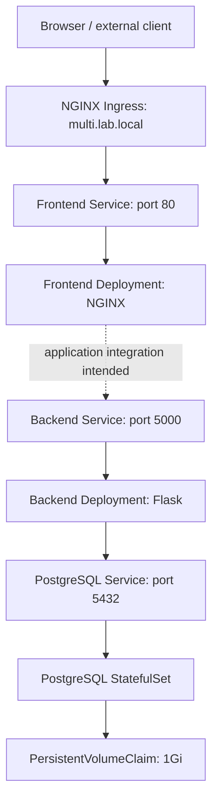
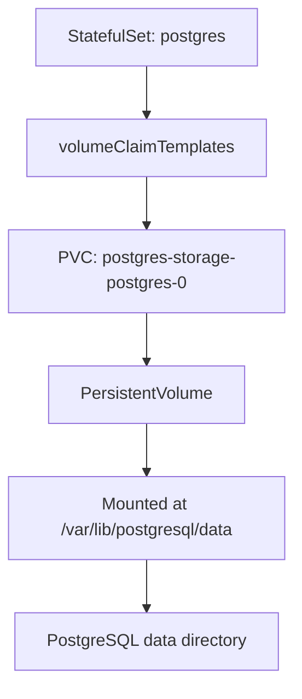

# Chapter 9 — Multi-Tier Application with Helm

## Chapter objectives

This chapter documents the multi-tier application built in the Kubernetes lab using a single Helm chart and a single Helm release. The deployment brought together a web frontend, a Flask backend, and PostgreSQL, with Kubernetes Services for internal discovery, a Secret for database initialization values, an Ingress for HTTP entry, and persistent storage for the database.

The chapter follows the recorded project under:

```text
~/helm-labs/multi-tier-chart
```

The release was installed as:

- **Release:** `multi-app`
- **Namespace:** `multi-dev`
- **Chart:** `multi-tier-chart`
- **Chart version:** `0.1.0`
- **Ingress host:** `multi.lab.local`

By the end of this chapter, you should be able to:

- Explain the roles of frontend, backend, and database tiers.
- Organize multiple Kubernetes resources in one Helm chart.
- Use Deployments for stateless application components.
- Use a StatefulSet and `volumeClaimTemplates` for a database Pod with persistent storage.
- Connect application configuration to Kubernetes Secrets.
- Use Services and Kubernetes DNS names for internal communication.
- Route external HTTP traffic through an Ingress.
- Render, lint, install, inspect, and troubleshoot a multi-resource Helm release.
- Distinguish resource creation and readiness from end-to-end application testing.
- Identify security and reliability improvements before using a similar design beyond a learning lab.

> **Evidence labels used in this chapter**
>
> - **Recorded lab step:** a command, configuration, or action present in the practice-session record.
> - **Recorded validation:** an output or state explicitly captured in the source conversation.
> - **Source limitation:** the source does not contain enough evidence to claim a particular behavior was tested or completed.
> - **Recommended improvement:** additional guidance for making the lab safer or more production-ready. It is not represented as something already implemented.

---

## 1. Project overview

The previous chapter covered Helm fundamentals. This chapter applies those concepts to a larger application consisting of multiple independently managed Kubernetes workloads.

The chart was created in:

```bash
mkdir -p ~/helm-labs/multi-tier-chart
cd ~/helm-labs
helm create multi-tier-chart
cd multi-tier-chart
```

The original `helm create` scaffold was then simplified and replaced with templates for the application components.

### 1.1 The intended architecture

The architecture discussed during the exercise was:



**Important source limitation:** the captured Ingress manifest routes `multi.lab.local/` to the frontend Service. The backend Deployment and Service are present, and its environment variables identify PostgreSQL as its database host. However, the source excerpts do not show an NGINX reverse-proxy configuration connecting frontend requests to the backend, nor a captured successful browser/API request traversing all three tiers. Therefore, this diagram describes the intended logical application flow; it should not be read as proof that the frontend-to-backend HTTP path was fully implemented and end-to-end tested in the recorded session.

### 1.2 Components and Kubernetes objects

| Application component | Kubernetes object | Recorded name |
|---|---|---|
| Frontend | Deployment | `frontend` |
| Frontend internal endpoint | Service | `frontend` |
| Backend | Deployment | `backend` |
| Backend internal endpoint | Service | `backend` |
| Database | StatefulSet | `postgres` |
| Database internal endpoint | Service | `postgres` |
| Database initialization values | Secret | `postgres-secret` |
| External HTTP routing | Ingress | `multi-tier` |
| Database storage request | PVC created by StatefulSet | `postgres-storage-postgres-0` |

All these resources were packaged into the Helm release `multi-app` in namespace `multi-dev`.

### 1.3 Why use one Helm release?

A single release provides a common installation and upgrade unit for the chart's related Kubernetes resources. It allows the operator to inspect the chart output and release history together.

It does not mean all components have the same runtime lifecycle:
- Frontend and backend Deployments can roll out independently.
- PostgreSQL is managed by a StatefulSet and has persistent storage.
- Services provide stable network endpoints for changing Pod IPs.
- Ingress handles external HTTP routing.
- PVC/PV lifecycle and database data-retention require special attention.

---

## 2. Lab environment and recorded values

### 2.1 Kubernetes environment

The application ran on the existing three-node kubeadm cluster:

| Node | Role | Host-only address |
|---|---|---|
| `k8master1` | Control plane | `192.168.56.10` |
| `k8worker1` | Worker | `192.168.56.20` |
| `k8worker2` | Worker | `192.168.56.21` |

The Ingress controller's external address observed in this exercise was `192.168.56.241`. The cluster used the NGINX Ingress Controller and MetalLB from the earlier networking chapters.

### 2.2 Recorded values.yaml

The conversation captured this values structure in `~/helm-labs/multi-tier-chart/values.yaml`:

```yaml
frontend:
  replicaCount: 2

  image:
    repository: nginx
    tag: latest

  service:
    port: 80

backend:
  replicaCount: 2

  image:
    repository: mearvi/flask-lab
    tag: latest

  service:
    port: 5000

postgres:
  image:
    repository: postgres
    tag: "16"

  database: appdb
  username: appuser
  password: apppassword

  service:
    port: 5432

ingress:
  enabled: true
  className: nginx
  host: multi.lab.local
```

This is the actual training configuration recorded in the conversation. In particular, `apppassword` is a sample lab credential. It is not suitable for a real environment and must not be reused as a production password.

### 2.3 What the values control

| Values path | Purpose | Recorded value |
|---|---|---|
| `frontend.replicaCount` | Number of frontend Pods | `2` |
| `frontend.image.repository` | Frontend image repository | `nginx` |
| `frontend.image.tag` | Frontend image tag | `latest` |
| `frontend.service.port` | Frontend Service port | `80` |
| `backend.replicaCount` | Number of backend Pods | `2` |
| `backend.image.repository` | Backend image repository | `mearvi/flask-lab` |
| `backend.image.tag` | Backend image tag | `latest` |
| `backend.service.port` | Backend Service port | `5000` |
| `postgres.image.repository` | Database image repository | `postgres` |
| `postgres.image.tag` | Database image tag | `16` |
| `postgres.database` | Initial database name | `appdb` |
| `postgres.username` | Initial database user | `appuser` |
| `postgres.password` | Sample lab password | `apppassword` |
| `postgres.service.port` | Database Service port | `5432` |
| `ingress.enabled` | Whether Ingress is rendered | `true` |
| `ingress.className` | Ingress class | `nginx` |
| `ingress.host` | Hostname routed by Ingress | `multi.lab.local` |

**Source note:** these values are from the recorded chart. The later GitOps copy of the chart used a different environment-specific values file and changed some replica counts. That later GitOps work is outside the scope of this chapter.

---

## 3. Creating and organizing the chart

### 3.1 Generate the chart

**Recorded lab commands:**

```bash
mkdir -p ~/helm-labs/multi-tier-chart
cd ~/helm-labs
helm create multi-tier-chart
cd multi-tier-chart
tree -L 2
```

The generated chart initially contained the standard scaffold from `helm create`, including Deployment, Service, HPA, Ingress, service account, HTTPRoute, helper, and test templates.

### 3.2 Remove the default application templates

The default templates were removed because the chart was being redesigned to describe multiple application components rather than one generic Deployment.

**Recorded cleanup commands:**

```bash
cd ~/helm-labs/multi-tier-chart/templates

rm deployment.yaml
rm service.yaml
rm hpa.yaml
rm ingress.yaml
rm serviceaccount.yaml
rm httproute.yaml
rm -rf tests
```

The source conversation shows the generated `NOTES.txt` and `_helpers.tpl` remaining at this stage.

**Caution:** these commands delete files. Confirm that the current working directory is the intended disposable chart and inspect custom changes before removing generated templates.

### 3.3 Create the component templates

The following template files were created:

```bash
touch templates/frontend-deployment.yaml
touch templates/frontend-service.yaml

touch templates/backend-deployment.yaml
touch templates/backend-service.yaml

touch templates/postgres-statefulset.yaml
touch templates/postgres-service.yaml

touch templates/configmap.yaml
touch templates/secret.yaml

touch templates/ingress.yaml
```

The recorded directory listing later showed:

```text
multi-tier-chart/
├── Chart.yaml
├── charts/
├── templates/
│   ├── NOTES.txt
│   ├── _helpers.tpl
│   ├── backend-deployment.yaml
│   ├── backend-service.yaml
│   ├── configmap.yaml
│   ├── frontend-deployment.yaml
│   ├── frontend-service.yaml
│   ├── ingress.yaml
│   ├── postgres-service.yaml
│   ├── postgres-statefulset.yaml
│   └── secret.yaml
├── values.yaml
└── values.yaml-ORG
```

The file `values.yaml-ORG` was present as a backup copy in the recorded workspace. It is not a Helm values file automatically loaded by Helm; the default file is `values.yaml`, unless another file is explicitly supplied using `-f`.

### 3.4 A template-file creation issue

During the exercise, some of the newly created template files were initially empty. The first render therefore showed only a subset of the intended resources. The source captured zero-byte files, including frontend/backend Deployment templates, and a partial `helm template` result.

The lesson is important: creating a file with `touch` only creates an empty file. It does not create a Kubernetes manifest. Each template must contain valid YAML/Helm template content before it can produce a resource.

The templates were subsequently populated. The final captured rendering included:
- One Secret
- Three Services
- Two Deployments
- One StatefulSet
- One Ingress

The final captured kind list did not include a ConfigMap, even though `templates/configmap.yaml` existed in the workspace and an earlier expected output mentioned one. The available source does not establish that the ConfigMap was included in the final deployed release. This chapter does not claim that it was deployed.

---

## 4. Frontend Deployment and Service

### 4.1 Frontend Deployment

The frontend used the NGINX container image and two replicas.

The recorded rendered Deployment included:

```yaml
apiVersion: apps/v1
kind: Deployment
metadata:
  name: frontend
spec:
  replicas: 2
  selector:
    matchLabels:
      app: frontend
  template:
    metadata:
      labels:
        app: frontend
    spec:
      containers:
        - name: frontend
          image: "nginx:latest"
          ports:
            - containerPort: 80
```

This is a simplified representation of the recorded rendered resource, with formatting normalized for readability.

Key points:
- `replicas: 2` requests two frontend Pods.
- The Deployment selector matches Pods with label `app: frontend`.
- The Pod template applies the same label.
- The container listens on port 80.
- The container image was `nginx:latest`.

### 4.2 Frontend Service

The frontend Service provides a stable ClusterIP endpoint in the namespace.

The recorded rendered Service included:

```yaml
apiVersion: v1
kind: Service
metadata:
  name: frontend
spec:
  selector:
    app: frontend
  ports:
    - port: 80
      targetPort: 80
```

The Service selector must match the labels on the frontend Pods. If the selector does not match, the Service may exist but have no ready endpoints.

Inspect it:

```bash
kubectl get service frontend -n multi-dev
kubectl describe service frontend -n multi-dev
kubectl get endpoints frontend -n multi-dev
```

For newer Kubernetes versions, EndpointSlices can also be inspected:

```bash
kubectl get endpointslices -n multi-dev
```

### 4.3 Frontend limitations in the recorded implementation

The captured frontend Deployment uses the stock `nginx:latest` image. The source does not show a custom NGINX configuration, frontend application bundle, or reverse-proxy configuration for forwarding requests to the backend.

Therefore:
- The NGINX frontend Deployment and Service were deployed.
- The Ingress routed to the frontend Service.
- A working NGINX-to-Flask proxy path is not proven by the captured manifests.

A future enhancement would add an NGINX configuration that proxies a defined path such as `/api/` to the backend Service. That requires a ConfigMap or another configuration mechanism, a mounted NGINX configuration file, and an HTTP test. It is not silently added to the historical implementation here.

---

## 5. Backend Deployment and Service

### 5.1 Backend Deployment

The backend used the Flask image built and published during the earlier application and CI/CD work:

```text
mearvi/flask-lab:latest
```

The captured rendered Deployment included two replicas and exposed container port 5000:

```yaml
apiVersion: apps/v1
kind: Deployment
metadata:
  name: backend
spec:
  replicas: 2
  selector:
    matchLabels:
      app: backend
  template:
    metadata:
      labels:
        app: backend
    spec:
      containers:
        - name: backend
          image: "mearvi/flask-lab:latest"
          imagePullPolicy: Always
          ports:
            - containerPort: 5000
```

The recorded Deployment also configured database connection variables. These are covered in the Secret section below.

### 5.2 Backend Service

The backend Service exposes port 5000 inside the cluster:

```yaml
apiVersion: v1
kind: Service
metadata:
  name: backend
spec:
  selector:
    app: backend
  ports:
    - port: 5000
      targetPort: 5000
```

The Service selects Pods labeled `app: backend`.

Inspect it:

```bash
kubectl get service backend -n multi-dev
kubectl describe service backend -n multi-dev
kubectl get endpoints backend -n multi-dev
```

### 5.3 Why a Service is required

Pod IP addresses are not stable application endpoints. A Deployment can replace Pods during scaling, rescheduling, or rollout. A Service provides a stable DNS name and forwards traffic to matching ready Pods.

Within the same namespace, other Pods can use:

```text
backend
```

A fully qualified Service DNS name is:

```text
backend.multi-dev.svc.cluster.local
```

The backend Service is an internal ClusterIP Service in the recorded manifest. No NodePort or LoadBalancer configuration was shown for it.

---

## 6. PostgreSQL Secret and database configuration

### 6.1 Recorded Secret values

The chart defined a Secret named `postgres-secret` with three keys:

- `POSTGRES_USER`
- `POSTGRES_PASSWORD`
- `POSTGRES_DB`

The rendered manifest captured by `helm get manifest` included:

```yaml
apiVersion: v1
kind: Secret
metadata:
  name: postgres-secret
type: Opaque
stringData:
  POSTGRES_USER: appuser
  POSTGRES_PASSWORD: apppassword
  POSTGRES_DB: appdb
```

This is a source-derived lab example. `stringData` accepts plain string values in the manifest; Kubernetes converts them into the Secret's stored data representation. It does not encrypt the password merely because it is a Secret.

### 6.2 Backend reads the Secret

The backend Deployment used the Secret to supply its database name, username, and password.

The recorded environment configuration was:

```yaml
env:
  - name: DB_HOST
    value: postgres

  - name: DB_PORT
    value: "5432"

  - name: DB_NAME
    valueFrom:
      secretKeyRef:
        name: postgres-secret
        key: POSTGRES_DB

  - name: DB_USER
    valueFrom:
      secretKeyRef:
        name: postgres-secret
        key: POSTGRES_USER

  - name: DB_PASSWORD
    valueFrom:
      secretKeyRef:
        name: postgres-secret
        key: POSTGRES_PASSWORD
```

The backend therefore receives:
- Database host: `postgres`
- Database port: `5432`
- Database name from the Secret key `POSTGRES_DB`
- Database username from `POSTGRES_USER`
- Database password from `POSTGRES_PASSWORD`

This is the Kubernetes mechanism for injecting Secret keys into container environment variables.

### 6.3 Inspect the Secret safely

List Secret names and types without printing their values:

```bash
kubectl get secrets -n multi-dev
kubectl describe secret postgres-secret -n multi-dev
```

The recorded output showed:
- `postgres-secret` of type `Opaque` with three data entries.
- A Helm release record Secret named `sh.helm.release.v1.multi-app.v1`.

Avoid using `kubectl get secret -o yaml` in shared terminals or logs because it can expose encoded Secret values.

### 6.4 Security issue in the lab values file

The recorded `values.yaml` stored `apppassword` directly in the chart values. The Secret template then used the value to render a Kubernetes Secret.

This is convenient for a disposable lab, but it is not safe for a real repository:
- Anyone with repository read access can read the password.
- Helm release values and rendered manifests may retain sensitive values.
- Base64 encoding is not encryption.
- Kubernetes Secret access must be controlled with RBAC.
- Secret encryption at rest must be configured separately where required.

**Recommended improvement:** remove plaintext credentials from Git-tracked values. Use a secret-management workflow such as External Secrets Operator with a supported secret store, or an encrypted GitOps secret mechanism. Do not commit a real password to `values.yaml`.

Chapter 7 explains Kubernetes Secret behavior. The Argo CD/GitOps chapter will revisit how secret values should be supplied to a GitOps-managed application.

---

## 7. PostgreSQL Service and StatefulSet

### 7.1 Why the database used a StatefulSet

The frontend and backend are stateless application workloads in this exercise. They were managed using Deployments.

PostgreSQL stores data and needs persistent storage. The chart used a StatefulSet so that the database Pod has a stable identity and can use a volume claim associated with that identity.

A StatefulSet provides:
- Stable Pod identity.
- Stable ordinal naming.
- A mechanism for associating persistent storage with each Pod.
- Ordered deployment and termination semantics.

The recorded StatefulSet had one replica and created the Pod named `postgres-0`.

A StatefulSet does not automatically make a database highly available. This lab used one PostgreSQL replica, not a replicated PostgreSQL cluster.

### 7.2 PostgreSQL Service

The database Service exposes port 5432:

```yaml
apiVersion: v1
kind: Service
metadata:
  name: postgres
spec:
  selector:
    app: postgres
  ports:
    - port: 5432
      targetPort: 5432
```

The Service selector matches the PostgreSQL Pod label `app: postgres`.

The StatefulSet uses `serviceName: postgres`. This is the governing Service name for the StatefulSet's network identity. The captured manifest does not establish that the Service was configured as headless; do not assume `clusterIP: None` unless it appears in the live Service YAML.

### 7.3 Recorded StatefulSet configuration

The rendered PostgreSQL StatefulSet used image `postgres:16`, one replica, and container port 5432.

A normalized excerpt of the recorded manifest is:

```yaml
apiVersion: apps/v1
kind: StatefulSet
metadata:
  name: postgres
spec:
  serviceName: postgres
  replicas: 1
  selector:
    matchLabels:
      app: postgres
  template:
    metadata:
      labels:
        app: postgres
    spec:
      containers:
        - name: postgres
          image: "postgres:16"
          ports:
            - containerPort: 5432
          env:
            - name: POSTGRES_USER
              valueFrom:
                secretKeyRef:
                  name: postgres-secret
                  key: POSTGRES_USER
            - name: POSTGRES_PASSWORD
              valueFrom:
                secretKeyRef:
                  name: postgres-secret
                  key: POSTGRES_PASSWORD
            - name: POSTGRES_DB
              valueFrom:
                secretKeyRef:
                  name: postgres-secret
                  key: POSTGRES_DB
          volumeMounts:
            - name: postgres-storage
              mountPath: /var/lib/postgresql/data
  volumeClaimTemplates:
    - metadata:
        name: postgres-storage
      spec:
        accessModes:
          - ReadWriteOnce
        resources:
          requests:
            storage: 1Gi
```

The StatefulSet reads the same Secret keys as the backend. The database container mounts its persistent volume at `/var/lib/postgresql/data`.

### 7.4 volumeClaimTemplates

The important part is:

```yaml
volumeClaimTemplates:
  - metadata:
      name: postgres-storage
    spec:
      accessModes:
        - ReadWriteOnce
      resources:
        requests:
          storage: 1Gi
```

When the StatefulSet creates its Pod, Kubernetes creates a PVC using the claim template. For the recorded Pod `postgres-0`, the PVC name was:

```text
postgres-storage-postgres-0
```

The volume flow is:



The lab's PVC used:
- Requested capacity: 1Gi
- Access mode: ReadWriteOnce
- StorageClass: `local-path`
- Status: Bound

The source output shows the claim was Bound. It does not show the name of the specific PV bound to this PostgreSQL claim in the same output excerpt, so this chapter does not assign a PV name to it.

### 7.5 Inspect database storage

```bash
kubectl get statefulset postgres -n multi-dev
kubectl get pod postgres-0 -n multi-dev -o wide
kubectl get pvc -n multi-dev
kubectl describe pvc postgres-storage-postgres-0 -n multi-dev
kubectl get storageclass
```

To inspect PVs cluster-wide:

```bash
kubectl get pv
```

A PVC is namespaced; a PV is cluster-scoped. Therefore, `kubectl get pv -n multi-dev` does not meaningfully filter PVs by namespace.

**Storage note:** `local-path` is suitable for this learning cluster. Local node-backed storage has node affinity and availability limitations. It is not equivalent to replicated, failure-tolerant production storage.

---

## 8. Ingress routing

### 8.1 Recorded Ingress configuration

The chart created an Ingress named `multi-tier` using the NGINX Ingress class.

The captured rendered manifest included:

```yaml
apiVersion: networking.k8s.io/v1
kind: Ingress
metadata:
  name: multi-tier
spec:
  ingressClassName: nginx
  rules:
    - host: multi.lab.local
      http:
        paths:
          - path: /
            pathType: Prefix
            backend:
              service:
                name: frontend
                port:
                  number: 80
```

The Ingress sends requests for host `multi.lab.local` and path prefix `/` to the frontend Service on port 80.

### 8.2 Recorded Ingress result

The source conversation captured:

```text
NAME         CLASS   HOSTS           ADDRESS           PORTS
multi-tier   nginx   multi.lab.local 192.168.56.241    80
```

This confirms the Ingress resource existed, used the NGINX class, and had an assigned address in the lab.

It does not by itself prove that the browser request returned the expected application content.

### 8.3 Host resolution on the Windows workstation

To access the host-based route from the Windows host, the hostname must resolve to the Ingress controller's reachable address.

The recorded lab address was `192.168.56.241`. A hosts-file entry for this lab hostname would be:

```text
192.168.56.241 multi.lab.local
```

On Windows, the hosts file is normally:

```text
C:\Windows\System32\drivers\etc\hosts
```

This is a host-local lab mapping. It is not a public DNS record.

### 8.4 Inspect Ingress and controller

```bash
kubectl get ingress -n multi-dev
kubectl describe ingress multi-tier -n multi-dev
kubectl get svc -n ingress-nginx
kubectl get pods -n ingress-nginx
```

If the Ingress has no address or requests fail, check the Ingress controller Service, controller Pods, class name, backend Service name, and backend Service endpoints.

---

## 9. Render and validate the complete chart

Before installation, the chart was linted and rendered.

### 9.1 Helm lint

From the chart directory:

```bash
cd ~/helm-labs/multi-tier-chart
helm lint .
```

The source conversation records a successful lint result:

```text
1 chart(s) linted, 0 chart(s) failed
```

### 9.2 Render the resource kinds

The recorded command was:

```bash
helm template multi . | grep "^kind:"
```

The captured final output was:

```text
kind: Secret
kind: Service
kind: Service
kind: Service
kind: Deployment
kind: Deployment
kind: StatefulSet
kind: Ingress
```

The resources corresponded to:

| Rendered kind | Resource name |
|---|---|
| Secret | `postgres-secret` |
| Service | `postgres` |
| Service | `backend` |
| Service | `frontend` |
| Deployment | `backend` |
| Deployment | `frontend` |
| StatefulSet | `postgres` |
| Ingress | `multi-tier` |

The source record contains a discrepancy worth preserving: an earlier expected output included a ConfigMap, but the final captured output above did not. The final release manifest excerpt also shows the Secret and application resources but no ConfigMap. The chapter therefore treats the ConfigMap as a file that appeared in the chart workspace, not as a confirmed deployed object.

### 9.3 Save and inspect rendered YAML

For a repeatable review:

```bash
helm template multi . -n multi-dev > rendered.yaml
```

Inspect the resource kinds:

```bash
grep '^kind:' rendered.yaml
```

Inspect individual resource definitions:

```bash
grep -n -A35 'kind: Deployment' rendered.yaml
grep -n -A45 'kind: StatefulSet' rendered.yaml
grep -n -A25 'kind: Ingress' rendered.yaml
```

Review the output for:
- Image names and tags.
- Replica counts.
- Container ports.
- Service selectors and target ports.
- Secret key references.
- Database mount path and claim template.
- Ingress host and Service backend.

---

## 10. Install the multi-tier release

### 10.1 Create the namespace

The recorded lab created a dedicated namespace:

```bash
kubectl create namespace multi-dev
```

### 10.2 Install the chart

From `~/helm-labs/multi-tier-chart`:

```bash
helm install multi-app . -n multi-dev
```

The recorded Helm output was:

```text
NAME: multi-app
LAST DEPLOYED: Mon Jun 15 21:53:57 2026
NAMESPACE: multi-dev
STATUS: deployed
REVISION: 1
TEST SUITE: None
```

This confirms that Helm installed release `multi-app`, revision 1, in namespace `multi-dev`.

**Important:** Helm reporting `STATUS: deployed` confirms the release operation completed. It is not, by itself, proof that every Pod is Ready or that application requests work. The next section records the Kubernetes-level checks.

### 10.3 Inspect the release

```bash
helm status multi-app -n multi-dev
helm history multi-app -n multi-dev
helm get manifest multi-app -n multi-dev
helm get values multi-app -n multi-dev
```

The recorded history showed revision 1 deployed with chart `multi-tier-chart-0.1.0`.

The captured `helm get values` output was:

```text
USER-SUPPLIED VALUES:
null
```

This means no user-supplied override values were recorded for that release. It does not mean the chart had no values: the chart's own `values.yaml` defaults were used. To inspect computed values including chart defaults, use:

```bash
helm get values multi-app -n multi-dev --all
```

---

## 11. Verify the Kubernetes resources

### 11.1 List resources in the namespace

```bash
kubectl get all -n multi-dev
```

The release created:
- Frontend Deployment and Service.
- Backend Deployment and Service.
- PostgreSQL StatefulSet and Service.
- Ingress.
- PostgreSQL Secret.
- A PVC created from the StatefulSet claim template.

Remember that `kubectl get all` does not literally display every Kubernetes resource type. Query PVCs, Secrets, and Ingress separately.

### 11.2 Verify Pods and scheduling

```bash
kubectl get pods -n multi-dev -o wide
```

The captured early output showed:
- Two frontend Pods at `1/1 Running`.
- Two backend Pods at `1/1 Running`.
- PostgreSQL Pod `postgres-0` initially at `0/1 ContainerCreating`.

The frontend and backend Pods were scheduled across the worker nodes. Pod IPs are dynamic and should not be copied into permanent application configuration.

### 11.3 Verify Deployments and StatefulSet

```bash
kubectl get deployments -n multi-dev
kubectl get statefulset -n multi-dev
kubectl get services -n multi-dev
```

Expected workload intent from the chart:

| Workload | Desired replicas |
|---|---:|
| Frontend Deployment | 2 |
| Backend Deployment | 2 |
| PostgreSQL StatefulSet | 1 |

### 11.4 Verify the Secret

```bash
kubectl get secrets -n multi-dev
kubectl describe secret postgres-secret -n multi-dev
```

The captured output showed `postgres-secret` with three data entries and the Helm release record Secret.

### 11.5 Verify the PVC

```bash
kubectl get pvc -n multi-dev
```

The captured PostgreSQL claim was:

| PVC | Status | Capacity | Access mode | StorageClass |
|---|---|---:|---|---|
| `postgres-storage-postgres-0` | Bound | 1Gi | RWO | `local-path` |

This is direct evidence that the database's claim was successfully bound to storage.

### 11.6 Verify the Ingress

```bash
kubectl get ingress -n multi-dev
```

The recorded Ingress:
- Name: `multi-tier`
- Class: `nginx`
- Host: `multi.lab.local`
- Address: `192.168.56.241`
- Port: `80`

---

## 12. PostgreSQL startup delay and troubleshooting

### 12.1 Initial state: ContainerCreating

Immediately after the Helm install, the frontend and backend Pods were Running, but PostgreSQL showed:

```text
postgres-0   0/1   ContainerCreating
```

At that moment, the PVC was already Bound. The source conversation correctly treated the PostgreSQL Pod as still starting and requested inspection rather than changing the StatefulSet configuration immediately.

### 12.2 Inspect the Pod and events

The troubleshooting commands were:

```bash
kubectl describe pod postgres-0 -n multi-dev

kubectl get events -n multi-dev \
  --sort-by=.metadata.creationTimestamp

kubectl get pod postgres-0 -n multi-dev -w
```

The Pod description and events are useful for distinguishing image-pull delay, volume attachment/mount problems, scheduling failures, container creation errors, and application startup issues.

### 12.3 What the captured events showed

The source conversation captured the PostgreSQL image pull and container startup:

```text
Successfully pulled image "postgres:16" in 54.688s
Created container: postgres
Started container postgres
```

The later Pod description showed:

```text
Status: Running
Image: postgres:16
Port: 5432/TCP
State: Running
Ready: True
```

The PVC was also Bound.

This establishes that the initial `ContainerCreating` state was temporary and PostgreSQL subsequently started successfully. The captured event excerpt supports the image download and container creation sequence. It does not establish that an `fsGroup` change was required; that was only mentioned as a possible diagnostic consideration and was not shown as an applied fix.

### 12.4 General PostgreSQL troubleshooting commands

If the database does not become Ready:

```bash
kubectl describe pod postgres-0 -n multi-dev
kubectl logs postgres-0 -n multi-dev
kubectl get pvc -n multi-dev
kubectl describe pvc postgres-storage-postgres-0 -n multi-dev
kubectl get events -n multi-dev --sort-by=.metadata.creationTimestamp
```

Check:
- Whether the image can be pulled.
- Whether the PVC is Bound.
- Whether the volume can be mounted.
- Whether Secret keys referenced by the Pod exist.
- Whether the database process starts successfully.
- Whether the node has sufficient resources.
- Whether filesystem ownership and permissions are correct for the selected image and volume.

Do not apply a security context change such as `fsGroup: 999` without evidence from the actual image, volume, and Pod events.

---

## 13. Internal service discovery and DNS

### 13.1 Database host configured in the backend

The backend Deployment used:

```yaml
- name: DB_HOST
  value: postgres

- name: DB_PORT
  value: "5432"
```

Because the backend and PostgreSQL Service were in the same namespace, the short Service name `postgres` is sufficient for Kubernetes DNS resolution.

The fully qualified Service DNS name is:

```text
postgres.multi-dev.svc.cluster.local
```

This is preferable to hardcoding a Pod IP, because the Service name remains stable when the database Pod is recreated.

### 13.2 Attempted checks from the backend container

The practice session entered a backend container and attempted:

```bash
env | grep DB
nslookup postgres
ping -c 2 postgres
```

The source record confirms the database environment values were present:

```text
DB_HOST=postgres
DB_PORT=5432
```

However, `nslookup` and `ping` were not installed in the minimal Flask image. The captured shell output showed:

```text
nslookup: not found
ping: not found
```

This is a missing-diagnostic-tool issue inside the container, not proof that cluster DNS or network connectivity failed.

### 13.3 Use a temporary diagnostic Pod

The recommended troubleshooting method was to run a separate temporary BusyBox Pod rather than modifying the application image:

```bash
kubectl run dns-test \
  --rm -it \
  --image=busybox:1.36 \
  -n multi-dev -- sh
```

Inside the temporary Pod:

```sh
nslookup postgres
nslookup backend
nslookup frontend
```

Expected DNS names include:

```text
postgres.multi-dev.svc.cluster.local
backend.multi-dev.svc.cluster.local
frontend.multi-dev.svc.cluster.local
```

**Evidence status:** the source conversation records this as the recommended next diagnostic step. It does not contain a captured successful BusyBox `nslookup` output. Treat the commands and expected names as a repeatable validation exercise, not as a completed DNS test.

### 13.4 Test Service endpoints separately

Check that each Service has ready backends:

```bash
kubectl get endpoints -n multi-dev
kubectl get endpointslices -n multi-dev
```

If a Service has no endpoints, compare its selector with the Pod labels:

```bash
kubectl get pods -n multi-dev --show-labels
kubectl describe service backend -n multi-dev
kubectl describe service postgres -n multi-dev
```

### 13.5 Test TCP connectivity and the application protocol

DNS resolution alone does not prove that PostgreSQL accepts connections. A stronger validation sequence is:

1. Confirm the DNS name resolves from a diagnostic Pod.
2. Confirm the PostgreSQL Service has a ready endpoint.
3. Test TCP port 5432 from a Pod with an appropriate network tool.
4. Use a PostgreSQL client with the correct credentials to authenticate and run a harmless query.
5. Inspect backend logs and test an application endpoint that actually exercises the database.

These are recommended follow-up tests. The captured source does not show a successful PostgreSQL login, SQL query, or complete frontend-to-backend-to-database HTTP request.

---

## 14. What was proven, and what still needs validation

It is important to distinguish Kubernetes resource health from full application behavior.

### 14.1 Recorded and verified

| Item | Evidence in the practice record |
|---|---|
| Helm release | `multi-app`, namespace `multi-dev`, revision 1, status `deployed` |
| Chart lint | `1 chart(s) linted, 0 chart(s) failed` |
| Rendered resources | Secret, three Services, two Deployments, StatefulSet, Ingress |
| Frontend | Two Pods reported Running and Ready |
| Backend | Two Pods reported Running and Ready |
| PostgreSQL | `postgres-0` later reported Running and Ready |
| PostgreSQL storage | `postgres-storage-postgres-0` PVC reported Bound, 1Gi, RWO, `local-path` |
| Secret | `postgres-secret` existed with three data keys |
| Ingress | `multi.lab.local` with address `192.168.56.241` |
| Backend DB configuration | `DB_HOST=postgres`, `DB_PORT=5432` shown in the rendered manifest and environment inspection |

### 14.2 Not established by the captured evidence

The source does not include:
- Successful BusyBox DNS lookup output.
- A successful PostgreSQL client login or SQL query.
- Backend logs proving an active database connection.
- A successful HTTP response from the Flask backend through the frontend.
- A successful end-to-end browser test of the complete three-tier path.
- A confirmed ConfigMap in the final rendered/deployed release.

This does not mean those behaviors were necessarily broken. It means they should not be marked as proven without the corresponding test output.

---

## 15. Helm release inspection

The following commands were used or recommended to inspect the installed multi-tier release:

```bash
helm status multi-app -n multi-dev

helm history multi-app -n multi-dev

helm get manifest multi-app -n multi-dev

helm get values multi-app -n multi-dev
```

### 15.1 Release status

The captured status showed:
- Name: `multi-app`
- Namespace: `multi-dev`
- Status: `deployed`
- Revision: `1`

### 15.2 Release history

The recorded history included revision 1 with:
- Status: `deployed`
- Chart: `multi-tier-chart-0.1.0`
- Description: `Install complete`

No later upgrade or rollback of `multi-app` is established in the source excerpt used for this chapter.

### 15.3 Inspect the exact manifest

`helm get manifest` displayed the resources Helm stored for the release, including:
- `postgres-secret`
- `backend`, `frontend`, and `postgres` Services
- `backend` and `frontend` Deployments
- `postgres` StatefulSet
- `multi-tier` Ingress

This command is especially useful when the current chart files have changed since installation. It helps answer: what manifest did Helm associate with this release?

### 15.4 Inspect values

The captured output from:

```bash
helm get values multi-app -n multi-dev
```

was:

```text
USER-SUPPLIED VALUES:
null
```

The release was installed without a separate user-supplied override file. The chart defaults in `values.yaml` were still used to render the resources.

To show computed values including defaults:

```bash
helm get values multi-app -n multi-dev --all
```

---

## 16. Security and production-readiness review

The lab successfully demonstrated packaging and deploying several application components, but it is not a production-ready reference architecture without further work.

### 16.1 Secrets

**Observed in the lab:** the PostgreSQL password was stored as plaintext in the chart's `values.yaml` and rendered into a Kubernetes Secret.

**Recommended improvement:**
- Remove real credentials from Git.
- Use a supported external secret store or encrypted secret workflow.
- Apply least-privilege RBAC to Secret access.
- Configure encryption at rest for Kubernetes Secrets where required.
- Rotate credentials and avoid exposing them in terminal output, CI logs, or Helm debug output.

### 16.2 Image tags

**Observed in the lab:** the frontend and backend values used `latest`; PostgreSQL used `16`.

**Recommended improvement:**
- Pin application images to immutable build identifiers or digests.
- Avoid relying on `latest` for reproducible rollouts.
- Review the impact of `imagePullPolicy: Always` and choose a policy deliberately.
- Record the application image version alongside the chart version.

### 16.3 Database durability

**Observed in the lab:** a 1Gi PVC using the `local-path` StorageClass was Bound.

**Recommended improvement:**
- Confirm backup and restore procedures.
- Test what happens when the worker hosting the local volume becomes unavailable.
- Understand the StorageClass and reclaim policy.
- Plan database upgrades and schema migrations separately from Helm resource updates.
- Do not treat one PostgreSQL StatefulSet replica as a highly available database.

### 16.4 Health probes and resource settings

The captured manifests do not establish that all containers had production-grade readiness, liveness, and startup probes or complete CPU/memory requests and limits.

**Recommended improvement:** define and test appropriate probes and resource requests/limits for each component. A database probe must account for database initialization time and should not cause unnecessary restarts.

### 16.5 Network exposure

**Observed in the lab:** Ingress routed HTTP host `multi.lab.local` to the frontend Service. The backend and PostgreSQL had internal Services.

**Recommended improvement:**
- Keep the database internal.
- Restrict backend access to the required callers.
- Add TLS to the external Ingress route when appropriate.
- Consider NetworkPolicies to restrict Pod-to-Pod traffic.
- Ensure that frontend proxy routes expose only intended backend endpoints.

### 16.6 Configuration and chart maintainability

**Recommended improvement:**
- Add a documented values schema.
- Keep environment overrides in separate values files.
- Use helper templates for consistent labels and names.
- Add chart tests and CI validation.
- Review rendered manifests as part of pull requests.
- Keep secrets out of ordinary values files.

---

## 17. Repeatable validation runbook

This runbook can be used to re-check the existing release. It does not reinstall or modify the application.

### 17.1 Confirm Helm release

```bash
helm status multi-app -n multi-dev
helm history multi-app -n multi-dev
helm get manifest multi-app -n multi-dev
```

### 17.2 Check Deployments and StatefulSet

```bash
kubectl get deployments -n multi-dev
kubectl get statefulset -n multi-dev
kubectl rollout status deployment/frontend -n multi-dev
kubectl rollout status deployment/backend -n multi-dev
```

For the StatefulSet:

```bash
kubectl rollout status statefulset/postgres -n multi-dev
```

### 17.3 Check Pods and Services

```bash
kubectl get pods -n multi-dev -o wide
kubectl get services -n multi-dev
kubectl get endpoints -n multi-dev
kubectl get endpointslices -n multi-dev
```

### 17.4 Check database storage and Secret object

```bash
kubectl get pvc -n multi-dev
kubectl describe pvc postgres-storage-postgres-0 -n multi-dev
kubectl get secret postgres-secret -n multi-dev
```

### 17.5 Check Ingress

```bash
kubectl get ingress -n multi-dev
kubectl describe ingress multi-tier -n multi-dev
```

### 17.6 Check recent events

```bash
kubectl get events -n multi-dev \
  --sort-by=.metadata.creationTimestamp
```

### 17.7 Optional DNS diagnostic Pod

```bash
kubectl run dns-test \
  --rm -it \
  --image=busybox:1.36 \
  -n multi-dev -- sh
```

Inside the Pod:

```sh
nslookup postgres
nslookup backend
nslookup frontend
```

Exit the shell to remove the temporary Pod when the command's `--rm` option is in effect.

---

## 18. Hands-on exercises

The following exercises let you repeat the important parts of the multi-tier project. They are not all claims about additional actions already completed in the original session.

### Exercise 1 — Inspect the chart

**Recorded workspace**

```bash
cd ~/helm-labs/multi-tier-chart
tree .
cat Chart.yaml
cat values.yaml
```

Identify the values controlling the frontend, backend, database, and Ingress.

### Exercise 2 — Review the rendered resources

**Recorded validation workflow**

```bash
helm lint .
helm template multi . > rendered.yaml
grep '^kind:' rendered.yaml
```

Confirm that the rendered output contains the expected Secret, Services, Deployments, StatefulSet, and Ingress. Review the actual output rather than assuming that every file in `templates/` produces a resource.

### Exercise 3 — Inspect the live release

**Recorded release**

```bash
helm status multi-app -n multi-dev
helm history multi-app -n multi-dev
helm get manifest multi-app -n multi-dev
helm get values multi-app -n multi-dev --all
```

Explain why `helm get values` without `--all` returned `null` for user-supplied values even though the chart had default values.

### Exercise 4 — Check selectors and endpoints

```bash
kubectl get pods -n multi-dev --show-labels
kubectl get services -n multi-dev
kubectl get endpoints -n multi-dev
```

For each Service, identify:
- Its selector.
- The matching Pod labels.
- Its Service port.
- Its targetPort.
- Whether it has ready endpoints.

### Exercise 5 — Verify database storage

```bash
kubectl get statefulset postgres -n multi-dev
kubectl get pod postgres-0 -n multi-dev -o wide
kubectl get pvc -n multi-dev
kubectl describe pvc postgres-storage-postgres-0 -n multi-dev
```

Explain how `volumeClaimTemplates` resulted in the PVC named `postgres-storage-postgres-0`.

### Exercise 6 — Verify DNS using a temporary Pod

**Recommended repeatable test**

```bash
kubectl run dns-test \
  --rm -it \
  --image=busybox:1.36 \
  -n multi-dev -- sh
```

Inside:

```sh
nslookup postgres
nslookup backend
nslookup frontend
```

Record the actual output. Do not mark DNS as verified solely because the Service objects exist.

### Exercise 7 — Test database connectivity

**Recommended additional test:** use a temporary diagnostic image containing a PostgreSQL client, or an approved client Pod, to connect to the PostgreSQL Service using the Secret values without printing the password. Verify that the connection succeeds and run a harmless query such as `SELECT 1;`.

Do not put the password directly in shell history or a shared terminal transcript. The exact client Pod manifest and successful SQL output were not present in the source record.

### Exercise 8 — Review the external route

```bash
kubectl get ingress multi-tier -n multi-dev
kubectl describe ingress multi-tier -n multi-dev
kubectl get svc frontend -n multi-dev
kubectl get endpoints frontend -n multi-dev
```

Confirm the Ingress host and backend Service mapping. Then test the hostname from the Windows workstation after configuring its hosts file. Record the actual HTTP response and status code.

### Exercise 9 — Improve the chart

Recommended enhancements:
- Replace the plaintext database password in `values.yaml` with a secure secret workflow.
- Replace mutable application image tags with immutable tags.
- Add readiness and liveness probes.
- Add resource requests and limits.
- Add TLS to the Ingress.
- Add a frontend reverse-proxy configuration if the frontend is intended to call the Flask backend.
- Add a documented backup/restore plan for PostgreSQL.

---

## 19. Troubleshooting reference

| Symptom | Checks | Likely area |
|---|---|---|
| `helm lint` fails | `helm lint .`, inspect template syntax and values keys | Chart/template errors |
| `helm template` omits a resource | Inspect file contents, conditional blocks, and rendered output | Empty or disabled template |
| Frontend/backend Service has no endpoints | Compare Service selector with Pod labels and readiness | Selector mismatch or Pods not Ready |
| PostgreSQL Pod is `ContainerCreating` | `kubectl describe pod`, events, PVC status | Image pull, volume mount, scheduling |
| PostgreSQL Pod is not Ready | `kubectl logs postgres-0`, describe Pod, check Secret keys | Database startup/configuration |
| PVC remains Pending | `kubectl describe pvc`, `kubectl get storageclass` | Provisioner or storage configuration |
| Backend cannot find database | Check `DB_HOST`, Service name, DNS from a diagnostic Pod | DNS or configuration |
| Backend cannot connect to database | Check PostgreSQL endpoints, TCP port, credentials, logs | Service path, network, auth, DB readiness |
| `nslookup: not found` inside app container | Use a temporary diagnostic Pod | Diagnostic utility absent from image |
| Ingress has no address | Check Ingress controller Service and MetalLB | Ingress/controller integration |
| Host resolves but request fails | Check hosts file, Ingress rule, frontend Service endpoints, controller logs | HTTP routing or application behavior |
| Helm status is deployed but application is unhealthy | Inspect Pods, events, probes, Services, and logs | Kubernetes/application readiness |

### Useful commands

```bash
# Chart validation
helm lint .
helm template multi . --debug

# Release inspection
helm status multi-app -n multi-dev
helm history multi-app -n multi-dev
helm get values multi-app -n multi-dev --all
helm get manifest multi-app -n multi-dev

# Workload state
kubectl get pods -n multi-dev -o wide
kubectl get deployments,statefulsets -n multi-dev
kubectl get services,endpoints -n multi-dev

# Database
kubectl describe pod postgres-0 -n multi-dev
kubectl logs postgres-0 -n multi-dev
kubectl get pvc -n multi-dev
kubectl describe pvc postgres-storage-postgres-0 -n multi-dev

# Events and ingress
kubectl get events -n multi-dev --sort-by=.metadata.creationTimestamp
kubectl describe ingress multi-tier -n multi-dev
```

---

## 20. Interview and knowledge-check questions

1. Why are frontend and backend workloads usually managed by Deployments?
2. Why did this chart use a StatefulSet for PostgreSQL?
3. What is the purpose of `serviceName` in the StatefulSet specification?
4. What does `volumeClaimTemplates` do?
5. Why does the PostgreSQL Pod have a stable name such as `postgres-0`?
6. What is the difference between a Service port and a container targetPort?
7. Why should the backend connect to `postgres` rather than a Pod IP?
8. What is the fully qualified DNS name for the PostgreSQL Service in `multi-dev`?
9. How does `secretKeyRef` inject a Secret value into a container?
10. Why is storing a real database password in `values.yaml` unsafe?
11. What does a Bound PVC prove, and what does it not prove?
12. Why does a Bound PVC not automatically prove the database is accepting connections?
13. What is the role of the Ingress in this chart?
14. Which Service does the recorded Ingress route to?
15. Why does a successful Helm install not guarantee that all Pods are Ready?
16. What is the difference between `helm get values` and `helm get values --all`?
17. Why can `nslookup` be missing from an application container even when Kubernetes DNS is healthy?
18. How would you test Service DNS without installing tools in the application image?
19. What evidence would you collect to prove end-to-end frontend-to-backend-to-database communication?
20. What changes would you make before using this architecture in production?

---

## 21. Chapter summary

The lab packaged a multi-tier application in the Helm chart `multi-tier-chart` and installed it as release `multi-app` in namespace `multi-dev`.

The recorded deployment included:
- Two frontend NGINX replicas managed by a Deployment.
- A frontend Service on port 80.
- Two Flask backend replicas managed by a Deployment.
- A backend Service on port 5000.
- A PostgreSQL StatefulSet with one replica.
- A PostgreSQL Service on port 5432.
- A Secret named `postgres-secret` with three database initialization keys.
- A 1Gi PVC created through `volumeClaimTemplates` and bound using the `local-path` StorageClass.
- An NGINX Ingress named `multi-tier` for host `multi.lab.local`.

The release was successfully installed at revision 1. The chart passed `helm lint`, and the captured final render contained the expected application resource kinds. Frontend and backend Pods were Running; PostgreSQL initially remained in `ContainerCreating`, then its image was pulled, the container started, and the Pod later reported Running and Ready. The database PVC was Bound.

The chapter also records the limits of the available validation: the attempted DNS utilities were missing from the minimal Flask image, and a successful temporary-Pod DNS lookup, PostgreSQL client connection, and full HTTP request through all three tiers were not captured. Those checks are therefore included as recommended follow-up exercises, not claimed as completed results.

This chapter demonstrates how Helm can package several related Kubernetes components in one release. The next storage chapter will explain PersistentVolumes, PersistentVolumeClaims, StorageClasses, access modes, and reclaim policies in greater depth.

---

## References

- [Helm Documentation — Charts](https://helm.sh/docs/topics/charts/)
- [Kubernetes Documentation — Deployments](https://kubernetes.io/docs/concepts/workloads/controllers/deployment/)
- [Kubernetes Documentation — StatefulSets](https://kubernetes.io/docs/concepts/workloads/controllers/statefulset/)
- [Kubernetes Documentation — Services](https://kubernetes.io/docs/concepts/services-networking/service/)
- [Kubernetes Documentation — DNS for Services and Pods](https://kubernetes.io/docs/concepts/services-networking/dns-pod-service/)
- [Kubernetes Documentation — Persistent Volumes](https://kubernetes.io/docs/concepts/storage/persistent-volumes/)
- [Kubernetes Documentation — Secrets](https://kubernetes.io/docs/concepts/configuration/secret/)
- [Kubernetes Documentation — Ingress](https://kubernetes.io/docs/concepts/services-networking/ingress/)

**Evidence note:** this chapter is based on the multi-tier Helm practice captured in the Kubernetes conversation export, including the chart values, rendered resources, Helm release output, Pod states, PVC state, Ingress output, and troubleshooting attempts. Additional operational guidance is labelled as recommended improvement or follow-up validation rather than historical lab output.
