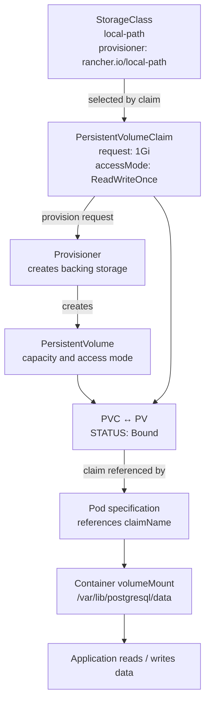

# Chapter 10 — Storage Fundamentals and Dynamic Provisioning

## Chapter objectives

This chapter explains how Kubernetes makes persistent storage available to Pods and documents the storage troubleshooting completed in the Vagrant lab. The practical focus is the Rancher Local Path Provisioner, the `local-path` StorageClass, Prometheus PVC recovery, and the PostgreSQL StatefulSet claim created by the multi-tier Helm chart.

By the end of this chapter, you should be able to:

- Explain the difference between ephemeral container storage, a PersistentVolume (PV), a PersistentVolumeClaim (PVC), and a StorageClass.
- Follow the lifecycle of a dynamically provisioned volume from a claim to a bound PV and a consuming Pod.
- Understand access modes, reclaim policies, and volume binding modes.
- Inspect PVCs, PVs, StorageClasses, Pods, and storage-related events.
- Diagnose a Pod that is Pending because its PVC is unbound.
- Explain why the Prometheus installation initially failed and how the local-path provisioner resolved it.
- Recognize how a StatefulSet `volumeClaimTemplates` creates persistent claims for database Pods.
- Identify the limits of node-local storage and the additional work required for production data protection.

> **Evidence labels used in this chapter**
>
> - **Recorded lab step:** a command or configuration present in the practice-session record.
> - **Recorded validation:** a command output or Kubernetes state explicitly captured in the source conversation.
> - **Source limitation:** the source does not contain enough evidence to claim a particular behavior was tested or completed.
> - **Recommended exercise / improvement:** additional guidance for learning or hardening. It is not represented as something already performed.

---

## 1. Why Kubernetes needs persistent storage

### 1.1 The container filesystem is not a database backup

A container has a writable filesystem layer. Data written only into that layer is coupled to the lifecycle of that container instance. If a container is replaced, its writable layer is not a reliable place to keep application data that must survive replacement.

A Pod can also be deleted and recreated. A replacement Pod may have a different name, a different IP address, and may be scheduled to a different node. Applications such as databases, monitoring systems, and stateful services therefore need storage whose lifecycle is managed separately from an individual container.

Examples of data that normally needs persistence:

- PostgreSQL database files.
- Prometheus time-series database (TSDB) data.
- Alertmanager state and silences.
- Application uploads and user-generated content.
- Message broker or search-engine data.

A volume mounted into a container gives the application a filesystem path backed by a Kubernetes volume. A PersistentVolumeClaim lets the workload request storage without hard-coding the details of the underlying storage implementation.

### 1.2 Ephemeral storage versus persistent storage

| Storage type | Typical purpose | Lifecycle / limitation |
|---|---|---|
| Container writable layer | Temporary files for one container instance | Not a durable application-data location |
| `emptyDir` | Scratch space shared by containers in one Pod | Removed when the Pod is removed from its node |
| `hostPath` | Access a path on a specific node | Tied to node filesystem; requires careful security and scheduling |
| PersistentVolume (PV) | Cluster storage resource | Lifecycle is separate from a Pod |
| PersistentVolumeClaim (PVC) | Workload's request for storage | Binds to a PV |
| StorageClass | Defines a storage/provisioning class | Connects a claim to a provisioner and storage policy |

**Important:** a PV is a Kubernetes resource representing storage; it is not itself a backup. A persistent disk can still be lost, corrupted, deleted, or become unavailable. Backups, restore testing, monitoring, and a failure-domain design remain necessary.

---

## 2. The four core Kubernetes storage objects

### 2.1 PersistentVolume (PV)

A PersistentVolume is a cluster-scoped resource representing a piece of storage made available to the cluster. It carries properties such as:

- Capacity.
- Access modes.
- StorageClass association.
- Reclaim policy.
- Volume source / provisioned storage reference.
- Current lifecycle phase and claim reference.

A PV can be created by an administrator (static provisioning) or by a storage provisioner in response to a PVC (dynamic provisioning).

Useful commands:

```bash
kubectl get pv
kubectl get pv -o wide
kubectl describe pv <pv-name>
kubectl get pv -o yaml
```

PV resources are cluster-scoped; do not append `-n <namespace>` to `kubectl get pv`.

### 2.2 PersistentVolumeClaim (PVC)

A PersistentVolumeClaim is a namespaced request for storage made by a workload or user. It can request:

- A storage capacity, for example `1Gi`.
- One or more access modes.
- A StorageClass (or an explicitly empty StorageClass for a static-binding workflow).
- Optionally, a volume mode such as `Filesystem` or `Block`.

A PVC is not the storage device. It is the request that Kubernetes attempts to satisfy with a compatible PV.

Useful commands:

```bash
kubectl get pvc -A
kubectl get pvc -n <namespace>
kubectl describe pvc <claim-name> -n <namespace>
kubectl get pvc <claim-name> -n <namespace> -o yaml
```

PVCs are namespaced. A Pod can reference a PVC only from its own namespace.

### 2.3 StorageClass

A StorageClass describes a class of storage and how it should be provisioned. It commonly specifies:

- `provisioner`: the CSI driver or external provisioner responsible for creating volumes.
- `parameters`: implementation-specific settings.
- `reclaimPolicy`: what happens to the PV after its claim is released.
- `volumeBindingMode`: when provisioning/binding should occur.
- `allowVolumeExpansion`: whether supported claims may be expanded.

A StorageClass is cluster-scoped.

Commands:

```bash
kubectl get storageclass
kubectl get sc
kubectl describe storageclass local-path
kubectl get storageclass local-path -o yaml
```

A default StorageClass is used when a PVC does not explicitly name a class and the cluster has a default configured. A cluster can have more than one StorageClass, but should not have multiple defaults unless the platform's behavior is intentionally understood and managed.

### 2.4 Pod volume and volumeMount

The Pod specification connects the claim to a container mount:

- `spec.volumes[].persistentVolumeClaim.claimName` references the PVC.
- `spec.containers[].volumeMounts[].mountPath` defines where the container sees the volume.

For a StatefulSet, `volumeClaimTemplates` creates a PVC for each StatefulSet Pod ordinal. The resulting claim is then referenced by the Pod created for that ordinal.

---

## 3. StorageClass → PVC → PV → Pod binding flow

The following Mermaid diagram shows the main dynamic-provisioning flow. The PVC is the request; the StorageClass identifies the provisioner; the provisioner creates a PV; Kubernetes binds the claim to that PV; and the Pod mounts the claim.



### 3.1 What happens in dynamic provisioning?

1. A workload or administrator creates a PVC.
2. Kubernetes identifies the requested StorageClass. If the PVC omits `storageClassName`, the default StorageClass may be selected.
3. The StorageClass names a provisioner.
4. The provisioner creates or allocates backing storage and a PV object.
5. Kubernetes matches the new PV with the PVC and binds them.
6. The PVC changes to `Bound`.
7. A Pod that references the claim can use it, subject to scheduling and volume-attachment/mount requirements.

The exact sequence can be affected by `volumeBindingMode`. With `WaitForFirstConsumer`, provisioning/binding is delayed until a consuming Pod exists so that topology and scheduling constraints can be considered. The simple diagram represents the logical dependency, not a guarantee that every controller action occurs in that exact temporal order.

### 3.2 Static versus dynamic provisioning

| Characteristic | Static provisioning | Dynamic provisioning |
|---|---|---|
| PV creation | Administrator creates PV first | Provisioner creates PV in response to PVC |
| StorageClass | May be omitted or used to match a class | Usually names the provisioner and policy |
| Operator effort | More manual capacity and PV management | Less manual PV creation |
| Typical learning use | Understand PV/PVC matching | Understand automated storage lifecycle |
| Recorded lab | Not shown as completed | Completed using local-path |

The recorded Vagrant storage work used dynamic provisioning. The source conversation does not show a completed static PV creation exercise.

---

## 4. Access modes and volume modes

### 4.1 Access modes

Access modes describe how a volume can be mounted by nodes or workloads. They are capability/eligibility declarations used during matching and mounting; they should not be interpreted as a universal application-level locking mechanism.

| Access mode | Meaning |
|---|---|
| `ReadWriteOnce` (RWO) | Can be mounted read-write by a single node at a time. Multiple Pods on that same node may be able to use it, depending on the volume implementation. |
| `ReadOnlyMany` (ROX) | Can be mounted read-only by many nodes, if the storage driver supports it. |
| `ReadWriteMany` (RWX) | Can be mounted read-write by many nodes, if the storage driver supports it. |
| `ReadWriteOncePod` (RWOP) | Can be mounted read-write by a single Pod; support depends on the CSI driver and Kubernetes version. |

**RWO does not mean exactly one Pod.** It means read-write access from one node at a time. If two Pods on the same node reference a compatible RWO volume, the storage system may allow both to mount it. If the workload requires strict single-Pod mounting, investigate RWOP support.

Not every storage backend supports every access mode. A PVC requesting RWX cannot be satisfied by a backend that only supports RWO.

### 4.2 Volume mode

Kubernetes supports two volume modes:

- `Filesystem` (default): the volume is mounted as a filesystem.
- `Block`: the volume is exposed as a raw block device to the Pod.

Most ordinary application and database examples use `Filesystem`. Raw block mode is a specialized use case and requires an application that knows how to manage a block device.

### 4.3 The modes used in your lab

The captured Prometheus claims used `RWO`; the PostgreSQL StatefulSet claim also requested `ReadWriteOnce`.

This was a suitable learning configuration for a single-replica database and local-path storage. It does not establish that a shared filesystem or multi-node read-write storage was configured.

---

## 5. Reclaim policies and data lifecycle

The reclaim policy controls what Kubernetes does with the PV resource after the PVC is deleted and the claim is released.

| Policy | General behavior | Operational consideration |
|---|---|---|
| `Delete` | The PV and, when supported by the provisioner, its backing storage are deleted | Convenient for dynamically provisioned disposable volumes; deletion can destroy data |
| `Retain` | PV remains after claim release and enters a released state for manual recovery/reuse | Safer when manual data recovery is required, but needs operator intervention |
| `Recycle` | Legacy scrub-and-reuse behavior | Deprecated/removed from normal modern storage workflows; do not select for new designs |

Your recorded `local-path` StorageClass showed reclaim policy `Delete`. The Prometheus PV output also showed `Delete`. This means deleting a claim can trigger deletion of the dynamically provisioned PV and its local backing directory according to the provisioner's behavior.

**Before deleting a PVC, StatefulSet, Helm release, or namespace, inspect the reclaim policy and understand the provisioner's cleanup behavior.** A Helm uninstall is not a database backup strategy.

Useful inspection commands:

```bash
kubectl get sc
kubectl get pv
kubectl describe pv <pv-name>
kubectl get pvc -n <namespace>
```

### 5.1 Retain versus Delete: practical decision

- Use `Delete` for disposable lab data where automatic cleanup is intended.
- Consider `Retain` when the data must be preserved for manual recovery after a claim is removed.
- For production, define backup, restore, retention, and disaster-recovery procedures independently of the PV reclaim policy.

A `Retain` policy does not automatically back up the volume. It only changes the cleanup behavior after claim release.

---

## 6. VolumeBindingMode and topology

The recorded local-path StorageClass showed:

- Provisioner: `rancher.io/local-path`
- Reclaim policy: `Delete`
- Volume binding mode: `WaitForFirstConsumer`
- Allow volume expansion: `false`

### 6.1 Immediate

With `Immediate`, the storage system attempts provisioning/binding as soon as the PVC is created. This can be problematic for topology-constrained storage if the system allocates a volume before the scheduler has selected a suitable node.

### 6.2 WaitForFirstConsumer

With `WaitForFirstConsumer`, provisioning/binding waits until a Pod using the claim is created. Kubernetes can then consider the Pod's scheduling constraints when choosing a compatible storage location.

This is particularly relevant to local storage because the volume is associated with a node. A Pod using that volume must be scheduled where the local storage is available.

**Do not assume that `WaitForFirstConsumer` means the volume is shared or replicated.** It is a binding/scheduling behavior, not a data-replication feature.

---

## 7. Your Vagrant lab: installing Local Path Provisioner

This is the first major hands-on storage exercise captured in the conversation.

### 7.1 The original Prometheus failure

Prometheus was installed using Helm:

```bash
helm install prometheus \
  prometheus-community/prometheus \
  -n prometheus
```

The chart requested persistent storage for Prometheus Server and Alertmanager. The captured state showed:

- `prometheus-server` Pod: Pending.
- `prometheus-alertmanager-0` Pod: Pending.
- PVCs: Pending.
- `kubectl get storageclass`: no resources found.
- Pod scheduling event: `pod has unbound immediate PersistentVolumeClaims`.

This was not initially an application-image or Prometheus configuration problem. The cluster had no StorageClass available to provision the requested volumes.

### 7.2 Troubleshooting chain

The investigation followed this pattern:

```text
Pod Pending
   |
   v
kubectl describe pod
   |
   v
Event: unbound PersistentVolumeClaims
   |
   v
kubectl get pvc -n prometheus
   |
   v
PVCs Pending
   |
   v
kubectl get storageclass
   |
   v
No StorageClass exists
```

Commands for this diagnostic sequence:

```bash
kubectl get pods -n prometheus
kubectl describe pod <prometheus-pod> -n prometheus

kubectl get pvc -n prometheus
kubectl describe pvc prometheus-server -n prometheus
kubectl describe pvc storage-prometheus-alertmanager-0 -n prometheus

kubectl get storageclass
kubectl get events -n prometheus --sort-by=.lastTimestamp
```

**Recorded root cause:** the PVCs had no StorageClass to invoke a provisioner. Therefore no matching dynamically provisioned PV could be created and the Pods could not proceed to normal scheduling/mounting.

### 7.3 Install Rancher Local Path Provisioner

For this Vagrant/VirtualBox lab, the selected provisioner was Rancher Local Path Provisioner.

**Recorded installation command:**

```bash
kubectl apply -f \
  https://raw.githubusercontent.com/rancher/local-path-provisioner/master/deploy/local-path-storage.yaml
```

Check its Pod:

```bash
kubectl get pods -n local-path-storage
```

The expected provisioner workload is named `local-path-provisioner`. Wait until it is Running before relying on it to satisfy new claims.

Inspect the StorageClass:

```bash
kubectl get storageclass
kubectl describe storageclass local-path
```

**Recorded StorageClass output (normalized):**

```text
NAME         PROVISIONER             RECLAIMPOLICY   VOLUMEBINDINGMODE
local-path   rancher.io/local-path   Delete          WaitForFirstConsumer

ALLOWVOLUMEEXPANSION
false
```

This established that the StorageClass existed. At this point, it was not yet marked as the default.

### 7.4 Mark local-path as the default StorageClass

The Prometheus PVCs had originally been created when no StorageClass existed. Adding a default StorageClass later does not reliably retrofit an already-created PVC whose `storageClassName` was left empty.

The recorded recovery therefore removed and reinstalled the lab Prometheus Helm release after setting the default StorageClass.

**Recorded patch command:**

```bash
kubectl patch storageclass local-path \
  -p '{"metadata":{"annotations":{"storageclass.kubernetes.io/is-default-class":"true"}}}'
```

Verify:

```bash
kubectl get storageclass
```

**Recorded output included:**

```text
NAME                 PROVISIONER             RECLAIMPOLICY
local-path (default) rancher.io/local-path   Delete

VOLUMEBINDINGMODE       ALLOWVOLUMEEXPANSION
WaitForFirstConsumer    false
```

The `(default)` marker confirmed that new PVCs that omit `storageClassName` could use `local-path`.

### 7.5 Recreate the Prometheus release and verify the claims

Because the original PVCs had been created without a usable StorageClass, the recorded lab removed and reinstalled the release:

```bash
helm uninstall prometheus -n prometheus

helm install prometheus \
  prometheus-community/prometheus \
  -n prometheus
```

> **Data warning:** uninstalling a Helm release and deleting PVCs can cause persistent data loss depending on the resources and reclaim policy. The recorded action was a learning-lab recovery while the initial Prometheus installation had no valuable metrics history. Do not copy this as a production remediation without first checking data-retention requirements.

Watch the claims:

```bash
kubectl get pvc -n prometheus -w
```

Then inspect the final state:

```bash
kubectl get pvc -n prometheus
kubectl get pv
kubectl get pods -n prometheus
```

**Recorded PVC validation (names and values captured in the source):**

| PVC | Status | Capacity | Access mode | StorageClass |
|---|---|---:|---|---|
| `prometheus-server` | Bound | 8Gi | RWO | `local-path` |
| `storage-prometheus-alertmanager-0` | Bound | 2Gi | RWO | `local-path` |

The source output showed dynamically generated PV names beginning with `pvc-`; these names are implementation-generated and should not be hard-coded in scripts or documentation as stable identifiers.

**What this proved:** both claims were successfully bound through the `local-path` StorageClass. This was a verified dynamic-provisioning exercise.

**What it did not prove:** it did not establish a multi-node shared filesystem, replicated storage, a backup/restore procedure, or production-grade availability.

---

## 8. PostgreSQL storage in the multi-tier Helm chart

The next recorded example appears in the multi-tier application chart documented in Chapter 9.

### 8.1 Why a StatefulSet?

The database was managed by a StatefulSet rather than a Deployment because the workload needed stable identity and a persistent claim associated with its Pod ordinal.

For the single-replica lab database:

- StatefulSet: `postgres`
- Pod identity: `postgres-0`
- Claim generated from the template: `postgres-storage-postgres-0`
- Container mount path: `/var/lib/postgresql/data`
- Requested capacity: `1Gi`
- Access mode: `ReadWriteOnce`

### 8.2 Recorded StatefulSet storage configuration

The captured chart template included the following relevant fragment:

```yaml
apiVersion: apps/v1
kind: StatefulSet
metadata:
  name: postgres
spec:
  serviceName: postgres
  replicas: 1

  selector:
    matchLabels:
      app: postgres

  template:
    metadata:
      labels:
        app: postgres
    spec:
      containers:
        - name: postgres
          image: "postgres:16"
          ports:
            - containerPort: 5432
          volumeMounts:
            - name: postgres-storage
              mountPath: /var/lib/postgresql/data

  volumeClaimTemplates:
    - metadata:
        name: postgres-storage
      spec:
        accessModes:
          - ReadWriteOnce
        resources:
          requests:
            storage: 1Gi
```

This excerpt is a normalized representation of the captured chart structure. The complete chart also included Secret references for PostgreSQL initialization variables.

### 8.3 How volumeClaimTemplates names the claim

For a StatefulSet named `postgres` and a claim template named `postgres-storage`, the claim for ordinal Pod `postgres-0` is:

```text
postgres-storage-postgres-0
```

The StatefulSet controller creates a separate claim for each Pod ordinal. If the StatefulSet had more replicas, each ordinal would receive its own claim (subject to the configured claim template and successful provisioning).

### 8.4 Recorded PVC validation

The captured command was:

```bash
kubectl get pvc,pv -n multi-dev
```

The recorded PVC row showed:

```text
NAME:           postgres-storage-postgres-0
STATUS:         Bound
CAPACITY:       1Gi
ACCESS MODES:   RWO
STORAGECLASS:   local-path
```

This confirms that the StatefulSet's claim was satisfied by the default `local-path` StorageClass.

The source also captured PostgreSQL initially in `ContainerCreating` while its image was being pulled. The PVC was already Bound. That distinction matters: a Bound claim does not guarantee that the container has finished starting, passed readiness checks, or successfully accepted SQL connections.

**Source limitation:** the captured session does not include a successful PostgreSQL client login, SQL query, or database restart-and-data-integrity test. The claim binding and Pod startup were observed; database persistence across Pod recreation was not independently demonstrated in the source record.

---

## 9. Inspecting the complete storage relationship

Use these commands to move from a claim to its backing PV and the Pod that consumes it.

### 9.1 Inspect all claims

```bash
kubectl get pvc -A
```

For one namespace:

```bash
kubectl get pvc -n multi-dev
kubectl describe pvc postgres-storage-postgres-0 -n multi-dev
```

### 9.2 Find the PV bound to a claim

The PVC output includes a `VOLUME` field. Use that value to inspect the PV:

```bash
kubectl get pvc postgres-storage-postgres-0 -n multi-dev
kubectl get pv
kubectl describe pv <volume-name>
```

Do not assume the generated PV name. Read it from the current cluster output.

### 9.3 Inspect the StorageClass

```bash
kubectl get sc
kubectl describe sc local-path
kubectl get sc local-path -o yaml
```

Review:
- Provisioner.
- Reclaim policy.
- Volume binding mode.
- Default-class annotation.
- Expansion setting.

### 9.4 Inspect the StatefulSet and Pod mounts

```bash
kubectl get statefulset postgres -n multi-dev
kubectl describe statefulset postgres -n multi-dev
kubectl get pod postgres-0 -n multi-dev -o yaml
```

Look for:
- `volumeClaimTemplates` on the StatefulSet.
- Claim name in the Pod's `volumes`.
- Matching `volumeMounts` entry in the container.
- Pod events for mount, attach, or scheduling errors.

---

## 10. Troubleshooting PVC and storage problems

### 10.1 Symptom: Pod Pending with an unbound PVC

Example event:

```text
pod has unbound immediate PersistentVolumeClaims
```

Investigation:

```bash
kubectl get pods -n <namespace>
kubectl describe pod <pod-name> -n <namespace>

kubectl get pvc -n <namespace>
kubectl describe pvc <pvc-name> -n <namespace>

kubectl get storageclass
kubectl get pv
kubectl get events -n <namespace> --sort-by=.lastTimestamp
```

Possible causes:
- No StorageClass exists.
- The PVC references a StorageClass that does not exist.
- No default StorageClass exists and the claim omitted `storageClassName`.
- No compatible PV is available for a static claim.
- The provisioner is unhealthy or cannot create backing storage.
- Requested capacity or access mode cannot be satisfied.
- Topology or node scheduling constraints prevent a compatible volume from being selected.

The Prometheus incident in your lab matched the first and third conditions: no StorageClass was available when the claims were created.

### 10.2 Symptom: PVC remains Pending after installing a StorageClass

Do not immediately delete the PVC. Inspect it first:

```bash
kubectl describe pvc <pvc-name> -n <namespace>
kubectl get pvc <pvc-name> -n <namespace> -o yaml
kubectl get sc
kubectl get pods -n local-path-storage
kubectl logs -n local-path-storage deployment/local-path-provisioner
```

Check the `storageClassName` field and PVC events. If the claim was created before a default class existed, it may not automatically receive the class after the fact.

**Recommended remediation approach:**
1. Inspect the PVC and its data-retention importance.
2. Check whether the claim explicitly names a StorageClass.
3. Verify that the provisioner Pod is healthy.
4. Review provisioner logs and events.
5. Only recreate a claim if it is safe to lose or restore its data and the workload owner has approved the action.

The recorded Prometheus lab used a Helm uninstall/reinstall because it was a new learning installation. That was not a general instruction to delete production claims.

### 10.3 Symptom: PVC is Bound but Pod is not Running

A Bound PVC only confirms the claim-to-volume binding. The Pod can still fail for other reasons:

- Image pull failures.
- Container startup or configuration errors.
- Volume mount errors.
- File-system permission or ownership problems.
- Node pressure or scheduling constraints.
- Readiness or liveness probe failures.

Commands:

```bash
kubectl get pod -n <namespace> -o wide
kubectl describe pod <pod-name> -n <namespace>
kubectl logs <pod-name> -n <namespace>
kubectl get events -n <namespace> --sort-by=.lastTimestamp
```

For a previous container instance:

```bash
kubectl logs <pod-name> -n <namespace> --previous
```

### 10.4 Symptom: volume cannot be mounted on another node

This can be expected with node-local storage. If a local volume is physically present on one node, a Pod cannot simply mount that same local directory from another node.

Check:

```bash
kubectl get pod <pod-name> -n <namespace> -o wide
kubectl describe pod <pod-name> -n <namespace>
kubectl describe pv <pv-name>
kubectl describe sc local-path
```

Review node affinity / topology information on the PV and the events from the scheduler and kubelet. Do not try to solve a local-storage topology issue by manually copying data directories between nodes.

### 10.5 Symptom: claim is lost or data disappears after deletion

Inspect the reclaim policy before deleting anything:

```bash
kubectl get pv
kubectl describe pv <pv-name>
kubectl get sc
```

With `Delete`, a provisioner may remove its backing storage after the claim is deleted. With `Retain`, the PV and backing data are intended to remain for manual recovery, subject to the storage implementation.

Never use `kubectl delete pvc` as a casual troubleshooting command for a database.

---

## 11. Local Path Provisioner: what it provides and what it does not

Local Path Provisioner makes it possible to dynamically create local directories on Kubernetes nodes and expose them through PVs. This is convenient for a local Vagrant/VirtualBox lab.

### 11.1 Benefits in the learning cluster

- Demonstrates StorageClass and dynamic provisioning.
- Avoids manually creating a PV for every PVC.
- Works in a local virtualized lab.
- Allows Helm charts that request persistent storage to become schedulable.
- Provides a useful environment for learning PVC lifecycle and troubleshooting.

### 11.2 Limitations

Local-path storage is not equivalent to network-attached or distributed storage:

- Data is local to a node.
- It does not automatically replicate data across the three Kubernetes nodes.
- Node failure or loss of the underlying VM/disk can make data unavailable.
- Rescheduling a Pod to another node does not make a node-local data directory magically appear there.
- A local-path StorageClass does not provide backup, snapshots, or disaster recovery by itself.
- The recorded StorageClass had expansion disabled.

This is why local-path was appropriate for the lab but should not be treated as a highly available production database storage architecture.

### 11.3 Do not confuse the storage components

| Component | Role |
|---|---|
| Kubernetes PV/PVC API | Represents and requests storage |
| StorageClass | Selects storage policy and provisioner |
| Local Path Provisioner | Creates node-local storage for claims |
| CSI driver | Standard Kubernetes storage-driver interface used by many storage platforms |
| Longhorn | Distributed block storage platform; covered in Chapter 16 |
| AWS EBS CSI driver | Integrates Kubernetes with Amazon EBS volumes; not installed or validated in this Vagrant lab |

The source conversation documents local-path. It does not document a completed NFS, AWS EBS CSI, or Longhorn deployment in this chapter's lab. Those are separate storage implementations and should be learned and validated independently.

---

## 12. Recommended hands-on exercises

The exercises below extend the recorded work. They are **recommended follow-up tasks**, not claims that they were already executed.

### Lab 10.1 — Inspect the existing default StorageClass

```bash
kubectl get sc
kubectl describe sc local-path
kubectl get sc local-path -o yaml
```

Record:
- Provisioner.
- Default annotation.
- Reclaim policy.
- Volume binding mode.
- Expansion setting.

Expected learning result: explain why new claims without an explicit `storageClassName` can use `local-path`.

### Lab 10.2 — Create a standalone PVC

Create a file named `storage-lab-pvc.yaml`:

```yaml
apiVersion: v1
kind: PersistentVolumeClaim
metadata:
  name: storage-lab-pvc
  namespace: default
spec:
  accessModes:
    - ReadWriteOnce
  storageClassName: local-path
  resources:
    requests:
      storage: 1Gi
```

Apply and inspect:

```bash
kubectl apply -f storage-lab-pvc.yaml
kubectl get pvc storage-lab-pvc
kubectl describe pvc storage-lab-pvc
kubectl get pv
```

Because the class uses `WaitForFirstConsumer`, the claim may remain Pending until a Pod consumes it. This is expected behavior for that binding mode, not automatically a provisioner failure.

### Lab 10.3 — Create a Pod that consumes the claim

Create `storage-lab-pod.yaml`:

```yaml
apiVersion: v1
kind: Pod
metadata:
  name: storage-lab-pod
  namespace: default
spec:
  containers:
    - name: storage-check
      image: busybox:1.36
      command: ["sh", "-c", "sleep 36000"]
      volumeMounts:
        - name: lab-data
          mountPath: /data
  volumes:
    - name: lab-data
      persistentVolumeClaim:
        claimName: storage-lab-pvc
```

Apply:

```bash
kubectl apply -f storage-lab-pod.yaml
kubectl get pod storage-lab-pod -o wide
kubectl get pvc storage-lab-pvc
kubectl get pv
```

Wait for the Pod to become Running and the PVC to become Bound. If it does not, inspect Pod and PVC events rather than guessing.

Write a test file:

```bash
kubectl exec storage-lab-pod -- sh -c \
  'date > /data/storage-check.txt && cat /data/storage-check.txt'
```

Then delete and recreate only the Pod (not the PVC):

```bash
kubectl delete pod storage-lab-pod
kubectl apply -f storage-lab-pod.yaml
kubectl wait --for=condition=Ready pod/storage-lab-pod --timeout=120s
kubectl exec storage-lab-pod -- cat /data/storage-check.txt
```

If the file remains available, this demonstrates persistence across Pod replacement while the claim and underlying volume remain. It does not demonstrate survival after node or disk loss.

### Lab 10.4 — Inspect StatefulSet-generated claims

Use the Chapter 9 database namespace:

```bash
kubectl get sts -n multi-dev
kubectl get pods -n multi-dev
kubectl get pvc -n multi-dev
kubectl describe pvc postgres-storage-postgres-0 -n multi-dev
```

Explain how `volumeClaimTemplates` creates a claim named for the StatefulSet and Pod ordinal.

### Lab 10.5 — Cleanup the standalone lab resources

Only after completing the exercise:

```bash
kubectl delete pod storage-lab-pod
kubectl delete pvc storage-lab-pvc
```

The StorageClass and its provisioner are shared cluster infrastructure. Do not remove them as part of this per-exercise cleanup.

**Data warning:** deleting a PVC with a `Delete` reclaim policy may delete the backing storage. This is intentional for this disposable test, not a safe default for database data.

---

## 13. Production-readiness considerations

Before using persistent storage for a production workload, define and validate:

1. **Failure domains:** what happens if the Pod, node, VM, disk, storage network, or entire availability zone fails?
2. **Replication:** does the storage platform replicate data, and across which failure domains?
3. **Backups:** how often are backups taken, where are they stored, and are they isolated from the primary storage?
4. **Restore testing:** can the team restore a volume and application-consistent data within the required RTO/RPO?
5. **Snapshots:** are snapshots supported, scheduled, retained, and protected?
6. **Capacity:** how are free space, inode usage, IOPS, latency, and throughput monitored?
7. **Expansion:** does the provisioner support expansion, and does the filesystem/application need an additional resize step?
8. **Access control:** which service accounts and operators can create, inspect, or delete claims and volumes?
9. **Data deletion:** what are the effects of deleting a PVC, StatefulSet, namespace, or Helm release?
10. **Application consistency:** is the database quiesced or using a supported backup mechanism before a snapshot is taken?

For the current lab, `local-path` is a learning provisioner. The Longhorn architecture is reserved for Chapter 16, where distributed storage and replicas can be examined separately.

---

## 14. Command reference

| Task | Command |
|---|---|
| List StorageClasses | `kubectl get sc` |
| Describe a StorageClass | `kubectl describe sc local-path` |
| List PVCs in all namespaces | `kubectl get pvc -A` |
| List PVCs in one namespace | `kubectl get pvc -n <namespace>` |
| Describe a PVC | `kubectl describe pvc <name> -n <namespace>` |
| List PVs | `kubectl get pv` |
| Describe a PV | `kubectl describe pv <name>` |
| Inspect a Pod's scheduling and mount events | `kubectl describe pod <pod> -n <namespace>` |
| List namespace events | `kubectl get events -n <namespace> --sort-by=.lastTimestamp` |
| Inspect provisioner Pods | `kubectl get pods -n local-path-storage` |
| Read provisioner logs | `kubectl logs -n local-path-storage deployment/local-path-provisioner` |
| Watch PVC state changes | `kubectl get pvc -n <namespace> -w` |
| Watch PV state changes | `kubectl get pv -w` |
| Inspect a StatefulSet | `kubectl describe sts <name> -n <namespace>` |

---

## 15. Knowledge check

1. What is the difference between a PV and a PVC?
2. Why does a workload request a PVC instead of referring directly to a PV?
3. What role does a StorageClass play in dynamic provisioning?
4. What was the root cause of the Prometheus Pending Pods in the Vagrant lab?
5. Why did installing a default StorageClass not necessarily repair the original PVCs?
6. What does the `rancher.io/local-path` provisioner do?
7. What does `WaitForFirstConsumer` change about volume binding?
8. Does `ReadWriteOnce` mean only one Pod can ever mount the volume?
9. What is the difference between `Delete` and `Retain` reclaim policies?
10. Why is local-path storage not equivalent to replicated, highly available storage?
11. How does a StatefulSet `volumeClaimTemplates` name the claim for `postgres-0`?
12. Does a PVC in `Bound` state prove that the database is healthy and that backups exist?

### Suggested answers

1. A PV represents provisioned storage; a PVC is a namespaced request for storage.
2. It decouples the application from the details and lifecycle of the underlying storage.
3. It identifies the provisioner and storage policy used to satisfy claims dynamically.
4. The cluster had no StorageClass/provisioner available for the Prometheus PVCs.
5. A PVC created before a default class existed may have an empty class and may need careful recreation or explicit correction.
6. It dynamically provisions local node-backed storage for PVCs.
7. It delays binding/provisioning until a consuming Pod exists, allowing scheduling/topology to be considered.
8. No. RWO means read-write mounting from one node at a time; multiple Pods on that node may be possible depending on the implementation.
9. Delete allows provisioned storage cleanup; Retain leaves the PV/storage for manual recovery or reuse.
10. Local-path does not replicate data across nodes and remains dependent on the node and its disk.
11. The claim name is `<claim-template-name>-<statefulset-name>-<ordinal>`, producing `postgres-storage-postgres-0`.
12. No. Bound confirms claim-to-volume binding only; it does not prove application health, data integrity, replication, or backup readiness.

---

## 16. Chapter completion checklist

### Recorded and verified in the source conversation

- [x] Identified Prometheus Pods blocked by unbound PVCs.
- [x] Confirmed that no StorageClass existed during the initial failure.
- [x] Installed Rancher Local Path Provisioner.
- [x] Inspected the `local-path` StorageClass and its provisioner.
- [x] Marked `local-path` as the default StorageClass.
- [x] Reinstalled the lab Prometheus release after the StorageClass was available.
- [x] Verified Prometheus Server PVC was Bound at 8Gi, RWO, using `local-path`.
- [x] Verified Alertmanager PVC was Bound at 2Gi, RWO, using `local-path`.
- [x] Verified the PostgreSQL StatefulSet claim was Bound at 1Gi, RWO, using `local-path`.

### Recommended follow-up work (not claimed as completed)

- [ ] Create a standalone PVC and inspect the generated PV.
- [ ] Mount the claim in a test Pod and verify data survives Pod replacement.
- [ ] Inspect the local-path PV's node/topology details.
- [ ] Test and document the effects of PVC deletion only with disposable test data.
- [ ] Define a backup and restore exercise for stateful application data.
- [ ] Compare local-path with a distributed storage platform in Chapter 16.

---

## 17. References

- [Kubernetes documentation — Persistent Volumes](https://kubernetes.io/docs/concepts/storage/persistent-volumes/)
- [Kubernetes documentation — StorageClasses](https://kubernetes.io/docs/concepts/storage/storage-classes/)
- [Kubernetes documentation — Volumes](https://kubernetes.io/docs/concepts/storage/volumes/)
- [Kubernetes documentation — StatefulSets](https://kubernetes.io/docs/concepts/workloads/controllers/statefulset/)
- [Rancher Local Path Provisioner](https://github.com/rancher/local-path-provisioner)

**Chapter scope note:** the hands-on evidence in this chapter is drawn from the Vagrant Kubernetes practice record, especially the Prometheus PVC incident and the PostgreSQL StatefulSet claim in the multi-tier Helm lab. Static provisioning, NFS, AWS EBS CSI, and Longhorn are not represented as completed exercises here. Longhorn is covered separately in Chapter 16.
