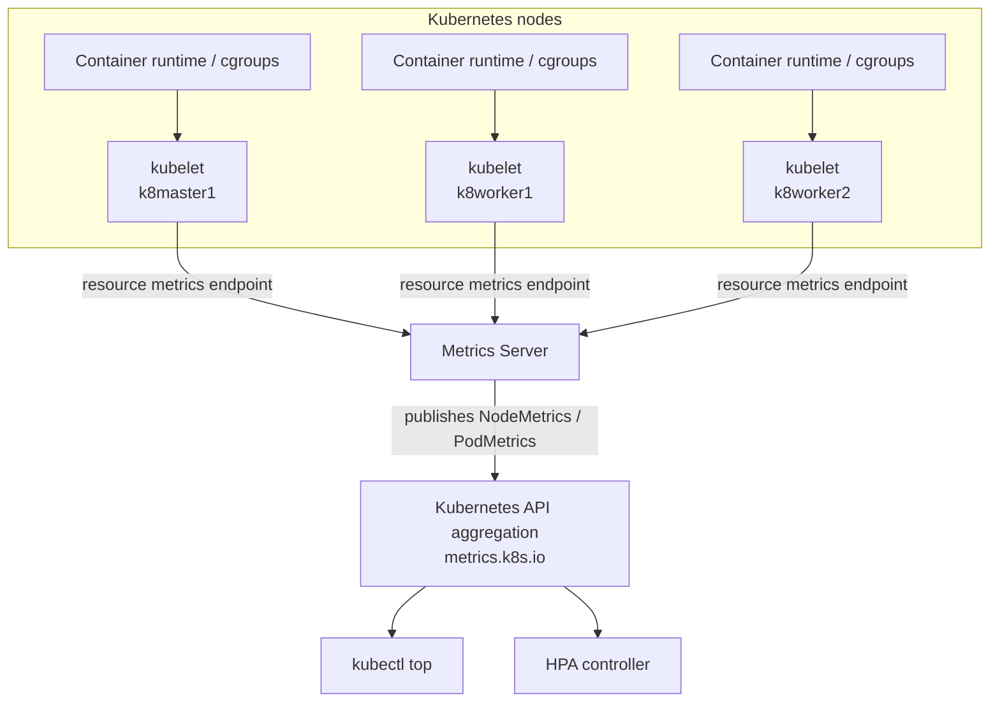
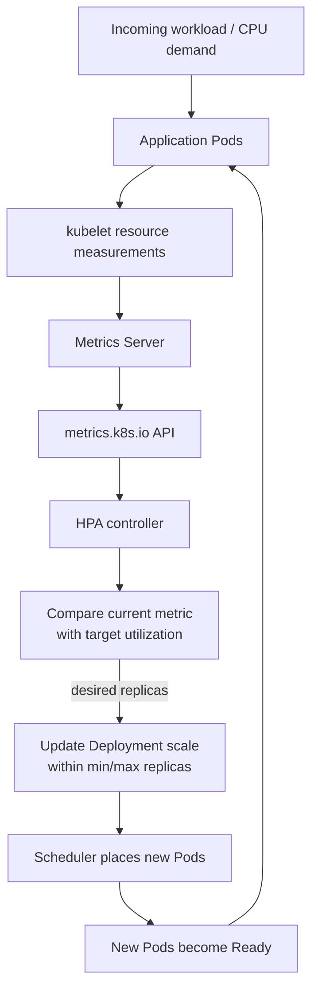

# Chapter 11 — Metrics Server and Autoscaling

## Chapter objectives

This chapter documents the resource-metrics and Horizontal Pod Autoscaler (HPA) work from the Kubernetes lab. It starts with the Metrics API problem encountered after the cluster was bootstrapped, records the Metrics Server installation and kubelet TLS workaround, and then connects those metrics to the HPA configured in the Flask Helm chart.

The practical examples use the three-node Vagrant cluster and the Flask release in namespace `helm-flask`.

By the end of this chapter, you should be able to:

- Explain the difference between Metrics Server, the Metrics API, and a full monitoring platform such as Prometheus.
- Trace how Metrics Server collects CPU and memory measurements from kubelets and exposes them through the Kubernetes API.
- Install and verify Metrics Server in a kubeadm/Vagrant cluster.
- Use `kubectl top nodes` and `kubectl top pods` to inspect resource usage.
- Understand CPU and memory requests, limits, and utilization.
- Explain how an HPA reads metrics and adjusts a workload's replica count.
- Configure an HPA using `autoscaling/v2`.
- Diagnose missing metrics, unknown HPA targets, and workloads that do not scale as expected.
- Distinguish a healthy HPA with available metrics from a demonstrated scale-out under load.

> **Evidence labels used in this chapter**
>
> - **Recorded lab step:** a command or configuration present in the practice-session record.
> - **Recorded validation:** an output or Kubernetes state explicitly captured in the source conversation.
> - **Source limitation:** the source does not contain enough evidence to claim a behavior was tested or completed.
> - **Recommended exercise / improvement:** additional guidance for learning or hardening. It is not represented as something already performed.

---

## 1. Why resource metrics matter

Kubernetes schedules Pods and manages workloads, but operators still need visibility into the resources being consumed by nodes and containers.

Typical questions include:

- Which node is using the most CPU or memory?
- Is a container approaching its configured resource limit?
- Does a workload have enough CPU to serve incoming requests?
- Should a Deployment run more replicas?
- Is a Pod Pending because the cluster has insufficient allocatable resources?
- Is an autoscaler receiving valid metrics?

The lab first exposed this gap when `kubectl top nodes` returned:

```text
error: Metrics API not available
```

This was expected before Metrics Server was installed. The cluster could run workloads, Services, DNS, and Ingress, but the resource Metrics API was not yet available.

Metrics Server and HPA address a specific part of this problem:
- Metrics Server gathers recent CPU and memory usage from kubelets.
- The Metrics API makes those resource measurements available to Kubernetes clients and controllers.
- HPA uses supported metrics to calculate a desired replica count for a scalable workload.

---

## 2. Metrics Server, Metrics API, and Prometheus are different

### 2.1 Metrics Server

Metrics Server is a cluster add-on that collects resource usage metrics from kubelets and exposes them through the Kubernetes Metrics API.

Common consumers include:
- `kubectl top nodes`
- `kubectl top pods`
- Horizontal Pod Autoscaler for CPU and memory resource metrics

Metrics Server is intended to provide lightweight, recent resource metrics for autoscaling and basic resource inspection. It is not a long-term metrics database.

### 2.2 Metrics API

The resource Metrics API is exposed under:

```text
/apis/metrics.k8s.io/
```

It provides objects such as:
- `NodeMetrics`
- `PodMetrics`

The API is commonly served through Kubernetes API aggregation. A Metrics Server installation registers an APIService for the `metrics.k8s.io` group.

Inspect it:

```bash
kubectl get apiservice v1beta1.metrics.k8s.io
kubectl describe apiservice v1beta1.metrics.k8s.io
kubectl get --raw /apis/metrics.k8s.io/
```

The exact API version and endpoint availability depend on the Kubernetes and Metrics Server versions installed. The commands above are useful checks for the common `metrics.k8s.io/v1beta1` resource metrics API.

### 2.3 Prometheus and Grafana

Prometheus is a monitoring and time-series database platform. It can scrape application and infrastructure metrics, retain history, evaluate PromQL queries, and support alerting workflows. Grafana can query Prometheus and visualize the collected data.

| Capability | Metrics Server | Prometheus |
|---|---|---|
| Recent CPU/memory usage for Pods and nodes | Yes | Can collect it through exporters/integrations |
| `kubectl top` support | Yes, via Metrics API | No, not directly |
| HPA resource-metric source | Common built-in resource metrics source | Not directly; custom/external metrics adapters are separate integrations |
| Long-term time-series retention | No | Yes |
| PromQL | No | Yes |
| Alerting and dashboards | Not its purpose | Commonly integrated with Alertmanager and Grafana |

**Important:** installing Metrics Server does not install Prometheus, Grafana, or a full observability stack. The Prometheus and Grafana work is documented in later chapters.

---

## 3. Kubelet metrics pipeline

The following Mermaid diagram shows the resource metrics path from nodes to Kubernetes API consumers.



### 3.1 Pipeline explanation

1. Workloads run on the nodes.
2. The kubelet on each node provides resource usage information for node and Pod/container workloads.
3. Metrics Server periodically collects these metrics from the kubelets.
4. Metrics Server exposes the data through the aggregated resource Metrics API.
5. `kubectl top` queries that API to display current node or Pod resource usage.
6. HPA controller uses the resource metrics when calculating desired replica counts for HPA targets.

The diagram is a logical pipeline. It does not mean Metrics Server scrapes Prometheus, or that HPA queries kubelets directly.

### 3.2 Metrics freshness and retention

Metrics Server provides recent measurements for autoscaling and resource inspection. It is not intended to retain a historical time series for weeks or months.

Use:
- Metrics Server for current resource metrics and built-in HPA resource metrics.
- Prometheus for time-series collection, history, PromQL, and alerting.
- Grafana for dashboards and visualization.

---

## 4. Installing Metrics Server in the Vagrant cluster

### 4.1 Lab environment

The cluster documented in earlier chapters has this topology:

| Node | Kubernetes role | Host-only address |
|---|---|---|
| `k8master1` | Control plane | `192.168.56.10` |
| `k8worker1` | Worker | `192.168.56.20` |
| `k8worker2` | Worker | `192.168.56.21` |

The practice conversation used the Metrics Server release manifest from the project's GitHub releases.

### 4.2 Check the initial state

**Recorded initial check:**

```bash
kubectl top nodes
```

The captured expected error was:

```text
error: Metrics API not available
```

This indicated that the Metrics API was not yet available. It did not mean the Kubernetes API server itself was down.

### 4.3 Apply the Metrics Server manifest

**Recorded installation command:**

```bash
kubectl apply -f \
  https://github.com/kubernetes-sigs/metrics-server/releases/latest/download/components.yaml
```

The manifest creates the Metrics Server components, including its Deployment and API registration resources.

Check the Pod:

```bash
kubectl get pods -n kube-system
kubectl get deployment metrics-server -n kube-system
```

The Pod may initially be in `ContainerCreating` before it becomes Running.

### 4.4 Inspect logs if the Pod is unhealthy

```bash
kubectl logs -n kube-system deployment/metrics-server
```

The recorded troubleshooting discussion identified kubelet certificate trust as a likely issue in kubeadm/Vagrant environments. Example errors included:
- `x509: certificate signed by unknown authority`
- Errors fetching metrics from a kubelet.

Metrics Server must be able to reach the kubelets on the nodes and validate their serving certificates unless configured otherwise.

### 4.5 The Vagrant lab TLS workaround

The practice conversation added this argument to the Metrics Server Deployment:

```text
--kubelet-insecure-tls
```

The recorded patch command was:

```bash
kubectl patch deployment metrics-server \
  -n kube-system \
  --type='json' \
  -p='[
    {"op":"add","path":"/spec/template/spec/containers/0/args/-","value":"--kubelet-insecure-tls"}
  ]'
```

An equivalent interactive approach discussed in the session was:

```bash
kubectl edit deployment metrics-server -n kube-system
```

Then add the argument under the Metrics Server container's `args` list.

**Security warning:** `--kubelet-insecure-tls` disables certificate verification for Metrics Server's kubelet connections. It was used as a lab workaround for the Vagrant cluster's kubelet certificate setup. Do not treat it as a production security best practice. For a production cluster, configure kubelet serving certificates and trust correctly, then remove the insecure flag.

**Operational caution:** the JSON patch above assumes the container is at index `0` and has an `args` list. Inspect the live Deployment first. If the argument already exists, do not append a duplicate. A version-controlled manifest or Helm-managed configuration is preferable to an undocumented live edit.

### 4.6 Wait for rollout

```bash
kubectl rollout status deployment metrics-server -n kube-system
kubectl get pods -n kube-system -l k8s-app=metrics-server
```

Labels can vary by manifest release. If the selector returns no Pod, inspect the Deployment's Pod template labels:

```bash
kubectl get deployment metrics-server -n kube-system --show-labels
kubectl get pods -n kube-system
```

### 4.7 Verify the Metrics API

```bash
kubectl get apiservice v1beta1.metrics.k8s.io
kubectl top nodes
kubectl top pods -A
```

If the APIService is Available and `kubectl top` returns measurements, the resource metrics path is working.

---

## 5. Recorded Metrics Server validation

The source conversation captured the Metrics Server Pod as:

```text
metrics-server-5f9b78ddbd-jw2c5   1/1   Running   0   8m25s
```

The recorded `kubectl top nodes` output was:

```text
NAME         CPU(cores)   CPU%   MEMORY(bytes)   MEMORY%
k8master1    473m         23%    1613Mi          42%
k8worker1    109m         5%     798Mi           13%
k8worker2    196m         9%     952Mi           16%
```

These values are a historical snapshot from the practice session, not current measurements. CPU and memory readings change continuously with workload activity.

### 5.1 Interpreting the columns

| Column | Meaning |
|---|---|
| `CPU(cores)` | CPU usage expressed in Kubernetes CPU units |
| `CPU%` | CPU usage as a percentage of node allocatable capacity used for this display |
| `MEMORY(bytes)` | Memory usage reported for the node |
| `MEMORY%` | Memory usage as a percentage of node allocatable capacity used for this display |

Kubernetes CPU unit examples:
- `1` CPU = one logical CPU core.
- `1000m` = one CPU core.
- `500m` = half a CPU core.
- `100m` = one tenth of a CPU core.

### 5.2 What the recorded output proved

- The Metrics Server Pod was Running and Ready.
- `kubectl top nodes` returned node CPU and memory measurements.
- The resource Metrics API was available to the kubectl client.
- The cluster had the metrics foundation required for built-in resource-based HPA evaluation.

**Source limitation:** the initial exercise proposed `kubectl top pods -A` and a BusyBox CPU load generator, but the captured evidence used here does not show the output of that CPU load experiment. The node metrics check is verified; the suggested load-generation exercise is not marked as completed.

---

## 6. CPU and memory requests and limits

HPA CPU utilization depends on CPU requests. This makes resource requests and limits essential to understand before configuring autoscaling.

### 6.1 Requests

A request is the amount of a resource Kubernetes uses when making scheduling decisions. For CPU, a request also provides the baseline used to calculate CPU utilization for an HPA resource metric.

Example:

```yaml
resources:
  requests:
    cpu: 100m
    memory: 128Mi
```

This requests:
- 100 millicores of CPU.
- 128 MiB of memory.

A request is not a hard cap. A container may use more than its CPU request when CPU is available.

### 6.2 Limits

A limit is the maximum resource amount enforced for a container.

```yaml
resources:
  limits:
    cpu: 200m
    memory: 256Mi
```

For CPU, the container may be throttled when it tries to exceed the configured limit. For memory, exceeding the limit can result in the container being terminated with an out-of-memory condition.

### 6.3 Recorded Flask resource configuration

The Flask Helm chart in `~/helm-labs/flask-lab` rendered this resource configuration:

```yaml
resources:
  requests:
    cpu: 100m
    memory: 128Mi
  limits:
    cpu: 200m
    memory: 256Mi
```

This was part of the captured Deployment template/rendered manifest. It is important because the HPA target used CPU average utilization.

### 6.4 Why requests matter for HPA

For a CPU utilization target, Kubernetes compares measured CPU usage with the CPU request for the relevant containers.

For example, if a Pod has a CPU request of `100m`:
- Usage of `50m` is 50% of request.
- Usage of `70m` is 70% of request.
- Usage of `100m` is 100% of request.

The percentage is not calculated against the node's total CPU capacity and is not the same as the CPU limit.

If a relevant container has no CPU request, the HPA cannot calculate CPU utilization for that container in the normal resource-utilization way. The HPA may report unknown metrics or be unable to calculate a replica recommendation.

---

## 7. Horizontal Pod Autoscaler (HPA)

### 7.1 What is HPA?

Horizontal Pod Autoscaler automatically adjusts the replica count of a scalable workload, such as a Deployment or StatefulSet, based on observed metrics.

Horizontal scaling means:
- Scale out: increase the number of Pods.
- Scale in: decrease the number of Pods.

HPA does not increase the CPU or memory assigned to an individual Pod. That is vertical sizing, which is a different concern.

### 7.2 HPA control loop

The HPA controller periodically evaluates the configured metrics and calculates the desired replica count. It then updates the target workload's scale subresource.



The loop repeats at intervals. HPA does not scale instantly for every CPU fluctuation; it uses controller reconciliation and metric windows, and scaling behavior can include stabilization and rate limits.

### 7.3 Basic HPA calculation

For a simple utilization metric, the commonly used recommendation formula is:

```text
desiredReplicas = ceil(
  currentReplicas × currentMetricValue / desiredMetricValue
)
```

Example:
- Current replicas: 2.
- Current average CPU utilization: 140%.
- Target average CPU utilization: 70%.

```text
desiredReplicas = ceil(2 × 140 / 70)
                = ceil(4)
                = 4
```

The final replica count is constrained by the HPA's minimum and maximum replicas and by the availability of valid metrics and schedulable cluster capacity.

This is an illustrative calculation, not a recorded scale-out event from your lab.

### 7.4 CPU utilization target is based on requests

The HPA target `averageUtilization: 70` means the target average CPU utilization is 70% of the CPU requests for the Pods being evaluated.

It does not mean:
- Scale when node CPU reaches 70%.
- Scale when CPU usage reaches 70% of the container CPU limit.
- Scale when the entire cluster reaches 70% CPU.

Correct resource requests are essential for meaningful utilization-based autoscaling.

---

## 8. HPA configuration in the Flask Helm chart

The HPA was introduced as part of the Flask Helm chart in:

```text
~/helm-labs/flask-lab
```

### 8.1 Recorded HPA configuration

The captured rendered manifest used API version `autoscaling/v2`:

```yaml
apiVersion: autoscaling/v2
kind: HorizontalPodAutoscaler
metadata:
  name: flask
spec:
  scaleTargetRef:
    apiVersion: apps/v1
    kind: Deployment
    name: flask

  minReplicas: 2
  maxReplicas: 5

  metrics:
    - type: Resource
      resource:
        name: cpu
        target:
          type: Utilization
          averageUtilization: 70
```

This configuration means:
- The target is Deployment `flask`.
- The HPA should maintain at least 2 replicas.
- It may scale up to 5 replicas.
- It evaluates average CPU utilization.
- Its target is 70% of the requested CPU.

### 8.2 How the Deployment and HPA fit together

The recorded Flask Deployment included:

```yaml
apiVersion: apps/v1
kind: Deployment
metadata:
  name: flask
spec:
  replicas: 2
  selector:
    matchLabels:
      app: flask
  template:
    metadata:
      labels:
        app: flask
    spec:
      containers:
        - name: flask-app
          image: "mearvi/flask-lab:b55df06c700ded1a6f74ac6c656aa38e62a779ee"
          ports:
            - containerPort: 5000
          resources:
            requests:
              cpu: 100m
              memory: 128Mi
            limits:
              cpu: 200m
              memory: 256Mi
```

The HPA targets the Deployment, not a specific Pod. The Deployment manages its ReplicaSet and Pods; HPA changes the Deployment's desired replica count.

**Important operational note:** when HPA manages a Deployment, avoid repeatedly forcing a conflicting replica count through manual `kubectl scale` commands or Helm upgrades that reset `spec.replicas`. Keep the chart and HPA ownership model consistent. Many Helm charts omit or carefully manage the Deployment replica field when HPA is enabled.

### 8.3 Helm validation

The source conversation captured a successful lint:

```bash
helm lint .
```

Output:

```text
1 chart(s) linted, 0 chart(s) failed
```

The chart was rendered before deployment:

```bash
helm template flask .
```

The captured render included:
- ConfigMap.
- Service.
- Deployment.
- HPA.
- Ingress.

The rendered Deployment showed CPU request `100m`, memory request `128Mi`, CPU limit `200m`, and memory limit `256Mi`. The HPA rendered with min 2, max 5, and CPU target 70%.

---

## 9. Recorded HPA validation

After the Flask Helm chart upgrade, the source conversation captured the following HPA state in namespace `helm-flask`:

```bash
kubectl get hpa -n helm-flask
```

Recorded result:

```text
NAME    REFERENCE         TARGETS    MINPODS   MAXPODS
flask   Deployment/flask  4%/70%     2         5
```

### 9.1 Interpreting the output

| Field | Recorded value | Meaning |
|---|---:|---|
| Name | `flask` | HPA object name |
| Reference | `Deployment/flask` | Workload being scaled |
| Current / target CPU | `4%/70%` | Current measured average CPU utilization versus target |
| Minimum Pods | `2` | HPA will not scale below 2 replicas |
| Maximum Pods | `5` | HPA will not scale above 5 replicas |

This output established that:
- The HPA object existed.
- It referenced Deployment `flask`.
- CPU metrics were available to the HPA.
- The current reported CPU utilization was below the 70% target.
- The configured scaling range was 2 to 5 replicas.

### 9.2 What was verified and what was not

**Verified in the source conversation:**
- Metrics Server Pod was `1/1 Running`.
- `kubectl top nodes` returned CPU and memory metrics for all three nodes.
- The Flask Helm chart rendered an HPA using `autoscaling/v2`.
- The HPA was present in namespace `helm-flask`.
- The HPA showed `4%/70%`, with minimum 2 and maximum 5 replicas.

**Not established by the captured evidence:**
- A controlled load test caused the Flask Deployment to scale from 2 replicas to 3, 4, or 5.
- A scale-in event was observed after load stopped.
- The HPA's scaling events and stabilization behavior were measured under sustained load.
- The Flask application throughput or latency improved after scaling.

A working HPA with available metrics is an important milestone, but it is not the same as a demonstrated scale-out/scale-in test.

---

## 10. Inspecting HPA and metrics

Use these commands when validating autoscaling.

### 10.1 Inspect HPA objects

```bash
kubectl get hpa -A
kubectl get hpa -n helm-flask
kubectl describe hpa flask -n helm-flask
kubectl get hpa flask -n helm-flask -o yaml
```

The `describe` output is especially useful. Review:
- Target reference.
- Current and desired replicas.
- Current metric and target.
- Conditions such as AbleToScale, ScalingActive, and ScalingLimited.
- Events explaining why the HPA cannot calculate or apply a recommendation.

### 10.2 Inspect Pod and node usage

```bash
kubectl top nodes
kubectl top pods -A
kubectl top pods -n helm-flask
kubectl top pods -n helm-flask --containers
```

For a label-selected workload:

```bash
kubectl top pods -n helm-flask -l app=flask
```

Confirm the label selector against the live Pods:

```bash
kubectl get pods -n helm-flask --show-labels
```

### 10.3 Inspect the target Deployment

```bash
kubectl get deployment flask -n helm-flask
kubectl describe deployment flask -n helm-flask
kubectl get rs -n helm-flask
kubectl get pods -n helm-flask -o wide
```

### 10.4 Watch the autoscaler

```bash
kubectl get hpa flask -n helm-flask -w
```

In another terminal:

```bash
kubectl get deployment flask -n helm-flask -w
```

This allows you to observe HPA metrics and the Deployment replica count together.

---

## 11. Troubleshooting Metrics Server and HPA

### 11.1 `kubectl top` reports Metrics API unavailable

Check:

```bash
kubectl get pods -n kube-system
kubectl get deployment metrics-server -n kube-system
kubectl logs -n kube-system deployment/metrics-server
kubectl get apiservice v1beta1.metrics.k8s.io
kubectl describe apiservice v1beta1.metrics.k8s.io
```

Possible causes:
- Metrics Server Pod is not Running/Ready.
- APIService registration is unavailable.
- Metrics Server cannot reach the kubelets.
- Kubelet certificate validation fails.
- Network policy, firewall, or node routing blocks the connection.
- Metrics Server version is incompatible with the cluster version.

Do not immediately add `--kubelet-insecure-tls` without checking logs and certificate configuration. It is a lab workaround, not the preferred production fix.

### 11.2 Metrics Server is Running but node metrics are missing

Inspect logs and APIService:

```bash
kubectl logs -n kube-system deployment/metrics-server
kubectl describe apiservice v1beta1.metrics.k8s.io
kubectl get nodes -o wide
```

Confirm:
- Node addresses are reachable from Metrics Server.
- Kubelet secure port connectivity is permitted.
- The Metrics Server container has the expected arguments.
- The APIService is Available.

### 11.3 HPA shows `<unknown>/70%`

This commonly indicates that the HPA cannot obtain or calculate the requested metric.

Check in this order:

```bash
kubectl get apiservice v1beta1.metrics.k8s.io
kubectl top pods -n helm-flask
kubectl describe hpa flask -n helm-flask
kubectl get deployment flask -n helm-flask -o yaml
```

Review:
- Is Metrics Server available?
- Are Pod metrics being returned?
- Does each relevant container have a CPU request?
- Does the HPA target the correct Deployment?
- Does the HPA metric name and target type match the intended metric?
- Are there events explaining missing metrics?

### 11.4 HPA exists but does not scale up

Possible explanations:
- Current CPU utilization is below the target.
- Load is too brief or not sustained long enough to affect the sampled metric.
- The HPA has already reached `maxReplicas`.
- Metrics are missing or invalid.
- CPU requests are absent or not configured as expected.
- New Pods cannot be scheduled because of insufficient node resources or other constraints.
- The workload has a minimum of 2 and is already at that floor.

Inspect:

```bash
kubectl describe hpa flask -n helm-flask
kubectl get deployment flask -n helm-flask
kubectl get pods -n helm-flask -o wide
kubectl get events -n helm-flask --sort-by=.lastTimestamp
kubectl top pods -n helm-flask
```

### 11.5 HPA scales up but new Pods do not become Ready

HPA only changes the desired replica count. It does not guarantee that new Pods can be scheduled or become healthy.

Check:

```bash
kubectl get deployment flask -n helm-flask
kubectl get rs -n helm-flask
kubectl get pods -n helm-flask -o wide
kubectl describe pod <pod-name> -n helm-flask
kubectl get events -n helm-flask --sort-by=.lastTimestamp
```

Look for:
- Insufficient CPU or memory.
- Image pull failures.
- Container crashes.
- Readiness probe failures.
- Node selectors, taints, affinity, or topology constraints.

### 11.6 HPA cannot scale below the minimum

That is expected. In the recorded Flask configuration, `minReplicas: 2`. Even when CPU usage is very low, the HPA will keep at least two replicas.

### 11.7 HPA cannot scale above the maximum

That is also expected. The recorded `maxReplicas: 5` caps the target Deployment at five replicas through this HPA.

---

## 12. Recommended hands-on exercises

The following exercises extend the recorded lab. They are **recommended follow-up tasks**, not claims that they were already executed.

### Lab 11.1 — Verify Metrics Server and the Metrics API

```bash
kubectl get deployment metrics-server -n kube-system
kubectl get pods -n kube-system
kubectl get apiservice v1beta1.metrics.k8s.io
kubectl top nodes
kubectl top pods -A
```

Record the timestamp and output. Do not compare a fresh measurement directly with the historical values in Section 5 as if they should match.

### Lab 11.2 — Inspect Flask requests and limits

```bash
kubectl get deployment flask -n helm-flask -o yaml
kubectl describe deployment flask -n helm-flask
kubectl top pods -n helm-flask --containers
```

Confirm the container has:
- CPU request: `100m`
- Memory request: `128Mi`
- CPU limit: `200m`
- Memory limit: `256Mi`

### Lab 11.3 — Inspect the HPA

```bash
kubectl get hpa flask -n helm-flask
kubectl describe hpa flask -n helm-flask
kubectl get hpa flask -n helm-flask -o yaml
```

Confirm:
- Scale target: Deployment `flask`.
- Minimum replicas: 2.
- Maximum replicas: 5.
- CPU target: 70% average utilization.

### Lab 11.4 — Generate controlled CPU load

**Safety note:** a tight CPU loop can consume a full CPU core. Run this only in the disposable learning cluster, monitor node utilization, and stop the test promptly. Do not run an uncontrolled load generator in a shared or production cluster.

The original conversation proposed this simple BusyBox test Pod:

```bash
kubectl run cpu-test \
  --image=busybox \
  --restart=Never \
  -- sh -c "while true; do :; done"
```

This tests whether a Pod's CPU usage appears in `kubectl top`; it does **not** necessarily load the Flask Deployment and therefore does not by itself prove that the Flask HPA scales.

For a meaningful HPA test, generate requests or CPU work inside the actual Flask workload, or use a dedicated test workload that is explicitly targeted by an HPA and has CPU requests configured.

Watch resource usage:

```bash
kubectl top pods -n helm-flask
kubectl top nodes
```

Stop and remove the standalone test Pod:

```bash
kubectl delete pod cpu-test
```

### Lab 11.5 — Observe HPA scaling on the Flask Deployment

Before testing:
1. Confirm the Flask Deployment has CPU requests.
2. Confirm Metrics Server and the HPA are healthy.
3. Confirm the HPA minimum and maximum replica values.
4. Choose a controlled load generator that sends work to the Flask application.
5. Monitor HPA, Deployment, Pods, and events in parallel.

Terminals:

```bash
kubectl get hpa flask -n helm-flask -w
```

```bash
kubectl get deployment flask -n helm-flask -w
```

```bash
kubectl top pods -n helm-flask
```

Record:
- Starting replicas.
- CPU utilization before load.
- CPU utilization during load.
- HPA desired/current replica count.
- Time until new Pods become Ready.
- Maximum replicas reached, if any.
- CPU utilization and replica count after load stops.

Do not assume the target will scale to five. It depends on actual CPU usage, the metric sampling window, HPA reconciliation, available capacity, and the workload's behavior.

### Lab 11.6 — Understand the scale-in phase

After stopping the load, continue watching:

```bash
kubectl get hpa flask -n helm-flask -w
kubectl get deployment flask -n helm-flask -w
```

Observe how the workload returns toward its minimum replica count. Scale-in can be delayed by controller timing and stabilization behavior; it is not expected to happen immediately after a load generator exits.

---

## 13. Production and operational considerations

Before relying on HPA for a production service, validate the following:

1. **Requests are realistic:** CPU utilization targets are meaningful only when requests reflect expected workload needs.
2. **Limits are appropriate:** overly restrictive CPU limits can throttle a workload and affect latency.
3. **Capacity exists:** adding replicas does not create more node capacity. The cluster must have resources to schedule them.
4. **Application can scale horizontally:** sessions, caches, local files, and background jobs must be designed for multiple replicas.
5. **Readiness probes are correct:** new replicas should receive traffic only when ready.
6. **Scaling signals are appropriate:** CPU may not represent queue depth, latency, request rate, or concurrency. Consider custom/external metrics where justified.
7. **Scaling behavior is tuned:** stabilization windows and scale-up/scale-down policies can reduce oscillation and protect the service.
8. **Dependencies can handle scale:** databases and downstream APIs may become bottlenecks when application replicas increase.
9. **Resource quotas are understood:** namespace quotas and limit ranges can constrain new Pods.
10. **Monitoring is broader than Metrics Server:** use Prometheus and Grafana for historical trends, alerts, and capacity planning.
11. **TLS is secure:** do not leave `--kubelet-insecure-tls` enabled as a production shortcut.
12. **Load tests are controlled:** use repeatable tests with a defined start, duration, target, and cleanup procedure.

HPA is one part of autoscaling. Cluster Autoscaler or a cloud node-provisioning solution may be required when Pods cannot be scheduled because the cluster has no spare node capacity. HPA scales Pods; it does not itself add worker nodes.

---

## 14. Command reference

| Task | Command |
|---|---|
| List Metrics Server Pod | `kubectl get pods -n kube-system` |
| Inspect Metrics Server Deployment | `kubectl describe deployment metrics-server -n kube-system` |
| Read Metrics Server logs | `kubectl logs -n kube-system deployment/metrics-server` |
| Check resource Metrics API | `kubectl get apiservice v1beta1.metrics.k8s.io` |
| List node metrics | `kubectl top nodes` |
| List Pod metrics across namespaces | `kubectl top pods -A` |
| List Pod metrics in namespace | `kubectl top pods -n <namespace>` |
| Include container-level usage | `kubectl top pods -n <namespace> --containers` |
| List all HPAs | `kubectl get hpa -A` |
| Inspect HPA | `kubectl describe hpa <name> -n <namespace>` |
| Watch HPA | `kubectl get hpa <name> -n <namespace> -w` |
| Inspect target Deployment | `kubectl describe deployment <name> -n <namespace>` |
| Watch Deployment replicas | `kubectl get deployment <name> -n <namespace> -w` |
| List namespace events | `kubectl get events -n <namespace> --sort-by=.lastTimestamp` |
| Check rollout | `kubectl rollout status deployment/<name> -n <namespace>` |

---

## 15. Knowledge check

1. What does Metrics Server collect, and from which Kubernetes component?
2. What API group does Metrics Server expose?
3. Why does `kubectl top nodes` fail when the Metrics API is unavailable?
4. How is Metrics Server different from Prometheus?
5. What was the TLS workaround used in the Vagrant lab, and why should it not be a production default?
6. What is the difference between a CPU request and a CPU limit?
7. Why does an HPA CPU utilization target depend on CPU requests?
8. What does `averageUtilization: 70` mean?
9. Which Kubernetes resource did the Flask HPA target?
10. What were the recorded Flask HPA minimum and maximum replica counts?
11. What did the recorded `4%/70%` target indicate?
12. Does a healthy HPA object prove that a scale-out test succeeded?
13. What happens when the HPA reaches `maxReplicas`?
14. Why might an HPA show `<unknown>` for CPU?
15. Does HPA automatically add worker nodes to the cluster?

### Suggested answers

1. Metrics Server collects recent CPU and memory resource metrics from kubelets.
2. The resource Metrics API is exposed under `metrics.k8s.io`.
3. `kubectl top` queries the resource Metrics API, which is not available until a working provider such as Metrics Server is installed.
4. Metrics Server provides recent resource metrics for autoscaling and `kubectl top`; Prometheus is a monitoring/time-series platform with historical data and PromQL.
5. `--kubelet-insecure-tls`; it skips kubelet serving-certificate verification and was used as a lab workaround.
6. A request is used for scheduling and utilization calculations; a limit is an enforced upper bound.
7. Utilization is calculated relative to the requested CPU amount.
8. The target average CPU usage is 70% of the Pods' CPU requests.
9. Deployment `flask` in namespace `helm-flask`.
10. Minimum 2, maximum 5.
11. The current average CPU utilization was 4% against a 70% target.
12. No. It proves the HPA has metrics and a target; an observed replica change under controlled load is separate evidence.
13. It cannot increase the target beyond the configured maximum.
14. Metrics may be unavailable, or required resource requests may be missing, among other metric calculation errors.
15. No. HPA scales workload replicas; a separate node autoscaling mechanism is needed to add nodes.

---

## 16. Chapter completion checklist

### Recorded and verified in the source conversation

- [x] Observed `kubectl top nodes` fail because the Metrics API was unavailable before installation.
- [x] Applied the Metrics Server release manifest.
- [x] Used `--kubelet-insecure-tls` as a Vagrant lab workaround for kubelet certificate validation.
- [x] Verified the Metrics Server Pod was `1/1 Running`.
- [x] Verified `kubectl top nodes` returned CPU and memory data for all three nodes.
- [x] Added CPU and memory requests/limits to the Flask Helm Deployment.
- [x] Rendered an `autoscaling/v2` HPA targeting Deployment `flask`.
- [x] Verified the HPA in `helm-flask` reported `4%/70%`, minimum 2, maximum 5 replicas.

### Recommended follow-up work (not claimed as completed)

- [ ] Capture `kubectl top pods -A` output.
- [ ] Run a controlled CPU load test and record Pod metrics.
- [ ] Generate traffic/workload against Flask and observe HPA scale-out.
- [ ] Stop load and observe scale-in.
- [ ] Record HPA conditions and events during both phases.
- [ ] Replace the insecure kubelet TLS workaround with properly trusted kubelet serving certificates.

---

## 17. References

- [Kubernetes documentation — Resource Metrics Pipeline](https://kubernetes.io/docs/tasks/debug/debug-cluster/resource-metrics-pipeline/)
- [Kubernetes documentation — Metrics Server](https://github.com/kubernetes-sigs/metrics-server)
- [Kubernetes documentation — Horizontal Pod Autoscaling](https://kubernetes.io/docs/tasks/run-application/horizontal-pod-autoscale/)
- [Kubernetes documentation — HPA algorithm details](https://kubernetes.io/docs/tasks/run-application/horizontal-pod-autoscale/#algorithm-details)
- [Kubernetes documentation — Resource Management for Pods and Containers](https://kubernetes.io/docs/concepts/configuration/manage-resources-containers/)

**Chapter scope note:** this chapter is grounded in the recorded Metrics Server installation and node-metrics output, plus the Flask Helm chart's resource configuration and HPA output. The original BusyBox CPU loop was proposed as a lab exercise; the captured evidence does not establish that it was run. The recorded HPA output proves that metrics were available and the autoscaler was configured, but does not prove a controlled scale-out/scale-in event. Prometheus monitoring and Grafana dashboards are covered in Chapters 12 and 13.
